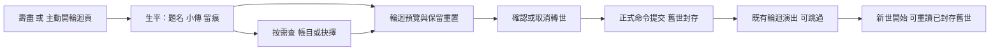

2026-10-23 **ATM-LIFE-C DONE（CLI／原生／桌面Web有界）**：三條原創事件回聲、既有權威來源／時序／同一靈獸核對及轉世凍結重讀完成；無新收益／RNG／保存欄位，舊世不補造。見[驗收](verification/atm-life-c.md)與[ADR-017](decisions/ADR-017-life-event-echoes.md)。下方候選／待實作為日期化歷史，ATM-LIFE-D仍後期另議；下一大型工作只在New Chat由使用者指定。

2026-10-22 REPORT-2 正式接入與CLI／原生／桌面Web有界驗收 **DONE**，見[驗收](verification/report-2.md)與[ADR-016](decisions/ADR-016-bounded-life-history.md)。歷世比較、有界庫存／容量觀測與同齡區間精查已接，舊世資料不補造；下一候選ATM-LIFE-C事件回聲，只在New Chat由使用者指定。下方日期化建議保留歷史。

2026-10-22 LEDGER-1／REPORT-1B 正式接入與桌面有界驗收 **DONE**，見[驗收](verification/ledger-1.md)及[ADR-015](decisions/ADR-015-resource-life-accounts.md)。資源帳目完成，下一候選REPORT-2；歷世比較、曲線與事件回聲仍後續。下方日期化施工建議保留歷史。

2026-10-22 DECISION-1 正式接入與桌面有界驗收 DONE，見[驗收](verification/decision-1.md)與[ADR-014](decisions/ADR-014-fortune-choice-receipts.md)。機緣權威收據／抉擇簿已接，下一候選LEDGER-1／REPORT-1B；完整帳目、前世卷冊與事件回聲仍後續。

2026-10-22 ATM-LIFE-DESIGN 已由使用者核定布局、十題優先與文稿；ATM-LIFE-A／REPORT-1A 正式接入及桌面有界驗收 DONE，見[驗收](verification/atm-life-a.md)。最近9世沿ADR-013。下一候選 DECISION-1；完整帳目／前世卷冊／事件回聲仍獨立後續，不在本輪展開。

2026-10-22 LEDGER-0：保存世數已由使用者核定為最近9世，敘事子樹上限352KiB；[正式契約](decisions/ADR-013-bounded-life-facts.md)與[驗收](verification/ledger-0.md)。布局／文稿決策保持分開，後續不得重問5／10／20世。

2026-10-22 **ATM-LIFE-DESIGN 專項候選已交**：承接已核定F-C題名800／題簽900／小傳文楷；[docs30](30-atm-life-design.md)補十題逐句來源、三種生命時機／缺紀錄、待決流程與保存10世容量提案。上述布局、條件與容量仍待審閱，未成為正式共用通則；共用殼0～2已完成，勿沿下文歷史待實作文字重做。正式選文／事實保存仍TODO。

2026-10-21 **UI-SHELL-DESIGN 字體F-C已選定；布局仍待確認**：使用者明確回覆「F-C」。核定卷末題名用明體、小傳與卷末句用文楷；數字、帳目、收據、按鈕及分頁仍用思源黑體。此為限定敘事角色的共用規範例外，後續經UiTypography集中接入，不授權各頁自行載字或全面換字。正式字型接線尚未實作；整體布局、題名條件與保存世數未因本次字體選擇接受，任務仍IN_PROGRESS。[方案與比較](29-ui-shell-design-proposal.md)。本輪僅記錄決策，未重跑引擎／瀏覽器／匯出，未改正式程式／build／玩家資料，未commit/push。

2026-10-21 **UI-SHELL-DESIGN樣張已交，尚待使用者選擇**：三橫式／六類頁面、F-B／F-C與顯示狀態比較見[docs29](29-ui-shell-design-proposal.md)。推薦方向仍是候選，正式UI、字型與當前規範未變；沒有美術接受或UI-SHELL-0實作聲稱。

# 一世卷末整合規劃：小傳、壽盡報告、帳簿與抉擇 UX

2026-10-21 · 任務 `ATM-LIFE-INTEGRATION-PLAN`。

**整合規劃 DONE；介面、帳簿與新內容實作 TODO。** 本輪使用者授權整合兩份研究與規劃取用方向、介面優化；不代表核定所有候選或啟動遊戲實作。唯一已核定的敘事方向仍為「有人為修士寫下一篇傳記」。

2026-10-21 **使用者追加全介面整合範圍**：HUD、資源自動展開、中央訊息、頁面開關與返回一起規劃，見[共用外框與顯示規則](28-unified-ui-shell-and-visibility-plan.md)。下一建議改為UI-SHELL-DESIGN，納入本文件ATM-LIFE-DESIGN樣張；先整理共用殼，再沿本文件實作小傳／收據／帳目。下文原先「下一ATM-LIFE-DESIGN」保留為較早順序，依本段及docs28銜接；字體與版型仍候選。

## 1. 找到的檔案與整合依據

使用者指定的 `docs/research/2026-10-21-1in8b-life-report-ux.md` 原本不在本機 main；fetch 後於 `origin/master` 找到。只以 git archive 取回該報告及其7張JPEG，沒有 checkout／merge／cherry-pick master 的其他內容，也沒有改正式遊戲來源。

| 來源 | 入口 | 本輪取用方式 |
| --- | --- | --- |
| 1in8b研究 | [完整報告](research/2026-10-21-1in8b-life-report-ux.md) | **以第15節更正為準**；第1–14節保留為靜態研究歷史，不直接作實作契約 |
| 修仙人生研究 | [docs26](26-cultivation-life-atmosphere-research.md) | 保留旁觀立傳、穩定題名、具體往事、字體候選、原創與資料真實性 |
| 現行介面規範 | [07](07-responsive-ui-web-spec.md)、[19](19-ui-ux-guidelines.md) | 紙面青玉、共用GameTab／CloseSeal、正式黑體、容器／內捲／44px；新字體僅為候選 |
| 技術架構 | [02](02-technical-architecture.md) | 命令／規則／呈現分離，版本化保存與重試，RNG及收益不由UI決定 |
| 原碼取回溯源 | [provenance.json](verification/artifacts/life-ux-integration/provenance.json) | 原報告與7張圖的路徑、來源commit與blob核對；本輪沒有重遊1in8b |

取回來源commit：`e71a3165362fe64c7c7a255e76a55e64db4bdafa`；報告Git blob：`cd66d2d56f4d2ac07cc7677d8d02cf58dd020b30`。研究截圖只供分析，不進遊戲資產／正式匯出；沒有取得第三方商用授權。本輪目視原始01／03／06／07四張圖，能支持摘要與分頁、相簿分組、抉擇卡層級的分析；財務圖表仍僅有原研究的程式摘錄，未補成實際遊玩證據。

## 2. 統一產品方向

**一份可先讀、可略過、可查證的一世卷末。** 第一層回答「這一世留下什麼」，第二層回答「具體發生什麼」，第三層回答「資源如何流動、下世可以觀察什麼」。

兩份研究不是各做一個報告。小傳與帳簿使用同一份當世事實；輪迴頁仍為唯一canonical入口，既有命燈／輪迴盤及已接受演出繼續使用。抉擇的當下收據與卷末抉擇簿也共享同一紀錄，不另從HUD文字拼一份歷史。

採用順序調整：先做足以支持小傳的有界事實與里程碑，交第一屏；再接結構化抉擇收據；完整資源帳目另立門檻。這保留1in8b「先有可信資料」的原則，也避免完整經濟審計成為小傳的前置大工程。

## 3. 研究內容取用表

| 取用項 | 來源靈感 | 整合方向 | 決策狀態 |
| --- | --- | --- | --- |
| 人生身份與卷末定調 | 江湖結局題簽＋1in8b文件摘要 | 第N世、終結方式、年歲、當世終點、一世題名 | 建議首批；不先新增姓名系統 |
| 旁觀立傳 | 使用者已選 | 第三人稱／省略主詞，真實行跡為骨架 | **已核定視角**；具體文稿待定 |
| 一句餘韻 | 江湖判詞 | 小傳末一句，與事件事實分層 | 建議首批；穩定變體，不每次重開重抽 |
| 此世留痕 | 江湖稱號歷程＋1in8b相簿／物件 | 最多三件：關鍵修行、建設、機緣／靈獸，點開查記錄 | 建議首批；不虛構缺少的第三件 |
| 精簡本世摘要持續可見 | 1in8b摘要配閱讀分頁 | 寬式側欄／短式摘要列，同一頁切閱讀區 | 建議介面方向，需樣張 |
| 生平／帳目／抉擇 | 1in8b分任務閱讀 | 作輪迴頁內閱讀分類，資料未就緒時不硬造空表 | 分段開放；不另加主導航 |
| 真實資源收支 | 1in8b帳目研究 | 單資源橫條＋數字表，種類與單位分開 | 帳簿完成後採用 |
| 選前代價與選後收據 | 兩研究的因果回聲與回饋 | 精確成本、可知效果、實得／截斷／餘量 | 建議第二批；不冒充參考站全有此功能 |
| 收起待決奇遇 | 1in8b實測暫收 | 同一pending可重開、查資源；暫收不放棄、不重抽 | 先定時間與命令契約，再做 |
| 生命時間帶 | 兩研究的歷程 | 先事件列表，後有界時間縮圖／區間聚合 | 延後；不強求每年一格 |
| 舊事回聲與熟面孔 | 江湖實測事件鏈 | 小量原創機緣／宗門／靈獸後續，卷末可回收 | 後續內容批次 |
| 歷世比較 | DAO2輪迴特性＋1in8b報告 | 道心、道證、年歲與境界分別比較，附記錄覆蓋 | 延後；保存數量待定 |
| 師徒／道侶／仇怨 | 江湖人際 | 獨立玩法及保存設計 | 本輪不列首版依賴 |
| 自動抉擇／倒數 | 1in8b流程 | 暫不採用，避免背景玩家未讀就被選走 | 非本期範圍 |
| 完整房間／紀念館／分享／人生評分 | 1in8b擴展 | 不納入本期；留痕卡已能提供記憶索引 | 非本期範圍 |
| 年度重心／真實國家／死亡機率曲線 | 1in8b核心玩法 | 不適配DAO2當前放置修仙；不搬用 | 不取用 |

原作長段文案、NPC、程式不進成品。研究模式可借鑑，正式文稿與規則另寫；不新增悟性、業障、幸福值等舊草案示例未實作的數值。

## 4. 必須解決的文件衝突

| 原研究描述 | 本計畫採用的結論 |
| --- | --- |
| 1in8b早期說輪迴只有公式、動畫3.4秒 | main已有R7命燈、F5拆層演出與保存回饋；不得按舊盤點重做或宣稱缺失 |
| 原報告說奇遇成本全是raw ID | 目前fortune_modal已有圖示、持有／需求、中文TIP及保存重試；僅未覆蓋名稱可再稽核，不重建整頁 |
| 第15節提議用「現有粗明體」 | 字檔存在不等於正式UI許可；UiTypography.chapter_font仍回傳黑體600。字體須另核定，不沿歷史規範擅改 |
| 當世最高境界直接讀highest_era | 它是跨世資料；有當世peak才寫巔峰，無則寫終點。跨世成就與天賦亦不能當本世事蹟 |
| 80／120年固定年度表 | 壽命按境界累加再加成；Lifespan實作與第15節一致。按資料預算聚合，不用固定表截斷長人生 |
| 跨年後把終值補滿每年 | 不成立；年度邊界實採或明示區間解析度，不補造歷史 |
| 前後庫存相減就是收入／支出 | 只能對淨變化；同交易有收有支時必須讀已提交的分項記錄 |
| 消耗朱紅、高溢出就是瓶頸 | 消耗用中性色與用途；溢出可能反映容量／使用，不能單憑總量斷言策略失敗 |
| 缺奇遇資料時寫「此生未遇」 | 無覆蓋不等於零；應寫「未有紀錄」，完整覆蓋且計數0才可寫未發生 |
| 360px完整報告／實機觸控／IndexedDB必驗 | 沿現行07：直式旋轉提示，桌面三橫式；實機依政策延期。權威Web保存按現有localStorage＋Web Lock，勿把IndexedDB列新必要條件 |
| 帳簿壞掉可隨意丟棄或原樣保留未知資料 | 可選擇不渲染，但須有大小／結構上限與明確復原；不能默默破壞整檔、跳過checksum或保存任意不可信字典 |

來源文件保留原文與日期，入口註明本計畫為跨研究採用清單；不抹除第15節的更正與未驗項。

## 5. 壽盡與轉世的介面流程

建議產品名稱「一世卷末」，小傳分類稱「生平」；技術文件仍可稱壽盡報告。提前轉世顯示「此世暫結」等候選，不寫享年／壽終；一般在世查看則是「此世行跡」預覽，不顯示未發生的終局。

壽盡沿既有自動提醒，等待離線報告／其他演出結束；同狀態關閉不反覆搶頁。閱讀不自動輪迴，不強制閱讀完成，不增加倒數。查看帳目／抉擇不另發獎，確認取消仍為原流程。

### 寬式候選

固定共用頁首與GameTab（轉世輪迴／道心天賦）；輪迴內容內再用SegmentChips選生平／帳目／抉擇。若首版僅生平，先省去這列分類，勿出現三個無內容入口。

左側精簡本世摘要與既有命燈／輪迴圖；右側為可捲動閱讀區。底部固定當次道果預覽、傳承／重置詳情入口與轉世確認操作。不要重複放兩份道心持有量與所得，也不要每張留痕卡旁都出現轉世鍵。

生平內容依序：題名 → 世次／終結方式／年歲／當世終點 → 小傳與卷末一句 → 最多三件留痕 → 更多大事記。留痕卡沿既有圖像，無合適授權圖即純文字，不為此新增世界地標或紀念房間。

### 844×390／800×360候選

精簡摘要放頂部單列，長題名可換行；圖片縮為既有短式比例。判詞預設可見，小傳可展開；閱讀分類保留共用樣式，內容單一內捲。固定收益、保存錯誤／重試與主操作；空間不足時先減裝飾和重複文字，保留16px最低正文與44px命中。

資料圖僅作概覽，精查用資源選擇器、列表／文字數值；密集年格不是44px按鈕網格。直式依07顯示旋轉提示，返回橫式恢復閱讀分類、捲動與確認狀態的既有取消契約。

## 6. 文字與字體的取用方向

小傳以2–4句為起點，建議60–100字比較；題名四至六字，卷末一句15–30字。此為樣張起點，不為塞版強制截字。記述真實變化，避免將帳簿數字逐項改寫成散文、以庫存最多推斷職業、或替玩家宣告後悔。

示例（虛構設計fixture，需有建屋／兩島開拓／結丹三種本世事實）：

> **雲外初行**
>
> 初居山中，築屋修行。其後開拓青木、玄礦兩島，往來漸遠。及至結丹，初居之外，已有數條穿雲而行的路。
>
> 一世行止，於此收卷。

只寫「結丹」不代表此刻仍是金丹，終點欄另讀實際狀態。有渡劫失敗的生命也不以一句「仙途失敗」代替全世；無具體事件記錄可用簡短中性文稿，明示記錄不完整，不編補傳記。

| 角色 | F-B克制候選 | F-C卷冊候選 |
| --- | --- | --- |
| 題名 | 共用黑體600 | 明體題字 |
| 小傳 | 共用黑體400 | 文楷 |
| 卷末一句 | 文楷 | 文楷 |
| 帳目／時間／收據／按鈕／分頁 | 共用黑體 | 共用黑體 |

F-C是先前代理推薦，**使用者尚未選定**。先用同一份長短文與三橫式做F-B／F-C比較；資料密集區不增加等寬字族，先用數字對齊解決。選定後才新增UiTypography共用角色並同步docs19。暖紙深墨、青玉操作、少量朱砂題簽為樣張方向，不直接核定新皮膚或全頁深色。

## 7. 抉擇 UX：決策前後同一條事實鏈

### 選擇之前

保留既有題圖、敘事、選項卡與成本圖示。精確成本顯示持有／需求，不藏在TIP；固定效果讀規則View；隨機效果只顯示可知風險／方向，不虛構成功率。偏好標籤按realm／weather／shichen分別顯示，文案稱「契合條件」，不寫「本次因此觸發」。

不把隱藏結局全部揭露成獎勵清單；可讓玩家知道付出與風險，同時保留敘事未知。未知資源名稱須由集中名稱映射處理；沒有圖時仍有可讀名稱，不將raw ID當成內容。

### 稍後查看與重開

建議「稍後查看」只是關閉閱讀；既有機緣通知可回到同一pending，不另設主入口。先驗目前關閉／路由是否已達成，避免新增重複按鈕。

待決狀態需明定：pending instance ID、可同時存在數、時限、其他命令是否允許、壽盡／輪迴如何清除。預設建議保持原有時間規則，暫收不額外凍結世界；若原規則無事件到期，不自行加入期限。資源改變後重開刷新負擔能力，提交時核心再驗資格；不能鎖住過去顯示的價格或免費重抽。

### 選擇之後

同頁顯示「選了什麼 → 結果短段 → 已付／實得／未入庫／餘量」，內容與固定保存狀態分開。非資源效果如修行秒數、丹藥或BUFF同樣由實際結果表達，不能只有資源金額。保存失敗寫明已結算，重試只保存；不能重新選、重擲或重複扣款。

同一權威收據寫入抉擇簿與小傳事實層。舊事件沒有完整收據時只顯示已知敘事，不以標稱rewards偽裝實得。

## 8. 資料分層與帳目口徑

### 先最小事實，後完整資源帳

| 層 | 首批資料 | 用途 |
| --- | --- | --- |
| 當世事實 | life ID、記錄開始時間、覆蓋區間、終點、當世峰值（有證據才有）、有界里程碑、敘事版本／選文ID | 題名、小傳、留痕 |
| 抉擇收據 | command／settlement ID、pending instance、選項、實際成本／所得／截斷、事件時間與保存狀態 | 當下結果與卷末抉擇簿 |
| 資源帳目 | 每資源／必要時每島的期初期末、入庫來源、支出用途、產前截斷量、調整及覆蓋區間 | 單資源橫條、數字表、後續曲線 |
| 歷世摘要 | 已封存小傳、重點事實與道果收據 | 重讀；保存最近幾世另核定 |

不建兩份ledger或在UI寫帳。可沿用既有事件模型擴充結構化交易結果，實際命名與掛點於實作設計確認；本計畫不先建通用事件引擎。

### 建議帳目採「實際入庫」口徑

每個資源分開驗算：

`期末 = 期初 + 實際入庫收入 - 已付支出 + 有號調整`

未入庫的生產／獎勵溢出另列，不再從實際入庫收入扣一次。若另顯示標稱收入，需明示標稱＝實際入庫＋未入庫（僅適用相同來源／區間）；容量縮減損失歸有號調整，不混進一般滿倉溢出。

島間運輸在單島帳目是轉入／轉出，在全域合併是內部移轉，不能算全域額外產出。加工按資源記材料支出與成品入庫；不同資源不直接相加，靈界跨世保留也不能算新世生產。初始／繼承資源列期初或獨立起始調整，口徑必須唯一。

同筆先付20再得30時，記支出20與入庫30，而非只記收入10；分項以核心已提交事實為準，前後淨差作對帳。Amount沿既有序列化／比較，不能為圖表將超大數強轉float；圖表只用可顯示的有界比例且明示尺度。

### 歷史與保存

記錄導入時標明開始年齡／覆蓋，完整、部分、缺漏、未支援四態分開。沒有記錄不顯示假0。長生命依有界區間聚合，分清樣本／區間／原始事件；重大事件優先保留，不能用終值回填過去年份。

輪迴預覽依目前revision只讀重建；真正轉世時在清空當世前取最終事實，與道果提交共同封存。避免玩家讀報告後又做命令，卻封存過期預覽。life ID與command／settlement ID去重，重播／重試不雙記、同tick多事件有穩定順序；重試不改敘事變體。

保存版本、遷移、兩代復原、錯誤上限與未知版本降級須設計及驗證。保留固定小傳文字與內容版本可避免更新後改寫往世；保留幾世、每世事件數／字節上限與刪除策略在LEDGER-0核定，不沿用原草案2–4KB估算當成保證。

## 9. 實作批次與舊任務對照

本計畫是docs26與1in8b研究的共同施工順序，不再另開平行重複功能。

| 批次 | 原任務承接 | 交付範圍／依賴 | 完成證據 |
| --- | --- | --- | --- |
| `ATM-LIFE-DESIGN` | docs26既有設計任務 | 三橫式生平樣張、F-B/F-C同文比較、8–12題名條件、待決UX流程及資料容量決策 | 樣張清楚標候選；使用者選方向；未定不冒充正式通則 |
| `LEDGER-0` | LEDGER-1的最小事實子範圍 | 當世里程碑／覆蓋、版本與封存契約；保存世數先核定 | 新舊檔、線上離線一致、拒寫復原、重試／輪迴去重；收益與RNG不變 |
| `ATM-LIFE-A / REPORT-1A` | docs26 A與REPORT-1生平部分 | 依LEDGER-0接一世卷末、題名／小傳／最多三件留痕與原轉世流程 | 事實逐句可核對；壽盡／提前／缺資料、桌面三橫式、低特效／重載 |
| `DECISION-1` | 原同名任務＋docs26 B部分 | 權威實得收據、選前資訊、暫收／重開、抉擇簿 | 同事件不重抽、資源變化重驗、保存重試不重扣、成本／實得／截斷核對 |
| `LEDGER-1 / REPORT-1B` | 原帳簿與REPORT-1帳目部分 | 全路徑分類收支、單資源條／表，接上述事實層 | 同交易收支、容量調整、加工／跨島移轉、在線離線、批次推進對帳與有界開銷 |
| `REPORT-2` | docs26 B歷史擴充、原同名任務 | 歷世比較、庫存／容量曲線、事件同齡軸與區間精查 | 缺資料不假造、長壽不截斷、同單位比較、表格替代與清楚尺度 |
| `ATM-LIFE-C` | docs26 C | 既有機緣／宗門／靈獸原創事件回聲 | 真實選擇能被後續與卷末回收、條件／去重／存檔一致 |

推薦下一個獨立任務為 **ATM-LIFE-DESIGN**，先交可比較樣張與選文條件；不直接從本計畫啟動LEDGER-1全量改造。第一版可完全沒有資源圖，但不能沒有可信事實。

後續測試按變更範圍：規則測試證明選文／收支／保存；原生證明布局與生命週期；真實桌面Web證明滑鼠、內捲、重開／保存拒寫／重載。三橫式1280×720、844×390、800×360；未做的項目明示。沿既有簡單效能及延期政策，不另創當輪觸控／實機或冷啟動閘門。

## 10. 本輪交付、未做與交接

已完成：找回原報告與7張原始JPEG、核對blob、閱讀兩研究及第15節、目視4張既有證據、核對main的輪迴／機緣／壽命／字體，建立跨研究取用表、衝突解法、介面流程、資料口徑與分段DoD。新規劃為本輪產出，來源報告的歷史驗證不改稱本輪完成。

未做：實作、樣張、美術生成、字體換用、帳簿schema遷移、遊戲Runner／原生／Web匯出與網站重新遊玩；未commit/push。沒有合併master的功能提交。後續開New Chat，以本文件、docs26核定方向及1in8b第15節作入口。
