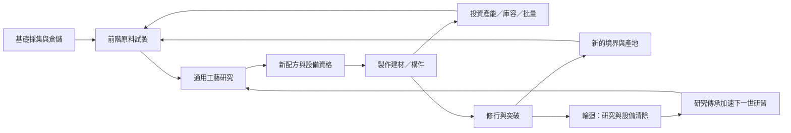

# ECON-R1：數值、工藝與多世經濟重構參考

日期：2026-11-07。任務：`ECON-R1-PLAN`。本文件是研究與設計交付，**不是正式數值已改版、平衡已通過或新版已上線**。研究起點為 [Kittens Game 拆解第五篇](../research/kittensgame/docs/05-insights-and-comparison-with-dao2.md)；本文件以實際來源補正其過度概括。

## 1. 已核定方向與設計結論

使用者於本次對話明確選定：

1. **通用研發＋宗門專精，散修可走完整主線。**
2. **可大幅拉長成長與多世累積，另開新版新檔。**
3. **每世重新研究，傳承只加速研究過程。**

因此採「當世研究 → 做出樣品／構件 → 投建設備 → 改善供給 → 開啟下一工藝 → 修行突破 → 輪迴再建」循環。研究狀態每世清空；研究傳承縮短研習時間，不保留已完成科技、不免費送材料／設備、不跳境界。既有宗門功法的跨世規則保持獨立，不藉此抹除五宗改版成果。

**核心變化是重新安排能力與瓶頸，不是把所有費用乘十。** 新材料必須改變可做的事；新技術應讓前期材料更好取得或加工；每次輪迴應更快重建熟悉產業，並把節省的時間投入新的前沿。

本次先設計 Era1–6；Era7–12 僅保留擴充原則，不解除既有後排安排。`era_id`、九界 `realm_id`、地理據點、材料加工深度仍各自獨立。建築新增以營造清單為主，不要求新增世界地標或美術才可驗證經濟。

### 1.1 本稿已決定與仍待量測的界線

| 項目 | 性質 |
| --- | --- |
| 散修可達、宗門專精、新版新檔、當世重研 | 使用者核定的產品方向 |
| 沿用 Godot／Session／Amount／純規則與可信保存 | 現有專案約束 |
| 通用研究採材料試製＋單槽研習進度，不另增可交易研究貨幣 | 本稿建議的實作基準，可在切片證據下調整 |
| 新構件、科技節點、成本、研究秒數、長期時間區間、DR各類上限 | 候選設計值，未經正式模擬與試玩，不標平衡定稿 |
| 現版遊戲與舊存檔 | 保留；不自動遷移、不覆寫、不補發或扣回 |

## 2. 來源可信度與第五篇修正

### 2.1 研究版本

Kittens Game 本機快照自報 **1.6.1.11／buildRevision 171**，來自既有 `research/kittensgame/source/`；本次未重新下載或執行第三方程式。2026-11-07 可開啟[官方遊戲頁](https://kittensgame.com/web/)，但 Web 讀取器無法取得其三個 JS URL；以下精確公式與費用以本機快照為據，不冒稱即時官方最新版。DAO2 以工作區實際來源、HEAD `b4dfb62d` 及既有未提交成果為基線。

| 第五篇說法 | 來源核對後的判斷 | DAO2 採用方式 |
| --- | --- | --- |
| 原料有cap、加工品全無cap | 過度概括。KG 木頭也可被製作而仍受容量限制；不同知識資源另有容量效果 | 每種資源明訂容量；首版加工品繼續有界，避免破壞既有數值／預留契約 |
| 全面淘汰硬上限 | DR只適合部分效果；機率合法域、庫存、最短工時仍須限制 | 效率軟上限與安全硬限制並存 |
| 離線全部換成時間池並精確高速重播 | 不符快照。`gainTemporalFlux`與`applyRedshift`是不同機制；後者有批次fastforward、容量處理與時間上限 | 保留DAO2權威時間推進，不因KG研究重寫離線架構 |
| 建築價格比普遍1.12～1.25 | 並非通用範圍，快照亦有1.10、1.35、1.5、1.75 | 由預期購買次數／回本期反推各設施曲線 |
| 對突破加成套0.95上限就保留5%失敗率 | 加上基礎機率仍可能超限；直接對總機率做DR又會削弱原本基率 | 對基率以上的剩餘空間計算，保留最終合法範圍 |

可核對：[DR函式](../research/kittensgame/source/game.js)、[離線與時間](../research/kittensgame/source/js/time.js)、[資源](../research/kittensgame/source/js/resources.js)、[建築](../research/kittensgame/source/js/buildings.js)。重點定位：game.js `getLimitedDR`約2726；time.js `gainTemporalFlux`約106、`applyRedshift`約188；resources.js `fastforward`約843。用函式名查找比依賴未來可能移動的行號可靠。

### 2.2 真正值得借鑑的三條KG成長線

以下均為**基礎投入**；KG一般合成產出會受craftRatio影響，不可把表內成本當永遠一比一。

| 經濟鏈 | 原始碼實例 | 對DAO2的意義 |
| --- | --- | --- |
| 原料壓成建材，再擴容 | 175木→梁、250礦物→板；倉庫基礎費1.5梁＋2板，提供木／礦容量；Construction花1300 science開相關建築 | 倉庫應由前階可取得建材建造，解決下一次採購所需容量 |
| 高階工藝反哺低階生產 | 100煤＋100鐵→鋼；15鋼→齒輪；Steamworks需65鋼＋20齒輪＋1藍圖；Steel Axe需20000 science＋75鋼，提高木工產量 | 銅精／陣芯不只繳升境費，也改善木、礦、草的供應及批量能力 |
| 實物與知識交叉推進 | 175毛皮→羊皮紙；25紙＋400文化→手稿；55手稿＋9000science→綱要；25綱要＋25000science→藍圖；工業化研究另需藍圖 | 研究用具體試驗材料與儀器，不應所有科技只是同一點數的加價購買 |

工坊自身提供craftRatio；更高合成效率能降低多條鏈的實際原料成本。這是KG的強反饋來源，也會在深鏈上複利。另一方面，KG有些配方初始已標解鎖，實際仍因原料／設施尚不可得而無法運作，並非每種資源都逐一由科技開鎖。

來源：[工坊](../research/kittensgame/source/js/workshop.js) recipes約2127～2306、craft約2656；[科技](../research/kittensgame/source/js/science.js) Construction／Writing／Steel／Physics／Industrialization；[建築](../research/kittensgame/source/js/buildings.js) warehouse／smelter／steamworks／workshop。本次借用機制與數學思想，不複製KG的數值表、文字或美術到正式內容。

## 3. DAO2實際基線：重整既有鏈，而非從零建立

| 已有內容 | 核實狀態 | 重構意義 |
| --- | --- | --- |
| 一般技能 | 24項：Era2九項、Era3三項、Era4–6十二項 | 不再以「只有六技能」作規劃前提 |
| 宗門 | 八共通功法、十專法、五宗身分／傳承／守護獸等 | 宗門已具專精，先整合效果分類，勿再疊平行科技樹 |
| 配方 | Era1–3八項＋Era4–6三項，其中一項為中石批量變體 | 缺的是清晰的能力階段與更多有效用途，不是完全沒有多階合成 |
| 正式內容載入 | `living_abode.gd`呼叫`attach_supply` | 不可僅看最小manifest或歷史註解判定Era4–6未實作 |
| hub製造 | 新工作在祖島付款／入庫，產線仍分開；舊已付款工作保留原scope | 沿現行原料回運、集中加工，不重新強迫大量島際互送 |
| 加工數值 | layer0且≤1e12；配方驗證要求正cap | 本稿不承諾無限倉儲或全量大數 |
| 建築成本 | 分段指數×`1+n/20`，減費上限90%，末端floor | 改成新曲線屬明確v2差異，不能當成補缺 |
| 離線 | 已有權威逐秒與受限快徑、工作／貨運／壽盡邊界 | 新研究須整合相同規則，不能另算一份離線獎勵 |

來源：[技能資料](../content/skills/era2.json)、[Era3技能](../content/skills/era3.json)、[Era4–6技能](../content/skills/era4_6.json)、[配方](../content/recipes/era1_3.json)、[後段供給](../content/supply/era4_6.json)、[IslandEconomy](../src/simulation/island_economy.gd)、[BuildingCosts](../src/simulation/building_costs.gd)、[輪迴](../src/simulation/reincarnation_rules.gd)。

### 3.1 現有材料展開：重構必須保留的價值

未計任何折扣／副產／產率效果的單件基礎展開：

| 物品 | 直接配方 | 展開到原料 |
| --- | --- | --- |
| 靈材 | 木10＋下石5 | 同左 |
| 銅精 | 玄銅10＋下石5 | 同左 |
| 陣芯 | 靈材2＋銅精2 | 木20＋玄銅20＋下石20 |
| 中石 | 下石5＋靈力10 | 同左 |
| 上石 | 中石3＋靈力50 | 下石15＋靈力80 |
| 金丹配方產物`golden_core_pill` | 築基丹3＋百年草2＋中石5 | 低草150＋玄銅60＋靈力650＋百年草2＋下石25 |
| 化神丹 | 金丹2＋千年草1＋秘銀2 | 低草300＋玄銅120＋靈力1300＋百年草4＋下石50＋千年草1＋秘銀2 |

現行金丹境內升層已用中石、丹液、陣芯；聚靈庫與修行陣亦使用加工品。應增加「先做出工藝能力、再決定產能投資」的中間決策，不把現有材料全刪後換名。

注意：寒銀島的精鐵／秘銀／寒鐵目前是直接採集；資料`tier=2`不證明其經過兩層合成。新報表應分開`era_requirement`、`rarity`與`process_depth`，後者從配方圖推導。

## 4. 系統分工：科技應拆出去，但不能全搬進宗門

| 系統 | 回答的問題 | 支付／限制 | 輪迴規則 |
| --- | --- | --- | --- |
| 個人技能 | 我本人擅長什麼？ | 沿技能點、當世等級與個人加成 | 沿既有當世清除 |
| 通用工藝研發 | 這一世能做什麼？ | 前置研究＋前階材料試製＋研習時間 | **完成狀態、進行中工作、試製投入全部清除** |
| 設施／產線 | 我每秒能做多少、能存多少？ | 實際建材、產線與庫容 | 設備重建，不由研究免費生成 |
| 宗門專法 | 我用什麼特色方式做得更好？ | 沿宗門身分／貢獻／專法資格 | 沿五宗既有傳承，與研究重置分開 |
| 研究傳承 | 下一世如何更快理解相同工藝？ | 有效研究／前沿成就的跨世累積 | 只縮短研究時間，不減材料、不增產、不免前置 |

### 4.1 技能重分類，不讓玩家同一能力付兩次費

- **保留個人技能**：冥想、聚氣、修速、修行靈力效率等；採集專長可繼續選修。技能不能成為散修主線唯一鑰匙。
- **拆出能力，保留效率**：建築精通的「工業階數可用」移往通用工程研究；若保留個人精通，只給有界成本／工時優勢。靈倉整備、天工煉靈、三島藏真等逐項拆分，禁止研究與舊技能各自再給一份相同效果。
- **不直接搬走宗門已學功法**：八共通功法、十專法先保持ID與權益，建立效果對照後才評估重複效果。
- 「築基功」實際增加金錢產率等名實不符項目，在新檔內容表中改名／重定位，不動舊版展示與效果。

本次新研究是新增能力系統，不是把ADR-012的選修技能偷偷改成必修。新版研究門檻須新content/rules版本；現行`ProcessingCatalog`拒絕非空skills gate，不能直接在JSON塞新技能前置。

### 4.2 宗門提供路線差異的候選方式

| 宗門 | 工藝專精候選 | 必須保留的共同替代 |
| --- | --- | --- |
| 太虛天闕 | 陣法研究更快、陣芯工序更順 | 通用陣紋學與普通陣芯配方 |
| 天劍聖宗 | 金屬加工／構件節材 | 普通冶煉與工程金屬供給 |
| 縹緲仙宮 | 藥材／丹液專精與丹藥工時 | 通用藥理與丹液／丹藥配方 |
| 萬佛靈宗 | 穩定生產、降低特定波動或維持費 | 散修以容量／普通設備達相同主線資格 |
| 紫霄玄門 | 符咒／高階靈力工藝效率 | 通用符紋、凝石與陣樞工藝 |

此表是新經濟的映射建議，**不是聲稱五宗目前已有上述全部效果**。沿現有身分、美術與專法，優先重用已有加成；首切片不一次新增五套配方。各宗可以改變投資順序，不能獨占所有人必用的突破材料。

## 5. 解鎖模型：從「升境整批開」改成可理解的能力台階

一個節點分開五種狀態：`hidden`未揭示、`known`已知目的、`unlocked`規則允許、`operable`設備與來源齊備、`affordable`可付款。已見過不等於這世已研究；庫存曾持有不等於已解鎖配方。

每個新資源都填寫：**首個來源、首次用途、持續用途、前階材料、付款庫存、工時／產線、庫容、首次可達證明、跨世政策**。研究完成、設備建成、首件入庫各自是一個不同的進度事實。

引導每次展示一個主要目標與至多兩個可選改善；預告下一層用途，不把全部未來材料擺滿介面。這是呈現順序，不能靠隱藏介面代替核心資格檢查。



圖中回饋是跨階段投資，不允許首件依賴自我：研究X不能消耗「只有完成X才能做的唯一產物」，第一座工坊不能要求其自身獨占產物。

## 6. Era1–6資源與工藝路線

### 6.1 逐段開放，而非一境只開一種資源

| 段落 | 先讓玩家掌握 | 再開放的能力與材料 | 反哺與主要決策 |
| --- | --- | --- | --- |
| Era1 練氣 | 靈力→居所→木／石／草；基礎自動產出 | 基本倉儲、築基丹沿既有首段能力；不強加正式研究頁 | 在研究系統出現前已理解產能、容量與突破；保留無新研究也能築基的起步 |
| Era2-A 築基初 | 青木原料供給與回運 | 木作、靈材、第一個前階工坊 | 首批靈材有兩個去向：倉儲或礦業工程 |
| Era2-B 築基中 | 玄礦原料→銅精 | 冶煉、合流的工程構件、工坊升階 | 花銅精改善採集，或做構件改善產線；不是一直儲錢升級 |
| Era2-C 築基後 | 木／礦供應已穩定 | 以兩種加工品完成陣紋入門研究；預告金丹期陣芯 | 研究資格先到，陣芯生產仍需Era3／設備；不要求陣芯才可升Era3 |
| Era3-A 金丹初 | 丹霞百年草與既有草供應 | 丹液、金丹、符咒與陣芯正式產線 | 木礦線與藥線共同支撐修行；研究新工藝或升聚靈庫 |
| Era3-B 金丹後 | 常用中石造成產線壓力 | 展示凝石批量化；完成研究後在Era4啟用 | 新科技明確消除「一顆一顆做」瓶頸；容量先足夠才能使用大批量 |
| Era4 元嬰 | 寒銀島的第一類工程金屬 | 依深採I→II→III順序揭示精鐵／寒鐵／秘銀；合成秘銀陣匣 | 高階金屬回頭升級木礦採集、工坊與研究設備；原料不全面失業 |
| Era5 化神 | 古藥千年草＋中石成熟供應 | 上石、化神丹、符陣整合 | 選擇把中石用於修行、上石或設備；不得只在同一數字上加零 |
| Era6 煉虛 | 太虛島虛空精華 | 太虛陣樞；整合金屬、符陣、靈石三支 | 支撐更高階產能／突破工程，為後續法則提供接口但不開九界空殼 |

**現況與提案差異**：原版深島三種金屬一起供給；新版分段揭示／啟用是新規則。丹液資料Era2與實際產線可用時機要分開；首版建議明確排到Era3丹霞啟用，不能只改說明就宣稱Era2可製。

### 6.2 材料用途矩陣（新增先限三種）

全部數量為候選，`new_*`僅設計ID，不是已加入遊戲。

| 材料 | 來源或候選配方 | 首次用途 | 持續用途／後段價值 | 容量／位置 |
| --- | --- | --- | --- | --- |
| 靈材／銅精 | 沿既有10原料＋5下石 | 第一輪產業設施 | 陣芯、研究樣品、工程構件 | 祖島有界；原料由島回運 |
| 靈紋構件 `new_spirit_module` | 靈材2＋銅精1→1；候選20s | Era2工坊／研究設備升階 | 中階倉儲與生產設施維護性投資；若與陣芯用途重疊則刪除此新物品 | 候選cap100，首個必要工程費不超20 |
| 陣芯 | 沿靈材2＋銅精2→1、20s | Era3修行／聚靈庫 | 陣匣、研究儀器、高階生產 | 沿有界，按必要採購反推擴容 |
| 丹液／符咒 | 沿現有材料成本 | 修行／研究試驗 | 丹藥、符陣與高階構件的交叉材料 | 祖島有界，不靠品階推定無限 |
| 精鐵／寒鐵／秘銀 | 新版深採分階段；首版不再新增三種礦石ID | 設施、寒鐵工程、金屬試驗 | 陣匣、化神丹與舊產線升級 | 地方採集／祖島到貨分帳 |
| 秘銀陣匣 `new_mithril_matrix` | 陣芯2＋精鐵5＋秘銀2→1；候選40s | Era4高階研習設備 | Era5倉儲、太虛陣樞 | 候選cap60；非獨門物品 |
| 上石／化神丹 | 沿現有配方骨幹 | Era5修行／前沿工程 | Era6工藝投入 | 不直接由低石免費升階 |
| 太虛陣樞 `new_void_array` | 陣匣2＋符咒4＋上石10＋虛空精華5→1；候選90s | Era6煉虛修行陣工程升階 | 太虛採集器／凝石工坊工程升階，反哺當境供給；Era7用途不計當前sink | 候選cap30，首件工程≤5 |

每個新增品至少有兩個**已安排實作**的用途，其中一個是經濟改善；不能用「未來會用」充數。首切片只試靈紋構件；若靈材／銅精直接支付已能產生相同選擇，就刪除構件，避免為湊深度加物品。

### 6.3 候選通用研究表

單項研究：材料一次原子支付＋單槽研習時間；完成後解鎖能力，設備另付建材。下表時長為**無傳承基礎秒數**，可與資源生產／修行並行；不能直接加總成通關時間。材料皆為前置狀態可取得；研究不用自己的唯一產物。

| ID／Era | 前置 | 候選試製費 | 秒 | 能力；不直接送設備 |
| --- | --- | --- | ---: | --- |
| R01 木作／2 | 築基、基礎研習席 | 木30＋下石10 | 120 | 靈材配方、初階工坊資格 |
| R02 冶煉／2 | R01、玄礦已開 | 玄銅30＋下石20 | 180 | 銅精配方 |
| R03 營造構件／2 | R02 | 靈材4＋銅精2 | 300 | 靈紋構件、工坊工程升階 |
| R04 倉儲工程／2 | R01 | 靈材3＋木40 | 180 | 加工倉與原料倉升階；非所有產線必經 |
| R05 陣紋入門／2 | R03 | 靈材6＋銅精4 | 600 | Era3陣芯／符咒製造資格 |
| R06 藥理凝液／3 | R02、丹霞已開 | 低草60＋百年草2 | 480 | 丹液與金丹後續工藝 |
| R07 凝石／3 | R05 | 下石100＋靈力200 | 600 | 中石小批量 |
| R08 批量凝石／3 | R07、做出中石 | 中石20＋陣芯2 | 1800 | Era4批量中石；先滿足單批庫容 |
| R09 深採I／4 | R05、寒銀島已開 | 陣芯3＋銅精10 | 2400 | 精鐵供給與設備；初開島只給前階可用採集能力 |
| R10 深採II／4 | R09 | 精鐵10＋陣芯2 | 3600 | 寒鐵供給 |
| R11 深採III／4 | R10 | 寒鐵10＋符咒10 | 5400 | 秘銀供給、陣匣配方 |
| R12 古藥精煉／5 | R06、R11、古藥已開 | 金丹2＋秘銀4 | 7200 | 千年草加工、化神丹；采得原料與學會加工分離 |
| R13 高階凝石／5 | R08 | 中石60＋陣芯5 | 7200 | 上石配方 |
| R14 太虛整合／6 | R11、R13、太虛已開 | 陣匣2＋上石10＋虛空精華5 | 14400 | 太虛陣樞與前沿設施 |

首個研習席必須只用金錢／木／下石建造，不用技能點、靈材或研究產物；首個加工工坊亦只用前階原料。現有藏經閣可承載研習功能，但技能點產出與工藝進度分開；**不額外加入「科技點」庫存**。科技費用不再依賴某宗貢獻。

批量中石現有配方500下石＋1000靈力→100中石／10s，遠高於小批量吞吐；首版候選保留比例，研究與設備拆成資格／能力，不再額外疊100倍產量加成。R08完成但庫容不足時能看到具體缺口與前階可達擴容路徑。

## 7. 多世長線節奏：延長的是發展跨度

### 7.1 測量口徑與候選區間

主軸用 **累積有效模擬時間**，含被結算的離線時間，不含暫停／壽盡後無收益時間；另記實際日曆時間、主動操作分鐘數、世數與失敗次數。不能把100小時有效時間說成必須盯畫面100小時。

| 里程碑 | 新版候選累積有效時間 | 玩家應獲得的新決策 |
| --- | ---: | --- |
| 首次築基 | 20～45分鐘 | 原料自動供給、第一輪工藝 |
| 首次可輪迴評估點 | 約3.5～6小時，依實際壽元資格重算 | 已完成數項研究，可看出下一世重研變快的價值；不假定已具提前轉世資格 |
| 首達金丹 | 4～8小時 | 合流陣芯、藥物與凝石三線；可能跨1～3世，不設世數硬門檻 |
| 首達元嬰 | 12～24小時 | 批量化與前沿金屬工程 |
| 首達化神 | 36～72小時 | 深鏈整合與專精投資 |
| 首達煉虛 | 80～160小時 | 多世研究效率累積支持完整當世產業重建 |

這是依使用者「可大幅拉長、多世累積」制定的**候選測試目標**，不是模擬所得。既有docs44的Era4–6約31.04小時是另一模型／另一範圍的歷史結果，不能直接和本表累積首達數字作百分比改善比較。

現行`ReincarnationRules.check_eligibility`通常要求壽盡；另有`rebirth_lotus／void_mirror`資格分支，但目前內容表未定義其正常取得路徑，不能當作可用捷徑。築基累計基礎壽元200祀×60秒＝3小時20分鐘，延壽／更高境界會再延後。因此本表首次輪迴僅是觀察目標，**不新增「完成研究即可提前輪迴」**；實測資格超過區間時修正時間目標，不放寬核心資格。若後續希望提前轉世，須另定新版資格與成本，加入門檻圖及速刷檢查。

每世目標流程須在當世可達壽元的80%以內留下正常操作餘裕；首世先檢查築基路徑能在練氣壽盡前完成。若某研究要到壽盡後才完成，先調低前沿研究／材料負擔或加入前階可取得的壽元選項，不能要求「先突破取得壽元，再完成突破前置」。

**不以純科技時長填滿80小時。** 長線主要來自產能投資、分支取捨、前沿設備與多世重建。開局每3～8分鐘、築基每10～20分鐘、後段每30～90分鐘至少有一個可理解的進展／可選投資，作試玩觀察指標；不是強制彈窗或必須定時點擊。

### 7.2 每世重研與研究傳承

候選研究工時：

`T_effective = max(T_floor, ceil(T_base × (1 − D(sum(research_time_reduction), 0.70))))`

- 每世`research_completed`與`research_job`清除；未完成研習不在輪迴後自動完成或退成可複領材料。
- 已見圖鑑可保留，只供路線預告；不得被資格檢查誤認為當世已學。
- 研究傳承只影響上述工時。材料費、設備費、配方產量、修行時間及宗門貢獻均不由它降低。
- 建議傳承按「首次完成某個研究深度的有效前沿」記錄，跨世不重複領同一里程碑；先不用重研R01就能無限刷的貨幣。
- 可設定深度里程碑給固定研究時間減免，之後以更多前沿逐步累加；第一版先做3檔而非無限天賦樹。候選原始減免0.15／0.30／0.50，實際給予門檻待模擬。
- `T_floor`候選10秒；即使高傳承也需重新投入材料、排研習與建設備。不得把研究加速又乘到產出，形成跨世雙重複利。

需要單獨稽核現有輪迴獎勵：`ReincarnationRules`會看建築等級總和。新增廉價研究設施／提高建築上限可能導致速刷道心道證。新研究設施預設不加入獎勵計數，正式方案用明確白名單／權重；既有建築與既有獎勵不得因研究文件直接改動。

## 8. 雙曲收益：統一效果類別，不統一所有成長

### 8.1 函數契約

對有限非負原始增益`x`、正極限`L`：

```text
D(x,L) = x                              if x <= 0.75L
       = L - (0.25L)^2 / (x - 0.50L)    otherwise
```

轉折處函數與一階斜率連續；高段仍持續增加，但邊際收益下降。`x=L`時實際為`0.875L`，不是已拿滿上限。產品效果一律先驗證有限數；負面效果與正面增益分帳，不直接把來源帶正負塞入同一總和抵消。

減耗極限`L=0.8`的算例：

| 原始減耗 | 有效減耗 | 實付比例 |
| ---: | ---: | ---: |
| 20% | 20% | 80% |
| 40% | 40% | 60% |
| 60% | 60% | 40% |
| 80% | 70% | 30% |
| 160% | 76.6667% | 23.3333% |

`L=0.8`前60%都線性，對現有許多10%～30%的增益根本沒有影響。因此必須從滿配置可達的`x`選L，不是放進函式就宣稱解決平衡。

### 8.2 效果登記表與候選參數

| 類別 | 輸入與結算位置 | 候選極限 | 仍保留的硬規則 |
| --- | --- | ---: | --- |
| 建築減費 | 同類技能／宗門／傳承減費先相加，最後一次D | 0.80 | 必要離散材料最少1；既有90%硬上限屬舊版，不混套 |
| 加工減耗 | 僅指定可折材料的原始減耗相加 | 0.50 | 核心構件不折；不把80%全局減費再乘一次 |
| 工時縮短 | 同類工作速度效果先轉同一時間減免單位 | 0.70 | 工時≥1 tick；研究另有10秒候選floor |
| 研究傳承 | 只在研究工時resolver生效 | 0.70 | 每世重新付款／研究、Era前置不免 |
| 普通產率 | 基礎產量×有限的分類乘區；先維持有感成長 | 不全面加DR | Amount支援邊界、庫容及原料約束 |
| 突破機率 | 對基礎機率以上的剩餘空間施加DR | `P_MAX−p0` | 最終仍在合法機率域；不新增早期強制失敗 |
| 容量／建築階數 | 由設備／研究明確給予 | 不用DR取代 | 可達容量、內容階數與資料上限 |

工程上每項效果登記`effect_id/family/scope/unit/stack_mode/limit/source`。同family的技能、丹藥、宗門先合併再D，不各自D後相加；不同family相乘前要有總配置試算。原本乘數1.1和1.2若要改成加數0.1＋0.2，屬v2新規則，不能假裝與原1.32相同。

### 8.3 機率及取整的具體陷阱

現版`TribulationRules`已用基率80%起、丹藥0.85幾何遞減及5%～95%限制；首批DR先接成本／工時，突破另做對照後再接，避免把現有遞減重複套兩次。

若`0<=p0<P_MAX`，候選為`p=p0+D(max(0,bonus),P_MAX-p0)`；`p0>=P_MAX`與保底／劇情必成功走明確分支，不計算零limit。例p0=0.80、P_MAX=0.95、bonus=0.15，p=0.93125，**不同於現版可能達0.95**，須列為新平衡差異。

即使減耗不達100%，`floor(1×0.3)=0`仍可能免費。候選規則：必要離散件不享折扣；可折原料使用統一精度，在每個權威批次計價，View／開始工作／批量預覽共用同一函式。單批與批量的支付政策要明訂；不得一個入口先取整、一個入口後取整讓拆單套利。

首版不新增全面合成增產。若每層輸出均×1.2，三層鏈理想原料只剩`1/1.2³=57.87%`，等價降耗42.13%，遠大於玩家以為的單次20%提升；加上工時與節材又會放大。優先採「縮短某產線」或「指定原料減耗」一種可解釋收益。

## 9. 建築成本、回本與倉儲

### 9.1 成長軸分開

設備的**小升級**改善吞吐／容量，**工程升階**新增材料與能力，**研究**開放工程資格。不要讓每一級同時增加成本倍率、換新材料、增加工時與解鎖新門檻。

候選小升級模型：`C_r(n)=base_r×q_r^n×(1-D(discount,L))`，每級依規則取整；每個工程段分開基價與q，段間有明確過渡。不一開始全部替換現有分段公式，先以一條產線比較。

| 同一設施的20次價格成長 | 1.08 | 1.12 | 1.15 | 1.20 |
| --- | ---: | ---: | ---: | ---: |
| 相對首級倍率`q^20` | 4.66 | 9.65 | 16.37 | 38.34 |

不要只因KG常用1.15便套全局。候選採集／一般產能q=1.08～1.12；加工設備1.12～1.15；一次性核心工程用明確材料費，不用大量可重複等級填長線。

成本有多種資源，不能直接把「100木＋1陣芯」相加當101。以當前有效供給換算機會成本，且共享產線的工時須相加；比較購買後到下一目標的總時間與不購買路線，算真正節省時間，避免只報單一資源的靜態回本。

### 9.2 容量與首次可達

- 原料cap提供投資節點；加工品cap用來界定合理緩衝與數值界線，不必像原料一樣頻繁卡住。
- 候選初始容量至少可容納最大的必要單批投入／產出與承諾預留；若達不到，需前階可建的擴容路徑。
- 必經首購價格應≤可達容量的80%，留一批工作緩衝；例外如容量本身就是學習目標，仍須有明確可達的前階擴容。
- 貨運吞吐用`cargo/trip_time`，實際到貨還要扣來源限制及目標空間。地方＋祖島＋在途不能合計成可支付庫存。
- 研究材料、製造材料、修行儲備共享庫存時，不能同時宣稱每個用途都享有完整產率；用預留與目標量避免自動生產餓死突破。
- 停工／滿倉不銷毀已付產物；保留既有預留語意，新研究排程亦要遵守。

## 10. 可重算的瓶頸範例

工具：[model_dao2_economy.py](../research/kittensgame/tools/model_dao2_economy.py)。以正式配方展開材料，另提供**非正式遊戲模擬器**的三產線教學算例；執行只輸出JSON、不讀寫玩家存檔。

本輪輸出：[參考計算JSON](../research/kittensgame/analysis/dao2-economy-reference.json)。重算命令：`python research/kittensgame/tools/model_dao2_economy.py`。內容或腳本變更後應重新生成報告；其中SHA用來辨識配方輸入，不代表完整runtime版本。

情境：從零開始做10陣芯；木／玄銅／下石各以1/s直接到貨；靈材、銅精、陣芯三條獨立線，工時10／10／20秒；無折扣、無庫容壓力、無運輸延遲、無研究費、無壽元／修行。每秒先到原料，再完成所有工作，再依穩定順序開始新批次；只做恰好所需數量。

| 改動 | 完成秒數 | 解讀 |
| --- | ---: | --- |
| 基準 | 230 | 消耗木／玄銅／下石各200 |
| 只把原料供給翻倍 | 225 | 產線仍慢，大量原料剩餘，幾乎沒加快目標 |
| 只把三線工時降20% | 224 | 原料又成為限制，效果也很小 |
| 供給翻倍且工時降20% | 181 | 同時解開兩側才有明顯效果 |

這證明不能用「採集技能＋100%」直接推定升境快一倍。此例為刻意構造的瓶頸展示，不是實際新檔到陣芯時間、不含完整規則，也不能作L1／L2遊戲通過證據。腳本會輸出來源SHA、材料展開、DR算表與算例結果；下一階段真正的策略模擬必須走GameSession／TimeAdvancer。

一般持續產出的下界可用`q_out=min(各原料淨供給/單件需求, 各產線能力, 到貨能力)`；但這只適用固定策略與穩態近似，首件延遲、共享機台、容量與整批付款需要離散事件或權威tick計算。

## 11. 新版新檔與核心實作邊界

### 11.1 不遷移玩家進度，但仍要版本與故障復原

使用者選另開新版新檔，故不做「重算舊技能並退款」的大規模強制遷移。新版採獨立profile／namespace及content/rules/economy/research版本；測試使用獨立origin與storage key。不能僅換網址port卻仍匯入舊玩家檔。

- 舊存檔保留原文／原版本，舊版入口與可用舊版包需在切換前明確保存；新程式不得用新版公式載入舊版快照。
- 開新檔只寫新namespace；UI要能辨識舊版／經濟新版，不能默認清空舊槽。
- 不支援匯入的舊版本給具名原因及返回舊版方式，不靜默改造或丟掉欄位。
- 新版內部更新仍須來源歸檔、候選快照、完整讀回、雙代提交與相同候選重試；寫失敗不能重新扣研究材料／再次發傳承。
- 若維護雙規則成本太高，保留凍結舊版程式／匯出包作舊進度入口；是否共用一個launcher是交付工程選擇，不改兩份資料隔離要求。

### 11.2 只新增需要的模組

| 擬改模組 | 責任與接口 |
| --- | --- |
| research內容＋驗證 | 穩定ID、前置研究、Era、材料、工時、unlocks；完整相依圖驗證 |
| `ResearchSystem` | `start_research`、`cancel_research`、完成邊界、當世重置；不依Node或動畫 |
| `EffectResolver`有界函式 | 按family合併、DR、成本／工時明細；禁止另建任意公式腳本引擎 |
| GameState／SaveCodec | 當世研究、唯一研習job、跨世研究效率里程碑、版本 |
| GameSession／CommandProcessor | 原子扣款、revision、拒絕原因與持久化重試；研究View唯讀 |
| TimeAdvancer／離線 | 研究完工／壽盡／輪迴與加工到貨順序固定；未證等價走權威路徑 |
| ContentLoader／IslandEconomy | 加入新工藝資格，不把research欄塞進舊skills gate；hub的付款／入庫權威保持 |
| Onboarding／研究View | 顯示下一用途、缺少前置、實付材料、有效工時與加成來源 |

研究啟動時凍結已付成本、工作版本、有效工時與完成結果；中途取得加速只作用下一項研究。取消預設不退已消耗試製材料、釋放研習槽，須在操作前可讀；不引入反覆取消套利。首版單槽、不自動排未授權科技，離線可以完成已開始工作，但不自動替玩家選分支。

製造已付款工作、在途貨物亦保留原配方／工時／scope，研究只影響下一批。任何新效果改變快徑前提時，先回退權威逐秒；不為本稿建立KG式時間池。

介面沿[docs19](19-ui-ux-guidelines.md)與[docs07](07-responsive-ui-web-spec.md)的共用殼、分頁、字級、CloseSeal、容器與44px命中。研究放經營下的工藝頁，宗門專法仍在宗門；使用者尚未核定新畫面，這是路由建議，不擅自增加第五個主入口。

## 12. 平衡與風險驗收

### 12.1 靜態相依不是只查配方DAG

把研究、設備、來源島、回運、容量、Era、配方與突破一起建成門檻圖。每個必經節點必須有一條從空白狀態可達的證明；AND／OR前置分開。科技圖無環不代表經濟無環，例如R需要陣芯、陣芯工坊需要R，或升Era4才給容量而升Era4本身需要該容量。

對每個新物品核對首來源、至少兩個已實作用途、cap、單批需求、地方／祖島支付、後續仍有價值。貨幣／副產／回收若日後加入，對所有轉換環驗證不能免費無限增殖；本輪不加入交易／回收系統。

### 12.2 策略矩陣與目標指標

| 策略／案例 | 要回答的問題 |
| --- | --- |
| 首世散修、無選修技能 | 能否重建完整主線；不要求一定首世到Era6 |
| 先產能／先研究／先容量 | 是否有一條策略在所有區段嚴格支配其餘；不同瓶頸應有不同最佳投資 |
| 五宗同等投入 | 各有所長，無一宗獨占必需材料；散修代價合理 |
| 第二世及高研究傳承 | 同樣材料／設備仍要建；研究加快不直接翻倍全經濟 |
| 低頻回訪與24／48h觀測 | 報告有效時間、壽盡／選擇／滿倉停止；不能用觀測時長當全部收益 |
| 滿倉、缺一材料、保留突破庫存 | 不負庫存、不重扣、工作可恢復，沒有自動加工永久餓死主線 |
| 失敗突破、取消研究、重載／拒寫重試 | 材料／研究／傳承僅發生一次；失敗也有明確恢復路徑 |

指標至少記：首次節點時間、各Era／各世總時長、主動操作次數、無選擇等待比例、每種資源產消比、溢出量、瓶頸占比、研究槽利用率、設備回本、輪迴每小時收益。主瓶頸候選占下一目標等待40%～65%，次要環節有餘裕；超出不是自動判錯，但須解釋設計意圖。

第一輪放行標準：所有必要節點可達；第一世築基留壽元餘裕；無唯一宗門門票；每世研究確實清除；選定傳承只減研究工時；沒有免費材料／速刷輪迴套利；在線／分段／離線同條件狀態一致。長線節奏區間由權威策略模擬再校正，不以本稿小算例替代。

## 13. 可執行分期與停止點

本次使用者指定插入數值重構規劃，承接既有EARLY-16／RES1成果；不回頭重做它們，也不直接開Era7。依序如下：

| 任務 | 交付 | 相依／驗收 |
| --- | --- | --- |
| ECON-R1-PLAN | 本參考、來源校正、三項方向、可重算算例 | 本輪文件／研究計算；不跑遊戲回歸 |
| ECON-R1-A 基線與完整圖 | 現版runtime組裝資料、全門檻／首購cap圖、三種基線策略 | DONE；[當前狀態](development-status.md#econ-r1-a)；現版三策略Era6 Lv10／22首購見證、L1；保留舊數值輸出 |
| ECON-R1-B 新檔與效果契約 | 獨立profile／版本、DR family、研究工作與每世重置、保存故障 | DONE；[狀態](development-status.md#econ-r1-b)／[接口契約](economy/econ-r1-b-contract.md)；L2領域＋最終L1，正式內容／UI留C/E |
| ECON-R1-C Era1–3切片 | R01～R07、首個構件取捨、材料→設備→修行完整閉環 | DONE；[狀態](development-status.md#econ-r1-c)／[契約](economy/econ-r1-c-contract.md)；兩世散修Era3 Lv10、材料不折、領域L2 |
| ECON-R1-D Era4–6與長線 | R08～R14、深採分階段、兩種後段構件、五宗效率對照 | DONE（核心與首輪有界量測）；[D-2狀態](development-status.md#econ-r1-d2)，80～160h待後續平衡定稿 |
| ECON-R1-E 工藝與引導呈現 | 共用UI研究頁、材料用途／瓶頸／傳承工時明細 | C可先做、D補內容；L1＋完成時一次Chrome1280×720 L2抽驗 |
| ECON-R1-F 整批收尾 | 調參凍結、隔離新版候選、舊入口／存檔仍可用 | D/E；僅此大型結案一次L3及候選包，之後小修補受影響範圍 |

執行runner前先`-Only '完整runner檔名,...' -List`，L1精選1～5支；實際新增檔名在實作階段建立，不在規劃稿假稱runner已存在。完整功能涉及共用核心時用L2領域相依，不自動擴全量。文件改動、參數提案或換聊天本身不觸發Web匯出。通用交付檢查沿`python tools/delivery_check.py`；各階段結果只記development-status。

### 13.1 本輪證據與未覆蓋範圍

三個只讀研究視角分別核對KG經濟、DAO2架構及反例；共識為通用研發獨立、保留材料反哺、不要直接取消cap或重寫離線。知識永久保留曾是研究建議之一，**已依使用者選擇明確排除，採每世重研**；宏觀時長亦改採長線新檔，而非保留現版時長。

本輪核實本機Godot為4.7.2，執行Python參考計算，未執行遊戲runner、玩家通關、Web匯出或瀏覽器遊戲驗收。材料基礎展開與數學例成立，不等於候選長線已平衡。實作／數值／新檔可用性仍全部待後續任務；本次交付完成後在新聊天接ECON-R1-A。
