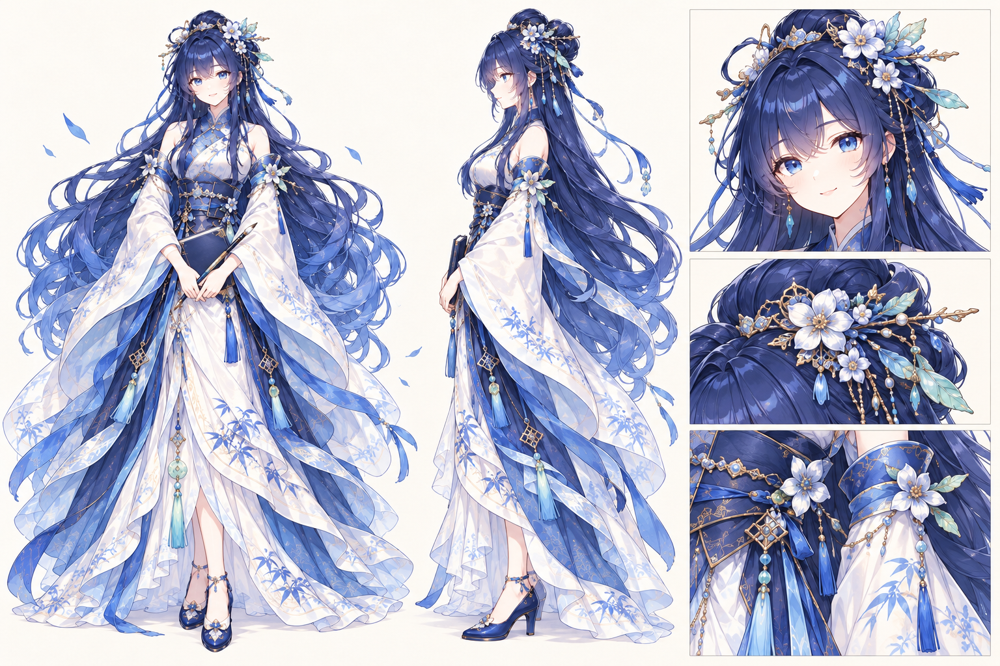
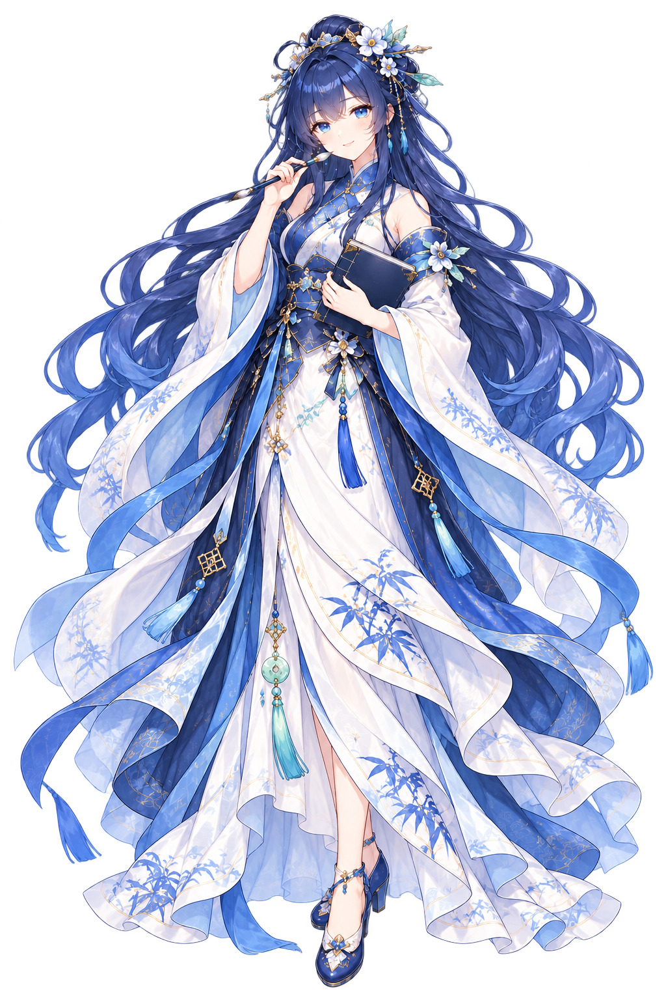
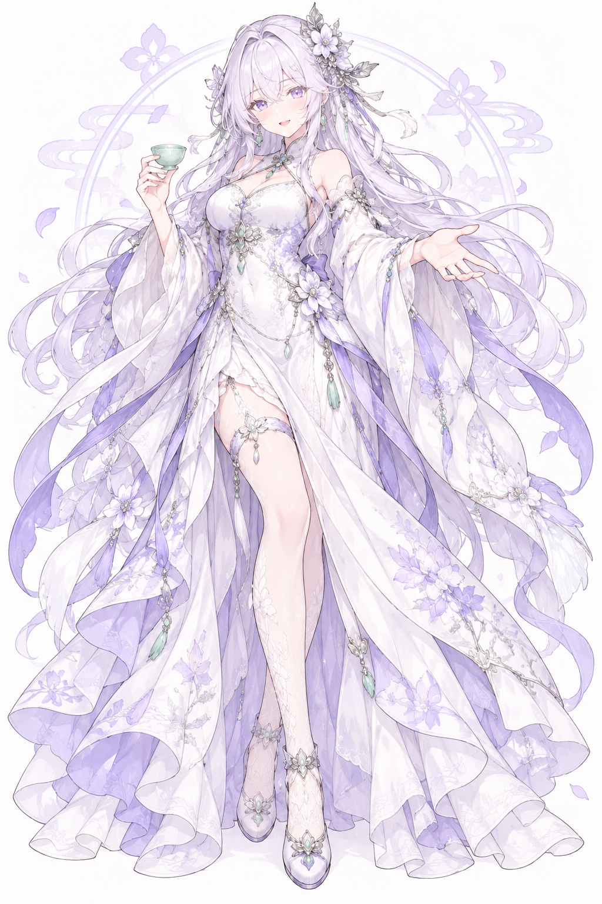
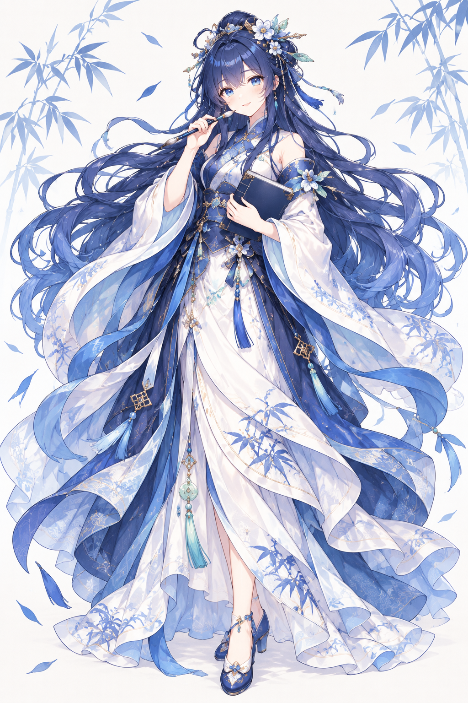
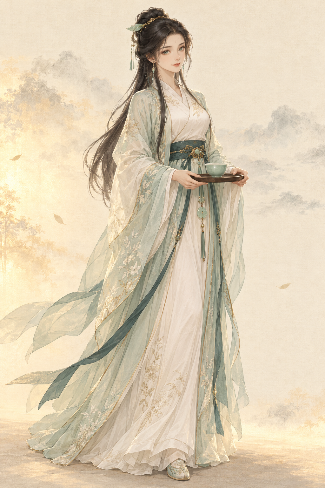
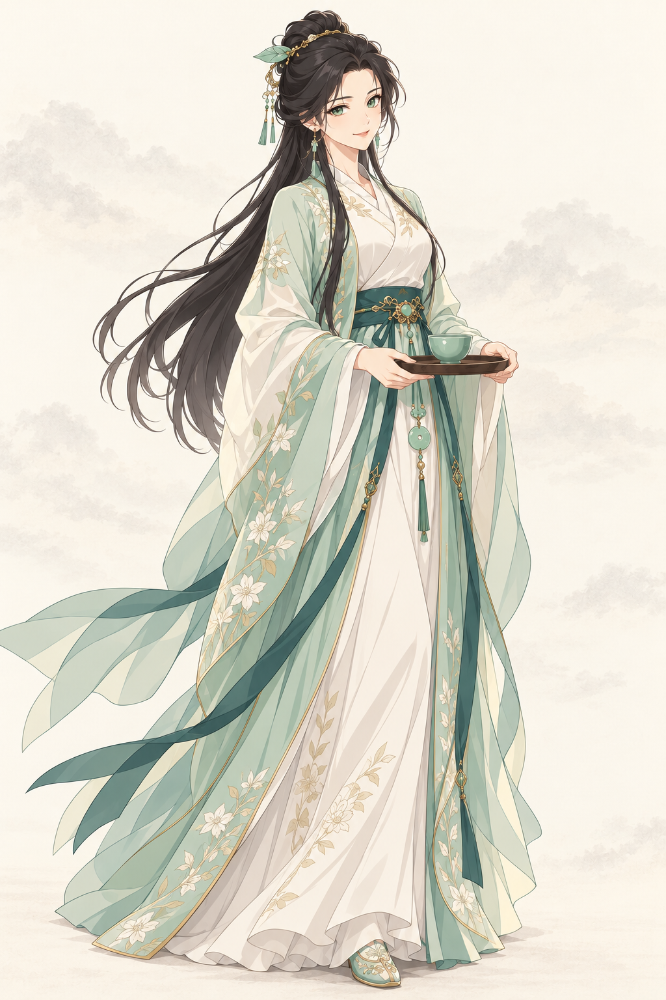
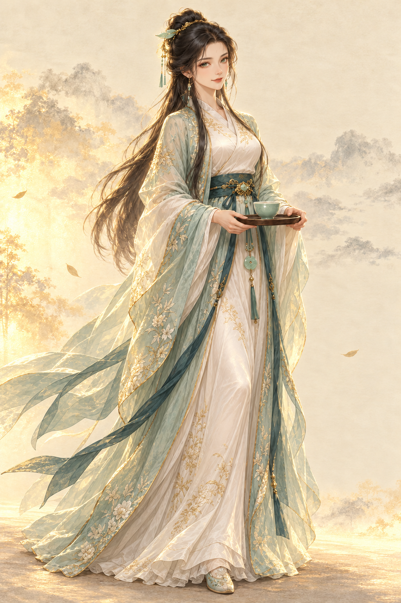

# 青蘅：首位仙侍畫風樣張

## 人物裝飾版 R3（2026-11-01 美術已接受）

使用者已接受本版人物美術／布局；下一步為Godot呈現接入，正式功能與響應式驗證另行完成。

[開啟人物版 R3](layout-review-r3.html)：沿R2透明立繪，加上淡墨雙線畫框、直式「侍女／青蘅」名籤、朱印、燕尾書籤小傳與卷末短句。題字採既有霞鶩文楷的手寫筆意；正文／操作沿黑體。R2保留對照，初遇CG與內容沿用；完整結果見[開發狀態](../../development-status.md#maid-art-r3)。可雙擊HTML審閱，正式Godot尚未接入。

## E設定與構圖 R2（待審閱）

[角色設定基準](character-baseline-r2.md) · [角色頁／初遇可切換審閱頁](layout-review-r2.html) · [完整提示詞](production-r2-prompts.json) · [來源與透明檢查](production-r2-manifest.json)

| 正／側視設定基準 | 雨夜入府初遇構圖 |
| --- | --- |
|  |  |

透明全身主立繪候選：

本輪新增圖像與占屏比例仍待接受。主立繪為1024×1536 RGBA，外部有真正透明像素，人物／書筆同一層；可見輪廓約2%留白，微量alpha1觸及左邊界，尚未標正式邊緣美術接受。清理替代稿`qingheng-portrait-r2b.png`未明顯改善留白，保留為未選稿。設定圖1536×1024，初遇1672×941；兩者皆單層RGB，不是分層場景。面部／配色／衣飾延續E，花簪與竹紋仍有生成細節差異，並非逐像素一致。

審閱頁獨立排文字／操作，可切人物與初遇、點開完整立繪，預設紙面黑體／青玉。HTML只作構圖工具；桌面控制授權逾時、IAB禁止file協定，實際瀏覽器檢視未完成，不冒稱遊戲UI或滑鼠驗收。雙擊本地HTML可人工審閱。此次未接入Godot或批量生表情。結果統一見[開發狀態](../../development-status.md#maid-art)。

## 已選定：E青藍書卷

2026-10-31 使用者「接受 推薦」，採用推薦的E作青蘅主方向：成年女性、深藍長髮、藍瞳、青白漢服、溫柔書卷氣與細緻二次元畫風。D銀白仙姬保留為未採用候選，並未核定為另一位角色。下一階段以E作角色設定基準、透明立繪及角色頁／初遇構圖的參照；樣張本身仍為帶背景原稿，正式資產與布局尚未完成。

## 使用者例圖修訂：D／E對照

| D：銀白仙姬，參考例圖GPT欄 | E：青藍書卷，參考例圖文心一言欄 |
| --- | --- |
|  |  |

依使用者提供的「AI娘形象對照圖」模仿其二次元臉型、細線條、繁複層疊衣裝與飄逸輪廓。D採銀白長髮／紫瞳／淡紫白裙與奉茶；E採深藍長髮／藍瞳／青白漢服與書筆。兩張是成年青蘅的造型替代候選，髮色與眼色隨參考改變，並非沿A設定鎖定同一造型。全身可見、臉與手未見明顯畸形；部分飄帶仍貼近畫邊，正式透明圖須補留白。兩圖皆帶背景，非透明或分層資產。

參照圖原路徑為使用者Downloads中的843591898_1632681411979538_147729111335781839_n.jpg；不搬入正式遊戲資產。其作者／授權未提供，使用者提供參照不代表第三方商用授權已取得。D／E使用該圖生成，與下方A–C的無外部圖參照紀錄不同；完整提示詞在[reference-r1-prompts.json](reference-r1-prompts.json)，來源hash及輸出紀錄在[reference-r1-manifest.json](reference-r1-manifest.json)。E畫風／造型方向已接受，D未採用。

## 前輪A–C（歷史比較）

2026-10-31 · MAID-ART 人物比較子階段，待使用者選定。三張由內建 image_gen 生成，並非正式遊戲截圖。

| A：工筆仙氣 | B：日系仙俠 | C：成熟華麗 |
| --- | --- | --- |
|  |  |  |
| 淡墨輪廓、礦物色與柔和紙感 | 清楚線稿、簡化色塊、較鮮明的動漫眼神 | 深淺層次、暖金輪廓光、較華麗的絲綢刺繡 |

共同設計為成年女性青蘅：黑色半挽長髮、玉葉髮簪、青白衣、深青腰帶、玉墜與奉茶姿態。B／C均以A原圖作參照；相貌保留主要特徵，風格轉換仍有眼形、臉部比例與衣紋差異，未宣稱像素級一致。

**建議**：若重視現有山水氣質，選A；若重視人物縮圖辨識，選B；若希望人物更華麗、光影更吸睛，選C。這是製作建議，未代表使用者接受。

**已檢視**：全身構圖、成年感、臉／手與茶具、衣飾連續性及三種渲染差異。未見明顯多肢或臉部畸形；托盤遮住部分手指，無法確認所有指節。三張左側部分飄帶抵達畫邊，正式立繪須擴留白。C的成熟華麗主要體現在材質與光影，臉型與A仍接近。

**用途與切層**：本輪為帶紙面背景的單層RGB畫風原稿，無透明alpha、無角色／背景／光效分層，不可直接當正式透明立繪。選定方向後再做正側設定、透明全身與表情差分，以及角色頁／初遇構圖；不在本階段預製整套CG。

**來源與授權紀錄**：由本專案文字提示詞生成原創候選，無外部作品或第三方人物參照。B／C只使用本輪A原圖；未主張獨占權或已完成商用法律清查。完整提示詞（含未採用B初稿）在[prompts.json](prompts.json)，原稿來源路徑、SHA256與格式在[manifest.json](manifest.json)。生成工具沒有提供額外授權文件。

狀態與命令結果僅記於[開發狀態](../../development-status.md#maid-art)。本輪沒有新增角色規則、UI接線、保存欄位或Web遊戲包，系統提案仍待選定。
