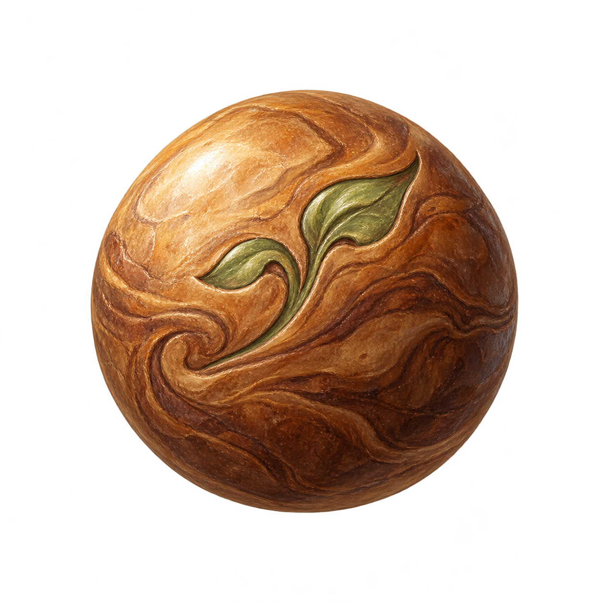
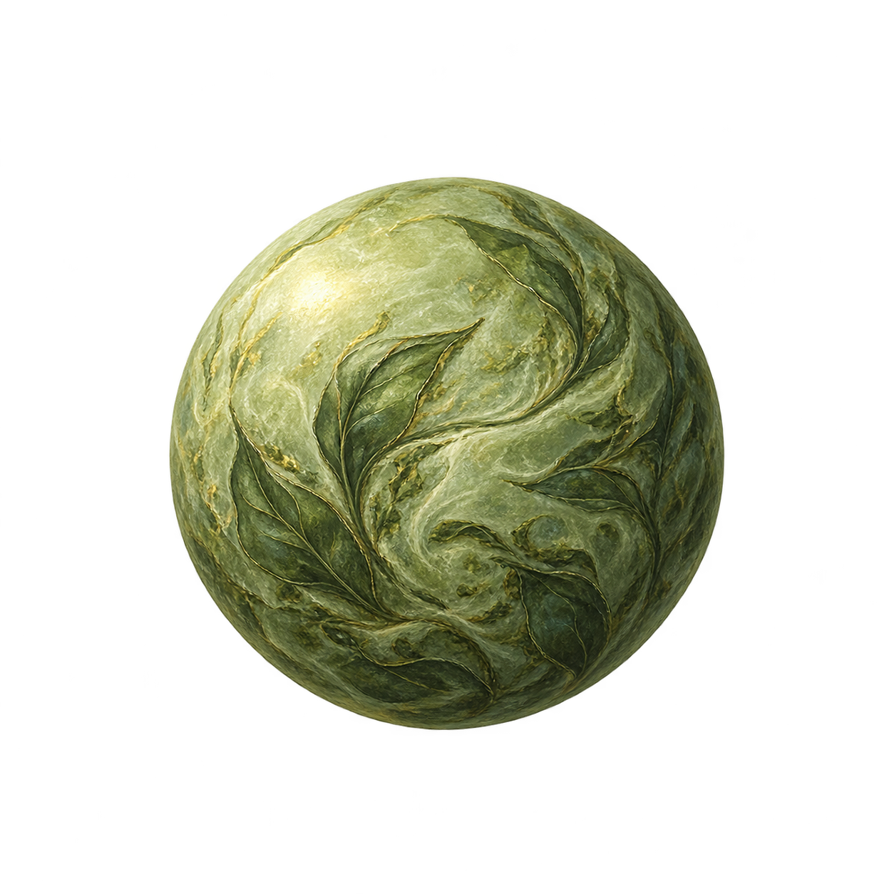
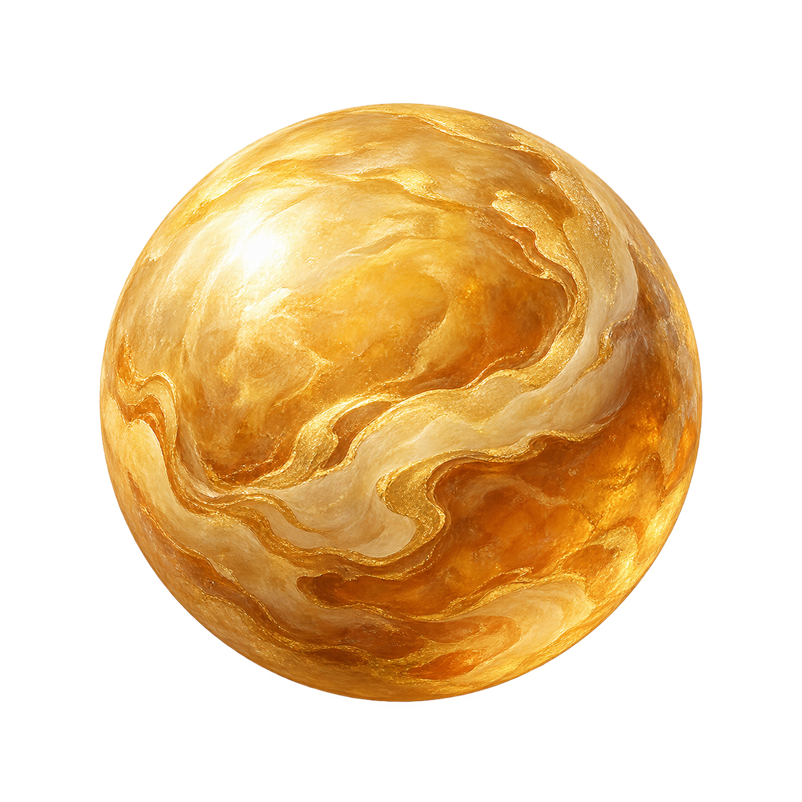
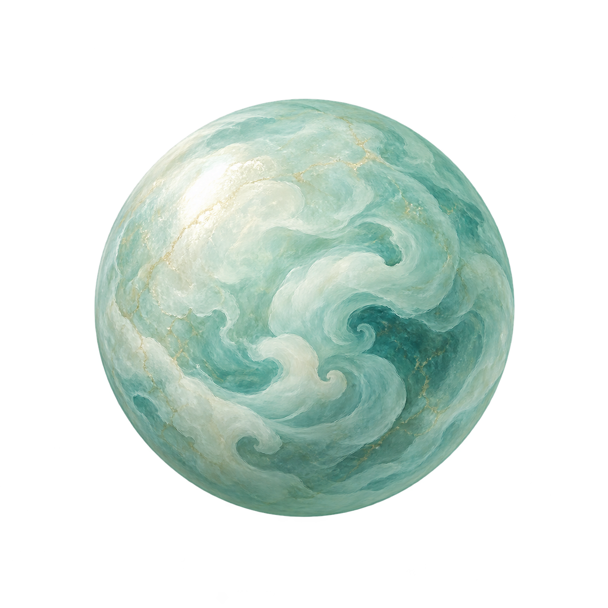
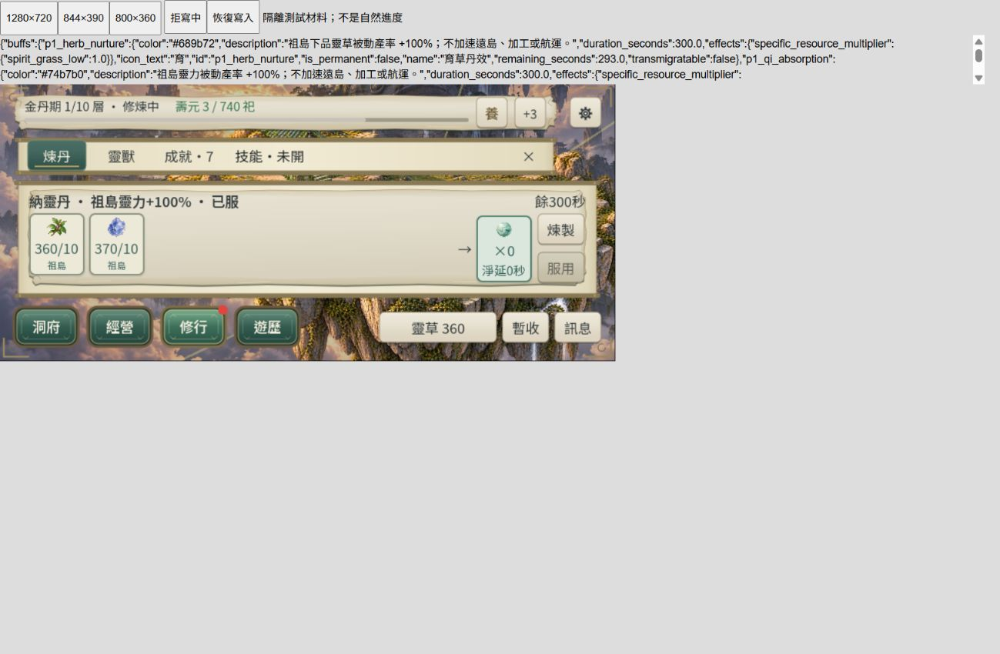

# CONTENT-P1-PILL 四丹美術審閱

2026-10-23；四張內建 ImageGen 原創透明圖，使用者明確回覆「美術接受」，四張新圖與本批正式丹卡呈現已接受，本批DONE（桌面／Web有界）。原稿與成品位元一致，提示詞／來源／hash／用途／權利界線見 [manifest](art-manifest.json)。正式小圖沿共用 UiIllustration B；密集 28px 圖沿既有例外。

## 養木丹

## 育草丹

## 聚財丹

## 納靈丹

## 正式 Godot 卡片

[原生三尺寸逐丹截圖](native-ui.json)；[Web 觀測](web-observations.json)。
