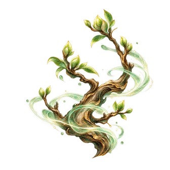
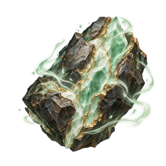
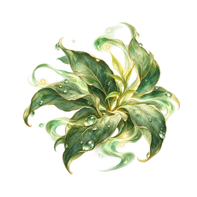
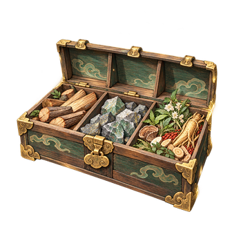

# CONTENT-P1-SKILL 五技能題圖審閱

2026-10-23。五張均為本批原創ImageGen透明PNG，**使用者於2026-10-23明確美術接受**；已接既有Godot研習卡。未改島上建築／地標，文字與狀態由Godot渲染。

| 青木養元法 | 玄礦煉息訣 | 百草培靈術 |
| --- | --- | --- |
|  |  |  |

| 靈倉整備法 | 丹火調息法 |
| --- | --- |
|  |  |

[完整prompt／來源／hash／切層／授權紀錄](art-manifest.json) · [Godot與桌面Web驗收](../../content-p1-skills.md)
