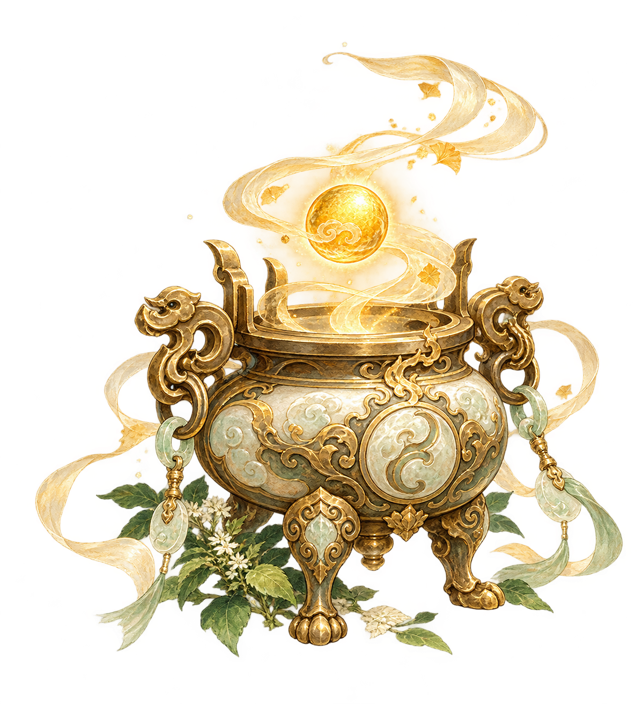
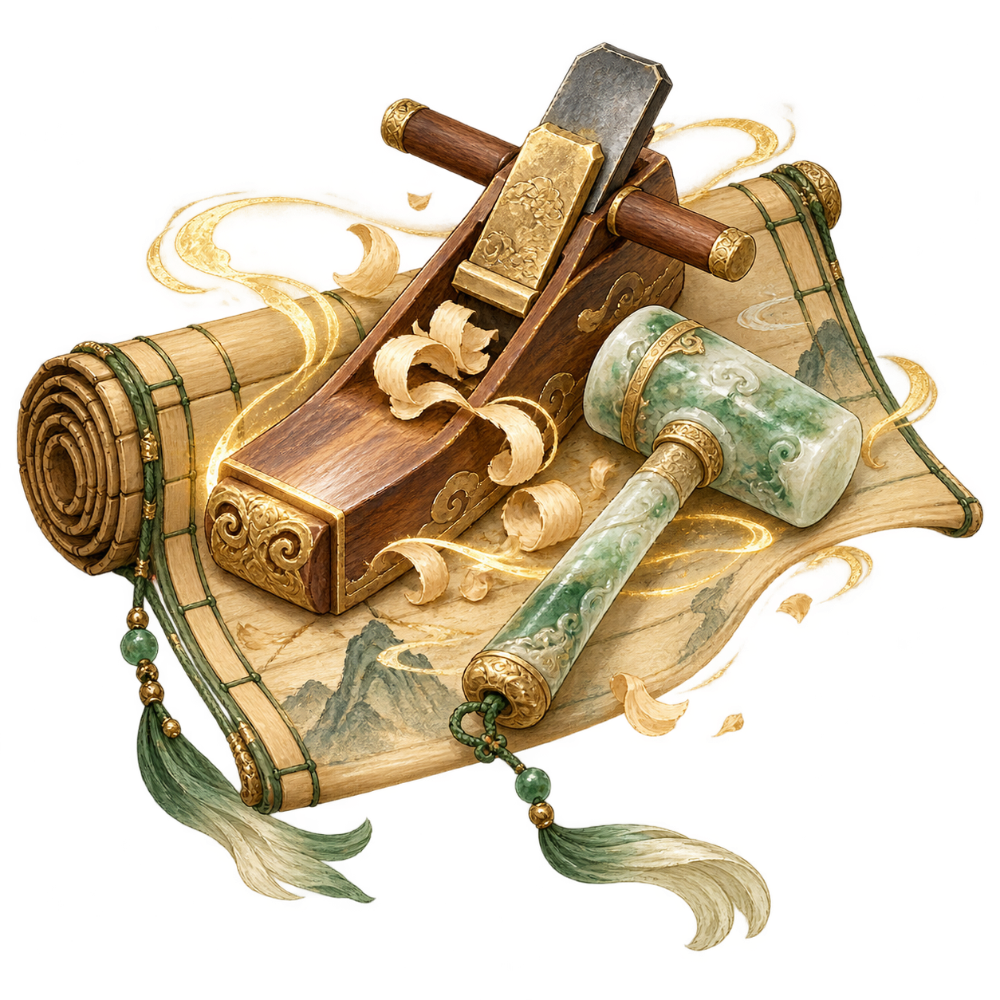
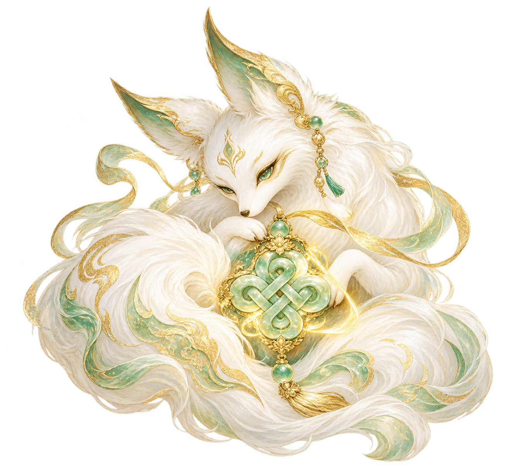
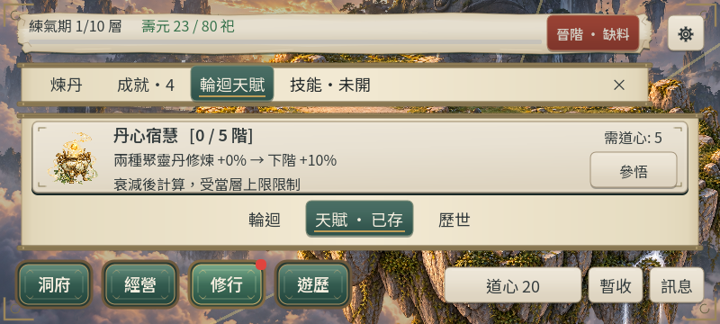

# CONTENT-P1-TALENT：三圖審閱

2026-10-23。內建ImageGen原創透明圖，沿既有輪迴紙面、玉白與古金手繪風格。使用者於2026-10-23明確回覆「美術接受」，三圖及新天賦卡現版呈現**已接受**。

丹心宿慧：丹爐、金丹與宿慧氣帶。

百工宿慧：木刨、玉鎚與竹木圖卷。

靈契宿慧：靈狐與玉結。

800×360原生成功保存後天賦卡；正式操作保持44px。

[提示詞、來源與hash](art-manifest.json)；[完整驗收與證據界線](../../content-p1-talents.md)。
