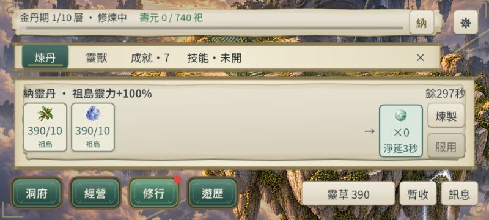

# CONTENT-P1-PILL：四種祖島單資源限時丹

2026-10-23。使用者明確核定 P 並指定本任務。**DONE（CLI／原生／桌面Web有界）；使用者已明確回覆「美術接受」，四張新圖與本批正式丹卡呈現已接受。** S／T 與共用 B 描邊規則保持，不延伸下一內容批次。

## 交付

- 新增 `wood_nurture_pill` 養木丹、`herb_nurture_pill` 育草丹（Era2），`wealth_gathering_pill` 聚財丹、`qi_absorption_pill` 納靈丹（Era3），原八丹 canonical 順序保持，總定義12。
- 每顆對祖島靈木／下品靈草／金錢／靈力被動產率的指定加數＋1、300模擬秒。既有全產乘區另算；不同資源並存，同資源加數合計。不改遠島、加工／航運、手採、掉落、RNG或庫容；加工配方仍8。
- 按 docs31§5 付料；共用費用函式沿丹火白名單，三階40→34靈力，納靈無靈力費。直煉1–99顆，一顆一入庫；新丹庫存0–999999，整批滿溢拒絕，只存pills，不建resources鏡像。沿正式唯一命令／事實／帳目，不靠動畫發收益。
- 新丹服用境界重驗；1–12顆、300n≤3600，刷新max(old,300n)。D≤old整批拒絕，不扣丹、不記服用；成功回執含淨延長。剩1秒該秒仍生產，之後移除；壽盡停止、轉世清除。
- `schema5`保持；新增`pill_version=1`（缺欄舊檔0），rules `core-flow-15-content-p1-pills`。content hash納入丹藥與BUFF定義。新丹庫存、BUFF有限時長／永久與跨世旗標、已知名稱／ID／效果身份嚴格校驗；未知未來版本拒讀。舊檔／分享匯入升版保留原文，`save_before_pills_<sha256>`讀回比對後才提交；失敗保留候選並只保存重試。
- 正式煉丹殼新增四張透明原創圖，沿共用UiIllustration B；短式28px密集圖沿既有例外。祖島目標／+100%／餘秒／單顆淨延可見；短式成功回饋併該卡題列「已煉／已服」，完整回執留TIP，保存保護沿共用遮罩與重試。沿既有字型、分頁、CloseSeal、容器與內捲。

## 驗證與命令

引擎本機 `--version`＝`4.7.2.stable.official.ed1daf0bf`，未更新引擎／模板。原生／CLI 的 APPDATA 均為本專案 build 內隔離profile。Web為獨立4426 origin及`content-p1-pills-acceptance` namespace，明示合成、已供料Era3 fixture，非自然新手流程，未讀寫玩家進度。

| 命令／證據 | 結果 |
| --- | --- |
| Godot `--headless --path . --script res://tests/content_p1_pills_runner.gd` | 最終609 checks／failures=[]：批量、精確扣料／折扣、界境、庫存／時長上限、非法型別原子拒絕、各target實際最後一秒倍率、刷新淨延、並存／同資源相加、回讀效果竄改拒絕、線上／離線、啟用多島＋加工economy jump、壽盡／輪迴、原文備份拒寫與重試、雙槽損壞／回復、分享匯入。[結果](artifacts/content-p1-pills/runner.json) |
| Godot 原生 `--path . --script res://tests/content_p1_pills_ui_runner.gd` | 最終102 checks／failures=[]；三橫式、12卡、四新圖、所有新丹按鈕44px、完整卡高度、單區捲動可達、成功回饋與返回；12張截圖。[結果](artifacts/content-p1-pills/native-ui.json) |
| `powershell -NoProfile -ExecutionPolicy Bypass -File tools/run_all_runners.ps1` | 104／104唯一Runner分段通過（成功前5＋續跑99），exit0、SCRIPT／SHADER ERROR0；專項最後609／原生102另補最終版。共用BUFF與既有煉丹最終另跑通過。[覆蓋](artifacts/content-p1-pills/runner-coverage.json)。 |
| `python tools/subset_game_fonts.py --check` | exit0，現有字型涵蓋新文案，無更換字族或重建字型。 |
| Godot `--editor --import --quit`；`--export-release Web build/web-content-p1-pills/index.html`／`ContentP1PillsAcceptance build/content-p1-pills-acceptance/index.html` | 候選匯出成功，來源修正與fixture還原後重新匯出；不寫原build/web。 |
| `python tools/content_p1_pills_audit.py` | 最終50項通過、failures=[]；來源／四圖原文hash與alpha、104唯一Runner覆蓋、原Web保持及兩候選hash／companions。[稽核](artifacts/content-p1-pills/audit.json) |
| `node tools/prepare_web_compression.mjs <兩候選目錄>` | 兩包Brotli往返及四首BGM companions成功。 |

### 真實桌面 Web

正式Godot、真實滑鼠，1280×720、844×390、800×360 iframe。1280完成四丹煉製／服用；丹火三階40→34的實扣與顯示一致，四BUFF並存；所有新丹數0。844開保存拒寫後煉一納靈，草370→360、石380→370，只入一顆；拒寫中再試仍一顆／同材料，恢復寫入後相同。800服此丹：餘293→300秒，淨延7秒、單顆扣為0，按鈕再次禁用；真實重載後四丹仍0，四BUFF仍在、材料草360／石370／木390。800關閉返回洞府已驗。

保存恢復會正常結算等待時段，靈力32→75.6476803507357、BUFF300→293；重載另有正常3秒，靈力94.3538290724796、舊三BUFF290秒、納靈297秒。這些不是再次煉製或扣費，不能宣稱全狀態凍結不變。早期連續動作讀取有250ms觀測落後，原始嘗試留在JSON，confirmed只取穩定結果。[觀測](artifacts/content-p1-pills/web-observations.json)、[診斷](artifacts/content-p1-pills/web-console.json)。

最後兩候選重新匯出後，另用全新4427來源對最終包做800橫式真實滑鼠煉製／服納靈與重載：草／石400→390，各扣一次，丹1→0；重載仍0／390／390，倒數300→297，靈力依原庫容由400正常結算至100。最終包資料見[smoke](artifacts/content-p1-pills/web-final-candidate.json)，[最終診斷](artifacts/content-p1-pills/web-final-console.json)。本輪驗收服務均已停止。

### 初輪失敗與限制

- 初輪專項runner兩處型別推斷錯誤已修正；保存重試測試原用同revision混入前一fixture造成讀取舊候選，改獨立Memory adapter，不改正式槽位選擇。
- 初輪多島測試fixture錯設築基丹資源鏡像、已滿產出與未解鎖材料，依序修正fixture；最終609全過。壞槽JSON負面測試刻意觸發Parse JSON診斷，保留原文，不稱日誌零錯誤。
- 初輪短式卡加狀態列後超高／縮放未刷新，修正為短式題列與圖格淨延、layout變更立即重讀同View；初輪原生失敗與其後通過日誌均保留。
- 全量前段技能測試原以pills[0]指聚靈丹；四新丹改附加原八丹後，正式原序保持，技能測試續跑通過。SKS-P1只將過時固定rules斷言更新15，未改舊效果預期。
- 第一沙箱Web服務4425不可達，改正常授權4426後真實瀏覽器成功；未改防火牆。初次BGM companions尚未生成產生下載警告，完成壓縮後companions已交。IAB另保留MutationObserver非Node錯誤，未歸因Godot。
- 最後補強共用apply_buff刷新：新BUFF保留較長remaining時duration同步保持可保存；不改舊BUFF的metadata語意，最終四項邊界＋BUFF／煉丹回歸通過。
- 初次稽核直接比較RUNNING標頭清單，因三支舊Runner自身也印同名標頭而得107條；按註冊順序去重後為104唯一、無缺支，稽核50項通過。
- 回歸改寫的14份既有JSON已逐位元還原，清單見[fixture紀錄](artifacts/content-p1-pills/fixture-restoration.json)。
- 原生退出仍有Font／CanvasItem／ObjectDB診斷；不將exit0等同日誌無錯。未量測FPS；觸控／實機延期，非當前阻擋。

## 圖像與交接

[四張圖與正式卡審閱](artifacts/content-p1-pills/art-review.md)、[完整提示詞／來源hash／用途／切層／權利聲明](artifacts/content-p1-pills/art-manifest.json)。使用內建ImageGen，原稿與runtime PNG byte-identical，無第三方圖像輸入。**四新圖與丹卡已於2026-10-23由使用者明確回覆「美術接受」，本批DONE（桌面／Web有界）。**

來源：alchemy_system／buff_system／command_processor、game_state、save_codec／save_manager、content_loader、alchemy_panel／abode_modal_manager／resource_icon、新四PNG、兩runner與隔離fixture／acceptance場景、project／export presets／runner入口、相關文件。保留引擎生成UID。未commit/push。本次接受收結僅更新metadata、稽核與文件，未重跑Godot／Runner／原生／瀏覽器／匯出，未改PNG／正式規則／玩家進度。接受後重新執行`python tools/content_p1_pills_audit.py`核對既有證據與hash；此前稽核保留為audit-before-art-acceptance.json。S／T／P三批均已收結；下一New Chat由使用者指定大型任務，不自動開工。
