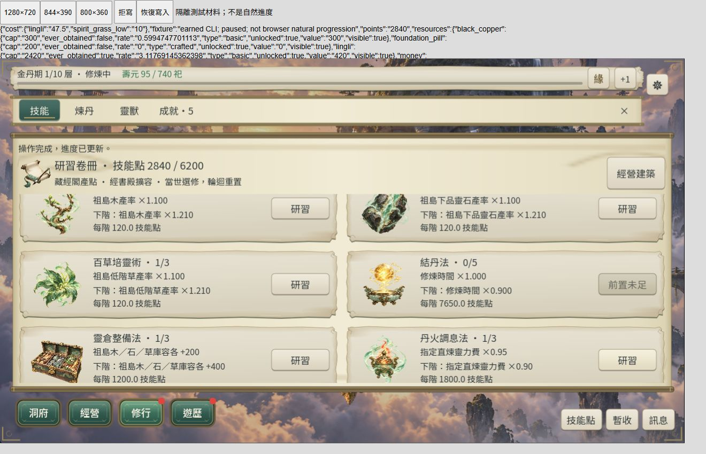
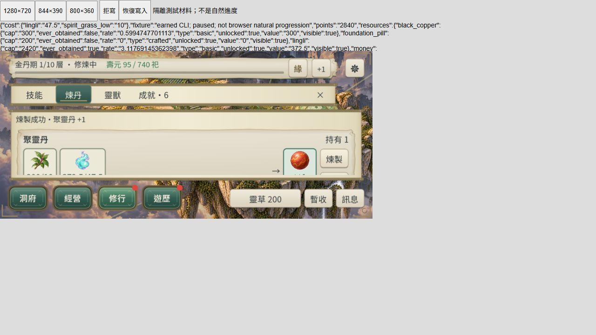

# CONTENT-P1-SKILL：五技能實作與桌面驗收

2026-10-23。**DONE（CLI／原生／桌面Web有界）：使用者明確回覆「美術接受，確認下一步驟」，五張新題圖人工美術閘門完成。** 使用者以任務ID指定開始本批，按docs31 S方案實作；T／P未因此核定。沒有commit／push，沒有修改玩家origin或凍結build/web。

## 交付

- `content/skills/era2.json`：青木養元法、玄礦煉息訣、百草培靈術；各三階／每階120點，只對祖島木／下品石／低階草被動產率乘1.1。不含玄銅、百年草、手採、遠島、加工或航運。
- `content/skills/era3.json`：靈倉整備法三階／每階1200點，各階三材料祖島庫容＋200，再沿既有容量乘區；丹火調息法三階／每階1800點，指定直煉靈力費每階減5%。沒有更動原七技能的成本、上限或效果。
- `src/simulation/skill_system.gd`：effects、文字與版本limits；`production.gd`：三材料容量通道。技能均走正式learn_skill、扣技能點與skill帳目，沒有新增分頁、字型或世界建築。
- `src/simulation/alchemy_system.gd`：共享Amount費用函式供View、整批預檢、實扣、帳目與paid_cost回執；50靈力依階成47.5／45／42.5，不逐顆取整。不折草料，築基丹兩入口及加工保持原費用。未來四丹名稱僅為折扣白名單，沒有註冊新丹／新配方。
- `src/persistence/save_codec.gd`：schema5保持，rules改`core-flow-13-content-p1-skills`，content增加`+content-p1-skills`，skill_version3／最多12ID。v0空、v1六項、v2七項、v3十二項；未來版本、新ID舊版本、非法型別／階數拒讀。沿SaveManager原JSON雜湊備份、讀回驗證與雙槽提交；重試不重送研習。
- 五張ImageGen透明PNG由既有`skill_study_view.gd`依ID自動載入；[來源／prompt／hash／授權與接受狀態](artifacts/content-p1-skills/art-manifest.json)。原稿完整保留，runtime336px，僅alpha裁邊／等比縮圖／留白。人工美術已於2026-10-23接受。
- 新增三支Runner、隔離acceptance場景／腳本／CLI-earned fixture與export preset；既有四支技能Runner只更新當前版本／總數／最後一張卡，原七技能斷言保留。

## 命令與證據

引擎版本命令為`tools/godot/4.7.2/Godot_v4.7.2-stable_win64_console.exe --version`，確認`4.7.2.stable.official.ed1daf0bf`。後續APPDATA指向本專案build/content-p1-skills-profile（原生另有專用profile），所有保存均隔離。

| 命令 | 最終結果與證據 |
| --- | --- |
| Godot `--headless --path . --script res://tests/content_p1_skills_runner.gd` | exit0，370 checks／failures=[]；鎖定／缺點／滿階／冪等、12ID往返、v2備份拒寫重試、輪迴清除、費用小數及逐秒／離線庫存帳目RNG。[結果](artifacts/content-p1-skills/runner.json) |
| Godot `--headless --path . --script res://tests/content_p1_skills_progression_runner.gd` | exit0，75 checks／failures=[]；空白新檔沿既有正式命令與模擬時間到Era3，無宗門取得五項三階。不是自然時間Web全程。[結果](artifacts/content-p1-skills/progression.json) |
| Godot `--path . --script res://tests/content_p1_skills_ui_runner.gd` | exit0，84 checks／failures=[]；原生三橫式／15張圖，五圖、字級／44px、寬度、卡片高度、內捲／返回。[結果](artifacts/content-p1-skills/native-ui.json) |
| `powershell -NoProfile -ExecutionPolicy Bypass -File tools/run_all_runners.ps1` | 99／99唯一Runner通過（原清單前82＋恢復15＋新增兩項單跑）；各支最後SCRIPT ERROR0。[覆蓋](artifacts/content-p1-skills/runner-coverage.json) |
| `python tools/subset_game_fonts.py --check` | exit0，現有字型涵蓋；沒有再產字型 |
| Godot `--headless --path . --editor --import` | 最後exit0；初輪user://與既有錯副檔名診斷保留 |
| Godot `--export-release Web build/web-content-p1-skills/index.html`／`ContentP1SkillsAcceptance build/content-p1-skills-acceptance/index.html` | 正常候選與隔離包最後export exit0；凍結build/web SHA256 `7e7e619dcaa28fb05e1c397adcc24ce9071d9b53b4e8fa6379c186e0af9f9400`保持 |
| `node tools/prepare_web_compression.mjs`（上述兩目錄） | Brotli往返與四首BGM companions，最後exit0 |
| `python tools/ui_shell_server.py --port 4401/4402/4403 --build build/content-p1-skills-acceptance` | 沙箱服務timeout；正常權限審核後同命令可由IAB存取；沒有改防火牆或網路設定 |

## 真實桌面Web

IAB隔離origin4401／4402／4403，正式Godot iframe實際1280×720／844×390／800×360；每尺寸均滑鼠研習五ID。測試起點是CLI正式命令賺取的Era3存檔，遊戲時間暫停以方便操作；不是連續自然時間空白新檔到Era3的Web試玩。外層尺寸／拒寫按鈕與state output只供驗收。

- 寬式與800分支五項各一階，6200→2840，三資源產率×1.1、容量各＋200，靈力費50→47.5。844分支亦逐項滑鼠研習，包含拒寫故障。
- 844拒寫後青木1階／2996點，拒寫重試同階同點；恢復保存後同份五技能各一階，重載保持。恢復／重載沿正式離線結算可增加資源或點數（例恢復3022.4），不可把時間收益當重複扣款或宣稱完全相同庫存。
- 800煉丹頁顯示祖島靈力420／47.5，真實滑鼠煉製一顆後靈力372.5、草210→200、持丹1，技能點仍2840；固定關閉返回洞府。重載五項仍各一階。
- 瀏覽器有兩筆`MutationObserver.observe`非Node例外，來源未歸因；不宣稱console零錯誤。Godot命令／畫面／保存結果已交叉確認；原始觀測保留。[完整觀測](artifacts/content-p1-skills/browser-observations.json)

## 初輪失敗與界線

- 專項初版先存revision1舊遷移，再存人工準備的revision0狀態，讀回依正確最高revision選舊槽，斷言失敗。測試改為遞增revision，未放寬正式雙槽選擇；最後370項通過。
- 初次未隔離APPDATA，全量第二支因user://無法寫入而初始化失敗、Nil.hide腳本錯誤；主動停止後改專案內profile重跑，沒有對玩家資料修權限。
- 初次export目錄未建立，匯出exit1；建立兩個專案內候選目錄後重跑成功。
- 隔離觀測腳本初版隨SceneTree暫停而停更，拒寫時output滯留舊狀態；修為ALWAYS、遊戲根保持PAUSABLE後重新匯出並重驗。保存保護本身已呈現，未用舊output宣稱拒寫證據。
- 原生及既有Runner退出仍有Font RID／CanvasItem／ObjectDB診斷；負面fixture的JSON／保存錯誤保留。沒有把exit0稱為所有日誌零錯誤。

- 舊B1測試只排除結丹法，誤把新增Era3兩項也當Era2可研習，四項assert失敗；改按正式definition.era篩選，並修R8共用模式按鈕總數／最後一張可達卡斷言。恢復後B1 53／SKS-P1 58／EARLY-V1-C 164／R8 151均通過；沒有降低境界鎖或跳過原七項數值。
- fixture還原初用CopyFile2遇WinError1224；改為專案內原檔就地寫回已備份bytes，11份最終hash皆核對。一次交接整理讀log省略UTF-8引發cp950解碼失敗，改明確UTF-8後完成，未改規則。

[命令退出碼](artifacts/content-p1-skills/command-exits.json)、[最後來源／兩候選包hash稽核](artifacts/content-p1-skills/final-manifest.json)、[fixture還原紀錄](artifacts/content-p1-skills/restored-generated-fixtures.json)與logs目錄保留。還原11份既有生成JSON至本輪前bytes，生成版本另存本批generated-fixtures。成功瀏覽器分頁／自有服務已關閉；初輪失敗data-URL分頁受URL政策限制不能關閉，沒有繞過。

觸控與實機依使用者政策延期，非當前阻擋。本批五圖人工美術已接受；不重開自然前期節奏閘門。下一批為CONTENT-P1-TALENT，T方案尚待核定，不由美術接受代為核定T／P。英文checkpoint置於updata.txt最頂部；下一大型工作使用New Chat。

## 2026-10-23 人工接受與收結

使用者明確回覆「美術接受，確認下一步驟」。五張題圖與本批技能卡呈現接受，CONTENT-P1-SKILL收結DONE；沿用上列370／75／84與99支Runner、桌面Web及保存證據。本次只改接受metadata／狀態／英文checkpoint與稽核狀態推導，執行Python hash／連結／既有證據稽核及diff檢查；沒有重跑Godot、Runner、瀏覽器或匯出，也沒有變更PNG、規則、保存schema或玩家資料，未commit/push。

下一New Chat先核定docs31§4的T方案，再開CONTENT-P1-TALENT：丹心宿慧（兩種修煉丹收益＋10%／階）、百工宿慧（四生產設施產率貢獻＋8%／階）、靈契宿慧（靈狐餵養經驗＋20%／階，與獸魂成長加數相加）；各五階，成本5／10／20／40／80道心。本次未開始天賦實作；P丹藥仍待各自核定，順序為TALENT→PILL。
