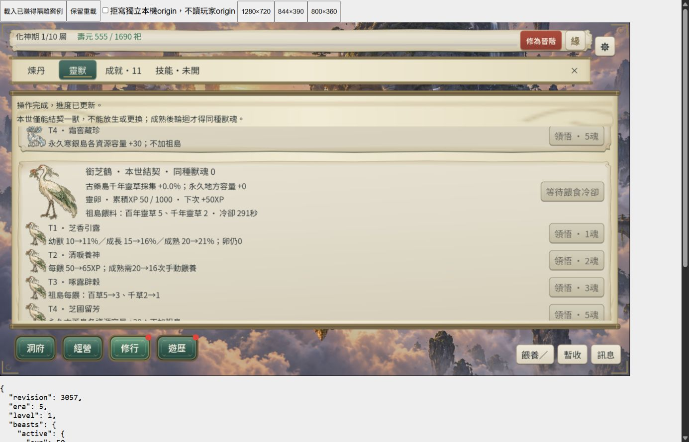
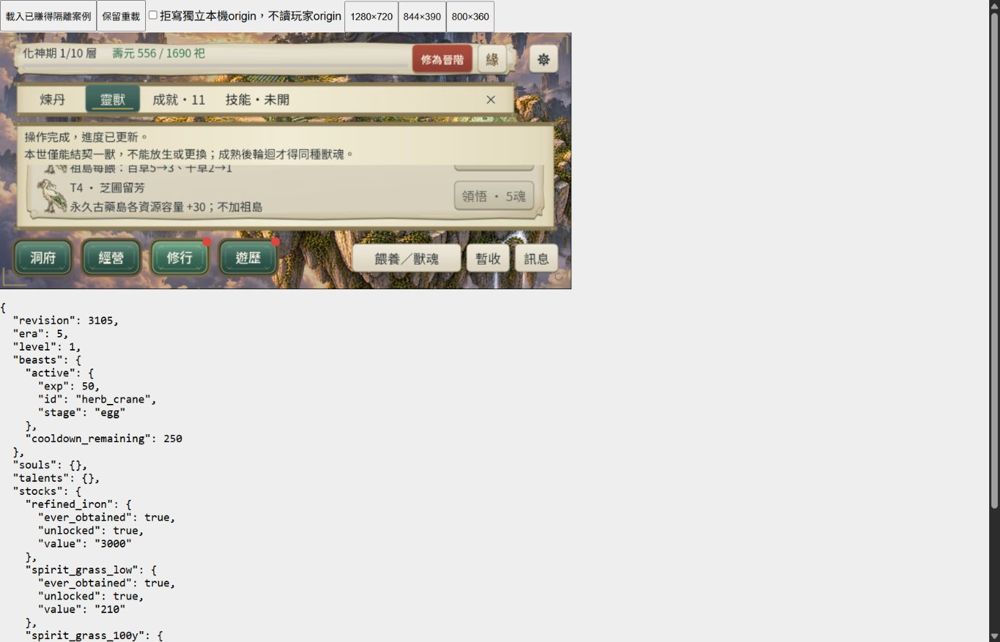

# CONTENT-P2-BEAST：整批 L3 收尾

2026-10-26 接受／啟動，2026-10-27 完成。使用者明確「接受，再接整批 L3 收尾」，兩圖、卡片與目前節奏已接受。**整批 DONE（L3／桌面 Web 有界）。133／133 唯一 runner 最終分段通過；不是單次全綠。** 沿[方案 X](../39-content-p2-beast-design.md)與[BEAST-2](content-p2-beasts-ui.md)，不開其他 P2／P3。

最終交付稽核 **955 項、0 failures**；7843 份既有 JSON 核對，73 份差異先封存後逐 byte 復原。接受 manifest 與現行契約的宗門 fixture 修復為明列例外。完整續跑的 exit 與逐支最終證據見下方連結。

## 範圍與變更

- 兩份獸圖 manifest 記為 ACCEPTED，proposal 記錄本次原話。兩張 runtime PNG 與原圖不變，來源、提示詞、alpha 與權利說明保持。
- `tests/content_p2_beasts_ui_runner.gd`：高卡在短橫式無法整張同屏，改將實際 feed／各 talent 動作捲入，再斷言 44px 命中與可視矩形；不放寬斷言。三尺寸最終 217 項通過。
- `tests/content_p2_pills_flow_runner.gd`：保存遵循 `DAO_TEST_STORAGE_ROOT`，避免沙箱 `user://` 啟動失敗；64 項完整正式模擬流程通過。
- `tests/content_p1_sect_runner.gd` 與 `src/verification/content_p1_sect_fixture.json`：舊 funded fixture 的 `experience/last_feed_age` 改為現行 `exp/cooldown_remaining`，寫入前檢查 encode.ok。舊產生器在新契約下寫出空檔卻未失敗，L3 UI 因而揭露 JSON_PARSE。原錯誤 fixture 已備份，修正 fixture 刻意保留，避免獨立 UI 仍讀到失效資料。沒有放寬保存契約。
- 新增 `tools/beast2_closure.py`、`run_beast2_closure.ps1`、`resume_beast2_closure.ps1`、`supplement_beast2_closure.ps1`、`beast2_closure_fixture.gd`、`beast2_closure_server.py` 與本頁證據。規則、R46、魂價、schema、引擎與玩家進度不變，未 commit／push。

## L3 命令與失敗保留

本機引擎 `tools/godot/4.7.2/Godot_v4.7.2-stable_win64_console.exe --version` → `4.7.2.stable.official.ed1daf0bf`；未更新引擎或模板。

`python tools/beast2_closure.py backup` 備份並核對 7845 份既有驗收／fixture JSON。排除歷史不可變封存目錄，未將既有 dirty 工作區重設為 Git HEAD。

`pwsh -NoProfile -File tools/run_beast2_closure.ps1 -Step full` 先 `-Full -List`，再 `tools/run_all_runners.ps1 -Full -Parallel 3 -TimeoutSeconds 600`，matrix=full、133 唯一 runner。正式壽盡與供給長流程已知超過 45 秒，因此給明確有界預算。首輪沙箱 `user://` 寫入失敗引發未初始化空節點，保留[原始命令](artifacts/content-p2-beasts-closure/full-command.log)與[中斷說明](artifacts/content-p2-beasts-closure/full-interrupted.txt)；停止自有程序樹，沒有當成功。

`pwsh -NoProfile -File tools/resume_beast2_closure.ps1` 在主機以 `-Only` 精選未通過／未執行 74 支，先 List，再 `-Matrix full -Parallel 3 -TimeoutSeconds 600`；沿原輪 59 支有效通過，不重跑 Full。八丹流程 572.9 秒通過；供給並行及自動串行兩輪均達 600 秒逾時，第二輪已正常進入 Era6 第1層，原續跑命令 exit1 保留。只以 `supplement_beast2_closure.ps1` 先 List、再精選同支 `-Matrix full -TimeoutSeconds 1800` 從原始已賺得來源完整補驗，不使用未退出的片段或跳過前境界冒充通過。宗門 UI 原因另有上述空 fixture，停滯後主動終止以取得 raw 診斷，原 SCRIPT ERROR 保留；修正後串行重試 69 項通過。核心產生器另以完整檔名先 List、再單支補驗；首份沙箱暫存 raw log 未成功封存，因此保留首命令並僅以專案內持久日誌補跑 3.5 秒通過。

最終每支 raw stdout／stderr 與唯一 `RUNNER_RESULT status=PASS exit=0` 必須核對，SCRIPT ERROR 或逾時不得計成功。[逐支結果](artifacts/content-p2-beasts-closure/runner-summary.json)、[主機續跑](artifacts/content-p2-beasts-closure/resume-command.log)、[原始封存](artifacts/content-p2-beasts-closure/logs-archive/)。不是單次全綠；既有 anchor、Font RID／CanvasItem／ObjectDB 退出診斷不等於零錯誤。

2026-10-27 最終補驗：供給 **1482.1 秒、94 項、0 failures、exit0**，完整 Era3→6 第10層、Era7 拒絕、壽盡輪迴回到 age0；[完整命令](artifacts/content-p2-beasts-closure/supplement-command.log)、[正式模擬結果](artifacts/content-p2-beasts-closure/supplement-isolated-storage/supply3-flow/earned-flow.json)。實際輸入來源逐字存於 [supply-source.json](artifacts/content-p2-beasts-closure/supply-source.json)，與 runner 的 source_sha256 一致；後續復原舊 fixture 不會遺失本輪輸入。不是使用中斷快照跳過前境界。至此133／133最終分段通過。

## 正常 Web 候選包

`run_beast2_closure.ps1 -Step export` 使用普通 Web preset，輸出 `build/web-content-p2-beasts/index.html`，exit0；`-Step compression` 執行 `node tools/prepare_web_compression.mjs build/web-content-p2-beasts`，exit0，Brotli 往返與四 BGM companion hash 核對。Compatibility、單執行緒；HTML 只作隔離測試殼，沒有 BEAST-2 專用 feature。後續修改僅測試及被普通 preset 排除的 verification fixture，不影響已驗正常包。

`-Step rebase` 僅重封兩條已賺得 Era4／Era5 分支的保存時間，兩次 `state_equal=true`；未授予材料、XP 或獸魂。隔離本機 origin 48476／48477，各自空獸槽，不能同世換獸。初次 4483／4484 連線拒絕、socket 權限與逾時保留；主機隱藏程序的高位 port 可達，未將失敗連線算通過。

## 桌面滑鼠：三橫式與保存

正常候選實際 mouse 結契兩獸，各正式首餵一次，兩獸從 0→50 XP；冷卻顯示並禁用重餵。霜角鹿首餵保存拒寫→再次拒寫重試→恢復→重載，最終仍只有 50 XP；鶴正常保存與重載亦為 50 XP。返回洞府、重開／內捲及固定關閉可達。

持久化殼讀的是已落盤狀態，拒寫期間仍顯示上一版，且 interval 有延遲；不能把這個摘要冒充未保存記憶體狀態。恢復與一般遊戲有正常採集、回運、離線補時及冷卻遞減，因此庫存不應假裝凍結：鹿恢復草 221.5、精鐵1228.2，鶴首餵百草95，隨後正式產出再回到100。精確拒寫當下扣款與八個合成獸魂天賦首購沿本日未改程式的 BEAST-2 L2 證據，本輪不宣稱再做完整八天賦／兩獸拒寫矩陣。

| backing 尺寸 | canvas CSS 實測 | 實際桌面操作 |
|---|---|---|
|1280×720|1279×719|兩獸卡、結契與首餵、鹿拒寫／再次重試／恢復|
|844×390|843×389|兩獸圖文、餵養／冷卻動作、成本與內捲|
|800×360|799×359|兩獸首段、天賦 T2／T4 捲入、固定關閉、返回與重載50 XP|

是完整卡片的可捲動閱讀，非要求高卡在最短視窗整張同屏；普通遊戲 canvas 不靠瀏覽器捲軸逃避短式，外殼下方 JSON 僅供驗收觀測。[12筆觀測](artifacts/content-p2-beasts-closure/browser-observations.json)、[候選與截圖 hash](artifacts/content-p2-beasts-closure/browser-final.json)、[warn/error 查詢](artifacts/content-p2-beasts-closure/browser-console.json)。查詢兩頁皆空，不擴張為全日零錯誤。工具捕捉 helper 初次跨 iframe evaluate 不支援、一次 closure 綁到鹿 tab 的觀測已明確改標鹿背景，未冒充鶴起點。

現有長時 WebGL `RangeError: Invalid array length` 限制沿[八丹收尾](content-p2-pills-closure.md)保留；這次有界操作沒有重現，不宣稱已修或 FPS／長時穩定性通過。實機依既有延期政策，非本輪阻擋。

## 檔案保護與交接

測試變動先封存，再逐 byte 復原開始前檔案；兩份接受 manifest 與上述宗門 fixture 修復為明確例外。來源910份與 PNG hash、正常 PCK／Brotli／音訊、三尺寸與持久化摘要另做交付稽核。[復原結果](artifacts/content-p2-beasts-closure/restored.json)、[交付稽核](artifacts/content-p2-beasts-closure/delivery-audit.json)。

L3 完成後更新 README／ROADMAP／docs25／docs39／handoff／development-status 與英文 updata checkpoint。本批結束即停止；下一大型任務由使用者在 New Chat 指定，不自動展開其他 P2／P3。

最後靜態：21 份嚴格 UTF-8、18 個本地驗收連結、2 支 Python AST、3 支 PowerShell AST，以及本輪 tracked 文件／測試範圍 `git diff --check` 通過；結果存於 `artifacts/content-p2-beasts-closure/static-final.json`。本行未增加連結或遊戲來源，未因此重跑遊戲／匯出。瀏覽器尺寸 override 已 reset，臨時兩頁與本輪四個隔離服務程序已停止；先前 BEAST-2 的4482服務未操作。
