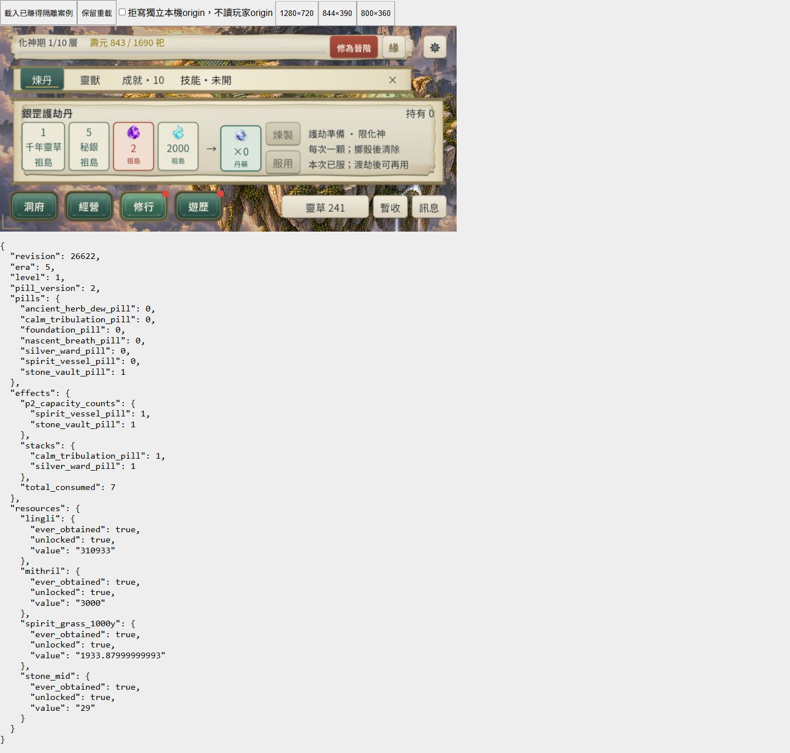
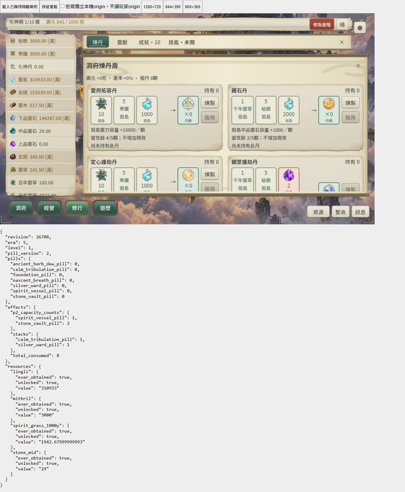

# CONTENT-P2-PILL 整批收尾

2026-10-25。使用者明確回覆「接受八圖、卡片與目前節奏」。八圖／卡片／整合節奏 ACCEPTED；**CONTENT-P2-PILL DONE（L3／有界桌面 Web）**。長時間停留另觀察到 WebGL 異常，保留未解限制；此結案不代表長時穩定性通過。

沿用 [PILL-1 核心與保存](content-p2-pills-core.md)、[PILL-2 八圖／卡片／合法流程](content-p2-pills-ui.md)。方案 V、R46 時間、schema5／pill_version2／core-flow-21-content-p2-pills 保持。已賺得元嬰快照至煉虛的代表流程仍屬模擬時間證據，非空白新檔或瀏覽器自然一生。

本輪先以 `python tools/pill2_closure.py backup` 備份並驗證 10072 份既有 JSON，才更新兩份八圖 manifest 與 proposal 的接受 metadata。大量既有 dirty 工作保留；測試改寫的既有報告須先封存再逐位元復原。新增 `pill2_closure.py`／`pill2_closure_fixture.gd`／`pill2_closure_server.py` 為收尾工具；只重封已賺得化神快照 envelope 時間，必須讀回 state_equal=true。

L3 選取先 `tools/run_all_runners.ps1 -Full -List`，125 支唯一 runner；正式執行 `-Full -Parallel 3 -TimeoutSeconds 1800`。1800 秒限時依既有逐秒供給／修行流程（單支曾超過 1187 秒）與並行負載設定，非把逾時算通過。引擎版本已確認 `4.7.2.stable.official.ed1daf0bf`。原始命令、exit 與各 runner stdout／stderr 留在 [本輪證據目錄](artifacts/content-p2-pills-closure/)。

正常 Web preset（custom_features 空白）候選輸出 `build/web-content-p2-pills`，不覆寫 `build/web`。壓縮採既有 `node tools/prepare_web_compression.mjs build/web-content-p2-pills`，驗 Brotli 往返與四首 BGM companions。桌面三橫式 1280×720／844×390／800×360 以本輪候選、真實滑鼠及獨立 origin 48472 驗證，拒寫 hook 只在測試殼；不改正式匯出檔。

最初 nested PowerShell 命令的 `$LASTEXITCODE` 被外層展開，解析報空管線且未啟動 runner；已改直接在當前 PowerShell 執行。保留此失敗，不算完成的全量驗收。讀取程序詳情的 CIM 因沙箱拒絕，未修改權限或終止其他程序。

## 最終 L3 與補驗

| 範圍 | 實際結果 |
| --- | --- |
| `tools/run_all_runners.ps1 -Full -Parallel 3 -TimeoutSeconds 1800`，PowerShell 7 正常主機 | **原命令 exit1 保留**；125支中123初跑通過，八丹UI串行重試通過，技能核心串行仍失敗 |
| `-Only 'content_p2_pills_ui_runner.gd,content_p1_pills_ui_runner.gd,m3b_alchemy_ui_runner.gd' -Matrix full -TimeoutSeconds 180` | 修正後三支全尺寸通過；八丹288項／failures=[]，原始 stdout／stderr 已封存 |
| `-Only 'sks_p2_core_runner.gd' -Matrix full -TimeoutSeconds 180` | 補驗 exit0、81項通過，保留原初跑及串行失敗 |
| 正常候選最終匯出／壓縮／重新封裝快照 | 均 exit0；SaveCodec讀回 `state_equal=true`，Brotli往返、四BGM companion hash均驗證 |
| `python tools/subset_game_fonts.py --check`／`python tools/compile_r46_content.py --check` | exit0；沒有重建字型或調整R46 |
| `python tools/pill2_closure.py audit` | 最終 **410項、failures=[]**；首次失敗稽核另存 |

合併 **125／125 唯一 runner 最終通過**；不是一次全綠的 Full 命令。L3 後僅補受影響項，沒有再跑一輪全量。各支最終成功 raw stdout／stderr 逐一檢查，沒有把 SCRIPT ERROR 或 timeout 算通過。最長供給合法流程1338.3秒、八丹代表流程527.6秒；新流程仍64項，天賦合法流程322.1秒。詳細結果見[交付稽核](artifacts/content-p2-pills-closure/delivery-audit.json)、[完整命令](artifacts/content-p2-pills-closure/full-command.log)及其 `logs/`。

## 實際修正

`src/presentation/alchemy_panel.gd`：初次完整尺寸驗收發現短橫式卡高184–211px，但捲動區只有162／132px，部分44px按鈕無法完整進入視區。短式P2卡改容器並排：左材料／圖／動作、右三行效果與原因；四材料銀罡卡分配較寬材料列。保留16px正文、44px動作、已接受八圖、正式資格與完整TIP。寬式保持原上下資訊；P1／舊丹只沿既有布局。沒有改命令或數值。

第一版並排未保留HFlow寬度，材料被壓成直列；第二版剩四材料卡過高；第三版因推斷Variant缺明確bool而編譯失敗，runner180秒逾時。均保留失敗，不放寬高度／可達斷言。補明確bool與四材料寬度後三UI三尺寸通過，並重新匯出本次候選。

`tests/sks_p2_core_runner.gd`：原兩項斷言固定要求 `TALENT_RULES_VERSION`，但正式新狀態已為pill_version2。改精確要求v2／`PILL_RULES_VERSION`／literal core-flow-21，保留SKS literal core-flow-19歷史常數及其餘81項付款／技能／保存檢查；沒有修改SaveCodec或正式規則。

## 桌面 Web 滑鼠與證據邊界

正常候選、獨立origin48472、IAB。外層1400×850只作工具容器，玩法使用遊戲內捲動。目標iframe1280×720／844×390／800×360；桌面scale1.25下canvas CSS實測 **1280×720／844×389／800×360**，backing1600×900／1055×487／1000×450。844容器390但canvas整數捨入為389，不能冒稱精確390或高DPR實機通過。原生CLI三尺寸仍為精確1280×720／844×390／800×360。

三版型新圖／效果可讀，800最短式銀罡四材料、三行護劫限制與兩顆按鈕完整可見。真實滑鼠藏石煉製持有0→1；之後服用拒寫進入全域保護，再次拒寫重試，落盤維持持有1／擴容計數1／總服用7。恢復寫入後只保存同份候選，重載仍持有0／計數2／總服用8，卡片「當世餘3/5顆」，中品靈石現貨29未增加。CloseSeal真實點擊返回洞府。正常時鐘持續，材料與revision可能自然變化；本輪不宣稱暫停精確付款差值，精確成本沿PILL-1／PILL-2既有證據。

[逐項狀態與尺寸](artifacts/content-p2-pills-closure/browser-observations.json)、[console原文](artifacts/content-p2-pills-closure/browser-console.json)。最初read-only DOM評估直接跨iframe讀contentDocument不可用，改frameLocator讀canvas；沒有注入或改遊戲狀態。

## 未解限制與原失敗

首個頁面於03:30載入後停留數小時，09:02:57（UTC 2026-10-25T01:02:57.972Z）出現 **RangeError: Invalid array length**，stack為`genObject`／`_emscripten_glGenVertexArrays`，畫面停止更新。煉製已落盤，但當時畫面仍顯示舊持有0，後續點擊不能算有效服用。已保存原文；從同一落盤案例重新載入後，才完成上述拒寫／恢復／重載流程。根因未定位，不能歸因GPU／驅動／本次UI，也**不能稱長時穩定性通過或已修復**；本批為有界功能收尾，未執行FPS或長時穩定性修復。此限制保留於交接與最終回報，不刪除先前L2 MutationObserver歷史。

沙箱初輪核心／保存已通過但其餘未完成，主動停止，正常主機啟動後才完成125支範圍。沙箱暫存目錄無法從正常主機讀回，只有當次擷取摘要，不假稱完整raw已封存。Windows PowerShell5對UTF-8無BOM中文regex誤解碼，第二次嘗試中斷；改現有PowerShell7，無更新環境。所有可取得正常主機原始日誌均封存。

第一次證據復原在沙箱遇到 `Invalid argument` 寫入錯誤，部分已復原；正常主機重試完成，最後由generated-flat反推累計 **62份**差異，避免漏計較早完成部分。10072份起點JSON中，1份art manifest為明確接受更新，其他 **10071份逐字一致**。第一次交付audit將空`LASTEXITCODE`要求為0而失敗，保留 `delivery-audit-initial.json`；改採實際exec程序exit0與raw runner PASS雙證據，空檔不被冒稱為0，最終410項通過。

測試殼favicon404、既有RID／ObjectDB／CanvasItem退出診斷、故障注入與上述失敗保留，不稱日誌零錯誤。驗收tab已關閉、viewport override已清除，自建服務Ctrl+C停止（exit1為主動終止）。896份候選來源／資產hash核對一致。未改玩家進度，未commit／push。

## 修改檔案與交接

本輪修改AlchemyPanel短式容器與SKS核心舊斷言；兩份八圖manifest、proposal及狀態文件只更新接受／收尾metadata，原圖／prompt不變。新增 `tools/pill2_closure.py`、`pill2_closure_fixture.gd/.uid`、`pill2_closure_server.py`、`run_pill2_closure.ps1`、本驗收與本輪證據。`README.md`、`ROADMAP.md`、docs25／docs37、ai-handoff／development-status及`updata.txt`同步交接。`pill2_delivery`欄位保留前輪L2歷史，最新結果以`closure`與此報告為準。

依Context Guard停止本階段；下一大型任務由使用者於New Chat指定，不自動開其他P2／P3，不重問V或美術接受，不為metadata重跑L3。未解WebGL長時停留問題保留為獨立後續可指定範圍。
