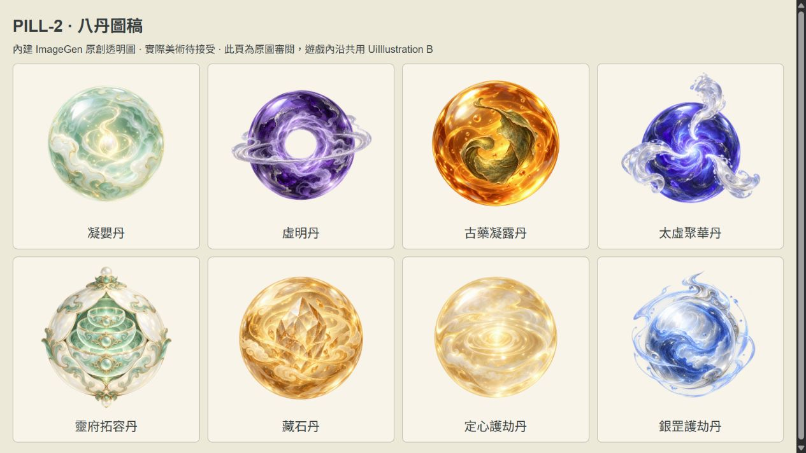
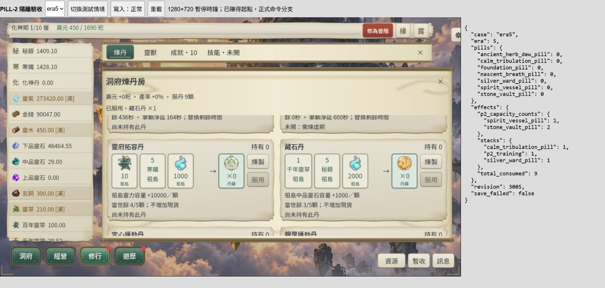

2026-10-25 更新：使用者已接受八圖、卡片與目前節奏，整批L3／有界桌面Web收尾完成；短橫式卡另修正過高。見[收尾驗收](content-p2-pills-closure.md)。下方待接受與未L3為當時狀態。

# CONTENT-P2-PILL / PILL-2 八卡、八圖與代表合法流程

2026-10-25。**PILL-2 技術交付（L1／有界L2，桌面1280×720）；整批 IN_PROGRESS，八圖／卡片／整合節奏待人工接受。** 承接[核定V](../37-content-p2-pill-design.md)與[PILL-1](content-p2-pills-core.md)，沒有改配方、數值、Era7開放或保存版本。未執行L3，未commit／push。

## 交付

- 正式煉丹房保留20丹順序，八新丹接獨立透明圖與共用 `UiIllustration B`。卡片讀正式 `can_refine`／`can_consume`／`p2_preview`，顯示共享計數、當級實得／捨棄、指定島／資源×1.5、剩餘／淨延、當世擴容剩餘次數及護劫淨增。已服／境界不符等狀態不再顯示可以再次增加機率的預覽。
- `AlchemySystem.get_view` 補正式煉製拒絕原因；preview補唯讀當前概率欄，沒有改命令判斷或公式。八卡將版本／供給／當世境界／指定庫／開島／缺料／無效果／滿次數原因翻為繁中。容量與護劫沒有假倒數。
- 卡片沿共用紙面、黑體、CloseSeal、44px動作、材料TIP與內捲。新丹材料磚常駐必要費用，精確持有量留TIP；沒有專圖的材料保留完整名稱而不留空圖框。無新增分頁或共用樣式。
- 內建ImageGen逐張生成八張原創RGBA候選；原稿與runtime逐位元相同，沒有去背、裁切或縮放。完整prompt、來源路徑、SHA256、用途、切層、權利界線見[manifest](artifacts/content-p2-pills-ui/art-manifest.json)與[prompts](artifacts/content-p2-pills-ui/prompts.json)。**PENDING_USER_ART_ACCEPTANCE**，不冒稱人類美術接受或第三方商用授權。runtime為 `assets/ui/pills-painted/<八ID>.png`，原圖為本驗收目錄 `<八ID>-original.png`。
- 新增兩支runner、隔離驗收scene／feature／export preset／`dao2_pill2_acceptance_era4|era5|era6` namespace、本機工具與資產審閱頁。HTML只作測試容器／觀測與原圖審閱，正式核心仍為Godot。
- Sans／Serif runtime子集補本次中文；字型來源未改。原有工作區大量未提交變更保留。

## L1／有界 L2

Godot本機 `4.7.2.stable.official.ed1daf0bf`；現有同版模板、Compatibility、單執行緒Web。每組先 `-Only ... -List`；沒有 `-Full`，沒有完整尺寸矩陣。五支唯一runner最終分段通過，**不是一次全綠命令或全量回歸**。

| 命令／範圍 | 結果 |
| --- | --- |
| `tools/run_all_runners.ps1 -Only 'content_p2_pills_ui_runner.gd,content_p2_pills_runner.gd,content_p2_pills_save_runner.gd,content_p1_pills_ui_runner.gd'` | 原命令exit1：新UI在圖資接入前缺圖／卡高失敗；核心560、保存484、P1 UI34 checks通過 |
| `-Only 'content_p2_pills_ui_runner.gd'` | 圖資接入後仍有4項高度失敗；調整新丹材料常駐費用／TIP及空圖框後最終exit0，96 checks／failures=[] |
| `-Only 'content_p2_pills_flow_runner.gd' -TimeoutSeconds 1800` | exit0，64 checks／failures=[]，465.6秒；這支含約46,490模擬秒的逐秒供給／修行，合理單支長測試；初次兩個參數型別／缺參數失敗保留 |
| Godot `--path . --resolution 1280x720 --script res://tests/content_p2_pills_ui_runner.gd` | 最終exit0，96 checks；八張原生圖已核對，[最終原生日誌](artifacts/content-p2-pills-ui/native-final.log) |
| `python tools/prepare_pill2_art.py` | exit0，8張RGBA／透明alpha0–255／原圖與runtime hash相同 |
| `python tools/subset_game_fonts.py`，再 `--check` | 最終exit0；初次check缺4字及一次Serif寫入錯誤保留，下次同命令成功，無環境更新 |
| Godot `--headless --path . --import` | exit0，[匯入日誌](artifacts/content-p2-pills-ui/import.log)；既有退出診斷不算零錯誤 |
| `--headless --path . --export-release Pill2Acceptance build/pill2-acceptance/index.html` | 初次與補namespace後最終皆exit0；局部L2測試包，非整批候選交付，[最終匯出](artifacts/content-p2-pills-ui/export-final.log) |
| `python tools/prepare_pill2_review.py` | exit0，八圖審閱HTML與四首BGM companion；不改PNG或Godot匯出核心 |
| `python tools/pill2_delivery_audit.py --restore`，再無參數稽核 | exit0，64項靜態／證據稽核通過；三份既有JSON與開始時副本hash相同，實際無需覆寫 |
| `git diff --check -- <本次相關來源／設定>` | exit0；保留Git換行提示，不擴為所有既有dirty來源檢查 |

原始失敗與通過日誌在[logs](artifacts/content-p2-pills-ui/logs/index.json)。先前沙箱Godot無法寫 `user://logs`；正常授權工具重跑，沒有改玩家進度。初次沙箱raw未能讀回，保留工具輸出摘要；不假稱完整raw已封存。

L2範圍理由：同一丹藥功能含View／共享圖示／保存依賴／合法供給流程及桌面滑鼠；仍只選五支，沒有擴為全量。

## 代表合法流程

實際來源 `docs/verification/artifacts/content-p2-supply-3/earned-era4.json`，本輪SHA256 **3f2e0a61853c01b465075df67c0e4088b84073572f2b531dfa3df11f751112b8**。這是開始時已存在的dirty工作區版本，以本次hash為準，不冒稱與TALENT-2文件的較早hash相同。本輪未覆寫來源。以專用 `user://pill2-earned-flow` 經SaveManager原文歸檔／候選保存正式遷移，再送Session命令；不注入資源、境界、修行、年齡、技能、seed或roll index。

從元嬰1層、無技能、年齡12,753秒，連續前進至煉虛，結尾59,243秒。供給driver遞迴籌料、正式加工與回運、建庫／開島／調度、自然時間修行及晉階。全部八ID均正式煉製與有效服用；定心在元嬰與化神各一次，合計9次。至少太虛丹鏈明確經開太虛島→地方自然採集／回運→上石加工→太虛聚華丹煉製／有效服用→再採集／回運虛華→虛明丹有效服用；不是合成資源fixture。

- 凝嬰首服實得614.4秒、捨棄285.6；虛明首服實得844秒、捨棄956。跨境實際擲骰後共享計數已清，境內只補當級缺口。
- 元嬰→化神在年齡26,663秒，以正式73%成功；化神→煉虛在58,623秒，以正式68%成功。既有seed/index沿來源，不為成功重設；擴容保留，準備旗標隨實際渡劫清除。
- 兩採集丹均有效服用，兩擴容丹各一次，供給／付款與主線交叉可達。更細的600秒邊界、滿庫、倍率乘區、失敗降境及拒寫不重抽沿本輪核心560／保存484與PILL-1既有證據，不把此成功分支冒充失敗分支。

[64項流程／用丹receipt／等待／渡劫trace](artifacts/content-p2-pills-ui/flow.json)、[元嬰](artifacts/content-p2-pills-ui/earned-era4.json)、[化神](artifacts/content-p2-pills-ui/earned-era5.json)、[煉虛](artifacts/content-p2-pills-ui/earned-era6.json)。這是**沿用合法快照、模擬時間的代表流程**；不是本輪空白新檔全程、瀏覽器自然時間一生或完整煉虛十層，也不代替人工節奏接受。

## 桌面 Web 真實滑鼠

當次來源、隔離loopback4472、IAB；Godot iframe觀測 **1280×720**，外層視窗只容納開發工具。遊戲時鐘在harness暫停，啟動／拒寫恢復／重載依法補等待時間，因此資源、壽元與revision可增加；不把這些增加誤作重服。fixture逐位元複製本輪合法流程快照。

- 化神真實滑鼠煉凝嬰：百草100→90、秘銀1412.1→1410.1、靈力267081→266081，持有0→1；服用後0、共享計數1，當級功滿。
- 煉藏石：千草25.72→24.72、秘銀1410.1→1405.1、靈力266081→264081；拒寫時服用持有1→0、擴容計數1→2、總服用8→9。再次拒寫重試仍同結果；恢復只保存同候選，重載仍計數2、未多服、未二次扣費，中石仍29，沒有因增容送現貨。
- 古藥兩次實際煉製（其中一次原打算服用，卡片訊息改高後點到煉製，依實際狀態記為第二次煉製），後正式服一顆：持有2→1，剩411→600秒、淨延189秒；再次實點無淨延禁用按鈕，持有／revision不變。
- 煉虛合法分支顯示兩張高階圖／共享計數／太虛餘598、淨延2秒；護劫Era限制與八圖載入分別由View／原生及Web觀測核對；共用CloseSeal真實點擊返回洞府。

[原始觀測JSONL](artifacts/content-p2-pills-ui/browser-states.jsonl)、[64項交付稽核](artifacts/content-p2-pills-ui/delivery-audit.json)、[來源／測試包hash](artifacts/content-p2-pills-ui/web-manifest.json)。拒寫重試期間相同觀測由工具列去重，重複按下的證據是當次工具操作與不變畫面，不冒稱JSONL每一行都代表一次點擊。

早期服務未啟動／沙箱loopback不可達及第一次忘加namespace分支，使專用新origin的預設namespace顯示空白新檔；已補隔離feature並重匯出，之後才採上述付款證據。無覆寫既有玩家origin。早期BGM companion未複製出現404，準備四首後觀察01曲HTTP200；不宣稱四首人工試聽。本輪console保留一筆無來源URL的MutationObserver.observe TypeError與早期BGM警告，不稱零錯誤；見[原文](artifacts/content-p2-pills-ui/browser-console.json)。原生另保留Font RID／CanvasItem／ObjectDB退出診斷。

## 修改檔案與停止點

來源：`src/presentation/alchemy_panel.gd`、`resource_icon.gd`、`src/simulation/alchemy_system.gd`（唯讀View欄）、`src/abode/living_abode.gd`（驗收feature namespace）；字型runtime與manifest；八PNG／import／manifest。測試：兩支 `content_p2_pills_*` runner與UID、P1 UI數量斷言、固定runner登記；`src/verification/pill2_acceptance.gd/.tscn`與三份earned JSON；project／export隔離設定。工具：`prepare_pill2_art.py`、`prepare_pill2_review.py`、`pill2_acceptance_server.py`、`pill2_delivery_audit.py`；設計metadata、README／ROADMAP／交接／狀態及英文checkpoint。

隔離驗收分頁已關閉、暫時viewport已恢復，4472自建服務以Ctrl+C停止（exit1為主動終止）；失敗連線頁由本輪暫時分頁清理。未跑L3、全尺寸或FPS，未交付正常release候選、未改正式玩家進度、未commit／push。觸控與實機延期，非當前阻擋。八圖／卡片與整合節奏仍待人工接受，整批保持IN_PROGRESS；接受後才做同批唯一L3收尾。依Context Guard完成交接後停止，下一New Chat先接受／具體修訂，不重問V，不開其他P2／P3。
