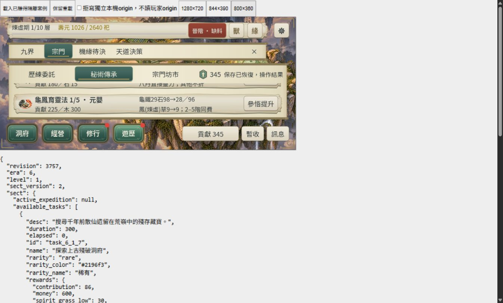
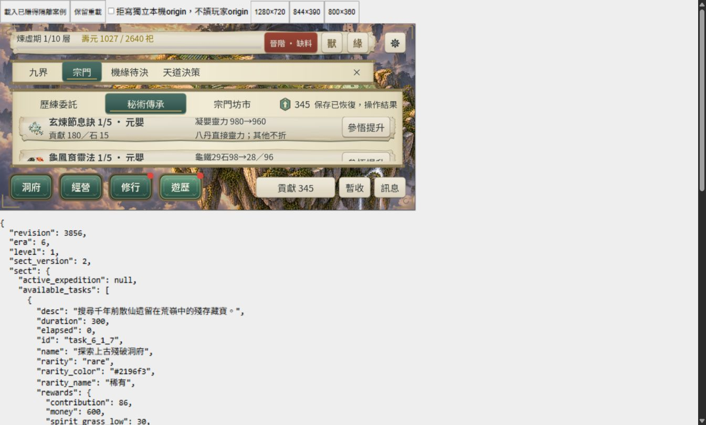
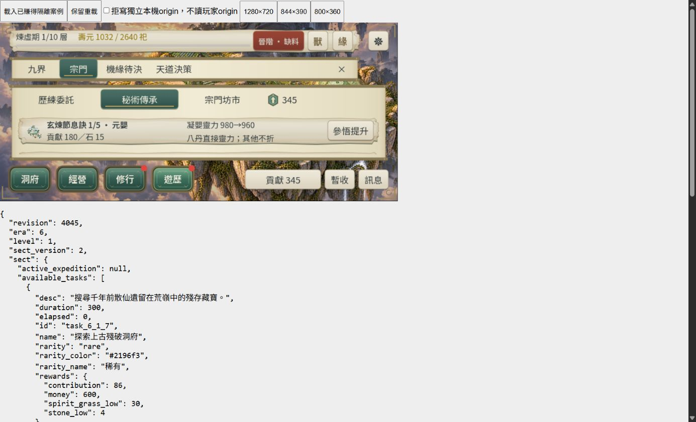

2026-10-26最終結果：**CONTENT-P2-SECT DONE（L3／桌面Web有界）。** 交付稽核1350項／failures=[]；129／129唯一runner最終分段通過。原Full exit1、五支補驗exit1與1800秒供給逾時永久保留。

最後兩項已完成：前次1968.2秒供給通過的沙箱raw logs已不存在，搜尋後未找到副本；未偽造或重建原日誌，改以同來源L2單支3600秒watchdog補驗（承接既有L3收尾），實跑1474.4秒、exit0、94項通過，stdout／stderr直接寫入專案persistent-temp，再封存至logs。原command與earned-flow結果保留。本輪沒有重跑Full、Web匯出或重問美術。4支驗收工具語法靜態檢查通過；逐項操作／失敗見final-two-actions.json。

最終18px正常候選於隔離origin 127.0.0.1:48474實際滑鼠補驗。1280×720／844×390／800×360 iframe，canvas CSS實測1279×719／843×389／799×359，backing與目標尺寸一致。兩法標題／成本／效果／44px操作可達、火鳳9→9平台可讀；615→495首學、第二法拒寫與拒寫重試磁碟仍495／一法一階，恢復後345／兩法一階，重載保持345／兩法一階。正常時鐘啟用，不宣稱木材精確差額；兩商品故障矩陣沿2026-10-25有效L2證據。24項瀏覽器稽核、9張原始JPEG截圖／逐項狀態／包hash見browser-final-18px.json與browser-final18-observations.json；舊final-web-*截圖為16px歷史，不能作18px證據。本輪IAB截圖恢復，沒有使用Windows原生輸入。

5955份起點清單，5954份原檔核對，76份測試差異先封存後復原；接受metadata保持。原始失敗、截圖故障與長時WebGL RangeError留存；長時穩定性／FPS未通過。未改玩家進度、正式規則、PNG，未commit／push。下方為原始驗收過程與歷史限制。





2026-10-26收尾續作：**CONTENT-P2-SECT仍IN_PROGRESS，目前僅剩供給raw logs補驗完成與交付audit。** 最終18px正常包桌面三橫式、兩法615→495→345、拒寫／再次重試／恢復／重載已補驗，24項瀏覽器稽核／9張原始JPEG通過。前次供給sandbox日誌目錄已不存在，已知暫存位置搜尋無副本；原1968.2秒exit0／94項結果保留，僅重跑該支至專案persistent-temp與隔離輸出，不跑Full。901份來源hash與5955份起點清單仍一致，76份先前差異封存復原保持。未玩家進度／commit／push，待單支結束後封存logs、audit再finalize。下方為歷史。

2026-10-26最新核對：授權還原已exit0，76份測試差異先封存後復原，基準核對通過；再次交付audit1332項僅剩供給補驗raw logs封存與最終18px桌面瀏覽器證據兩項未通過，仍IN_PROGRESS。未重跑全量或重問美術。

# CONTENT-P2-SECT 整批收尾

2026-10-26狀態核對：**仍IN_PROGRESS。** 五支補驗四支通過、供給1800秒逾時；後續單支供給以3600秒上限實跑1968.2秒、exit0，94 checks／failures=[]。129支已有分段通過紀錄，非單次Full全綠；未再跑Full或要求美術接受。`sect2_closure.py logs`完成，但供給補驗sandbox temp原始log路徑目前不可讀，命令摘要與isolated-supply-complete/supply3-flow/earned-flow.json保留。restore首次因既有rules.json寫入失敗，已重啟授權還原，完成狀態須看restored.json。本輪audit1332項仍失敗：供給raw logs、基準復原、最終18px瀏覽器證據。未finalize、未DONE。下方2026-10-25「補驗仍執行中」為歷史。

2026-10-25續作交接：**IN_PROGRESS，未整批DONE。** 使用者已接受兩圖／卡片／節奏；L3主輪127/129最終通過（原Full exit1），供給／SKS與三UI隔離補驗仍在執行。最後依規範將短式卡題由16修正至18px，三支宗門UI全尺寸補驗exit0、重新匯出／重新壓縮exit0；最終18px包尚無真實瀏覽器視覺補驗。IAB截圖失效，Windows Computer Use安全檢查無法可靠辨識網址而停止操作；未繞過、未捏造通過。先前16px候選三橫式截圖僅作歷史，不能當18px最終證據。測試產物尚未復原、交付audit／finalize未執行；需待隔離補驗結束再封存／復原。不得再跑Full。

2026-10-25。使用者明確回覆「接受現版兩圖、卡片與目前節奏」。沿方案 W、正式 8 功法／30 委託模板／8 商品與 sect_version 2；兩張 PNG／原圖／prompt 保持。**本頁驗收尚在收集，完成狀態以最上方最終結果為準。**

## 交付範圍與修正

- 兩份 art manifest 及方案 JSON 記錄人工接受。正式費用、收益、Era 條件、R46 時間、schema5／core-flow-22 不變。
- 正常 Web 抽驗發現短式正式工作區比獨立 UI runner 小，兩法需來回捲動才能讀完整。SectPanel 的短式 P2 功法改為圖、標題／成本、兩行效果、按鈕橫向分區；P2 商品縮短重複文案，終身次數仍在標題。最短式正文16px／標題18px、按鈕至少44px，完整效果與限制保留 TIP；寬式仍用原圖與完整文案。18px最終版僅三支CLI全尺寸通過，Web仍待補；先前16px截圖不可冒充。未新增共用視覺規則。
- 新 UI runner 使用扣除正式 HUD／功能分頁／Dock 的短工作區（844 對應160px、800對應130px高）；驗證卡片完整容納、44px及按鈕全命中。首修不足與尺寸實測失敗保留，第三版190項通過，最終再補三支宗門 UI。
- 前世回聲兩處合成短委託補上穩定 ID，符合既有 SectSaveContract；不放寬正式驗證。供給長流程支援 `DAO_TEST_STORAGE_ROOT` 隔離輸出，避免覆寫既有證據時寫入失敗。
- SKS 核心的舊 pill 規則斷言在主輪失敗；工作區現有兩項斷言已更新為精確 sect_version2／core-flow-22，仍保留 pill／SKS 歷史常數與81項其餘契約，補驗最終內容，不宣稱修改正式保存邏輯。

## L3 命令與原始結果

證據目錄：[content-p2-sect-closure](artifacts/content-p2-sect-closure/)。Godot `4.7.2.stable.official.ed1daf0bf`，未更新引擎／模板。

```powershell
python tools/sect2_closure.py backup
pwsh -NoProfile -File tools/run_all_runners.ps1 -Full -List
pwsh -NoProfile -File tools/run_sect2_closure.ps1 -Step full
# wrapper: run_all_runners.ps1 -Full -Parallel 3 -TimeoutSeconds 1800
```

129支主輪 **原命令 exit1**：124支初跑通過，life_echo核心／UI及res1c2_offline串行重試通過，共127支；供給長流程與SKS核心串行仍失敗。不是一次全綠。首個沙箱嘗試因既有隔離fixture不可寫而停止，原命令與可取得raw logs另存；正常主機主輪才是完整129支覆蓋。長流程1800秒上限依既有供給／八丹／天賦模擬證據，不以逾時算通過。

精選補驗先用相同 `-Only ... -List` 確認五支，然後以獨立 `DAO_TEST_STORAGE_ROOT=res://docs/verification/artifacts/content-p2-sect-closure/isolated-final` 跑：

```powershell
pwsh -NoProfile -File tools/run_all_runners.ps1 -Only 'content_p2_supply_progression_runner.gd,sks_p2_core_runner.gd,content_p2_sect_ui_runner.gd,content_p1_sect_ui_runner.gd,uix_r9_sect_ui_runner.gd' -Matrix full -TimeoutSeconds 1800
```

另外按交接執行 `DAO_VIEWPORT_MATRIX=full` 的 `abode_presentation_parity_runner.gd`，**exit0／RUNNER_RESULT PASS**，呈現 facade／堆疊／四版型／signal／替換session／保存順序及清理通過。這不是額外全量。

原始失敗含：沙箱fixture寫入、供給既有JSON寫入、前世回聲無ID合成委託、SKS舊規則斷言、短式卡片高度／按鈕可達性；保存原stdout／stderr及SCRIPT ERROR。P1 UI一次額外補驗69項無邏輯失敗，但報告檔無法寫入而正確判失敗，後續改隔離報告。既有anchor／Font RID／CanvasItem／ObjectDB退出診斷不被稱為已修。

## 正常 Web 候選與桌面滑鼠

`run_sect2_closure.ps1 -Step export`：Godot正式 `Web` preset → `build/web-content-p2-sect/index.html`，exit0；修正短式後重新匯出。`-Step compression`：現有 `prepare_web_compression.mjs`，exit0，三核心檔Brotli roundtrip及四BGM companions核對。正常包排除驗收fixture，不以隔離 Sect2Acceptance 包冒充正常候選。`-Step rebase` 只重封已賺得 `sect2-era6.json` 的保存時間，`state_equal=true`，不補貢獻／材料／境界。

本機服務 `python tools/sect2_closure_server.py` 只綁127.0.0.1:48473，外層工具列／摘要方便觀察；遊戲用內部捲軸。起點與故障只在獨立origin，未讀玩家origin。

| 證據 | 真實滑鼠／實測結果 |
| --- | --- |
| 本輪正常候選，短式修正前 | 兩法首學貢獻615→495→345。龜鳳首學拒寫時磁碟仍495／僅玄煉1階；再次重試仍相同；恢復後磁碟345、兩法各1階，重載仍345。畫面全域保存保護及恢復提示有PNG。正常時鐘啟用，木材自然增長，不能稱暫停精確扣料 |
| 最終修正版正常候選 | 1280／844／800目標iframe，兩卡圖、標題／成本／當前→下階、火鳳9→9平台與44px動作可見；800玄煉／龜鳳可分別完整捲入，商品門檻與終身0/10可見。重載既有兩法仍1階／345，未重新學習 |
| 同日既有SECT-2 L2 | 元嬰／煉虛兩分支，兩商品拒寫／拒寫再試／恢復／重載不重扣及返回／重開，18項稽核、38份觀測、15圖；[原始證據與精確費用](content-p2-sect-ui.md)。本輪規則／交易程式不改，保留同日有效證據，未冒稱最終正常包重做完整兩商品矩陣 |

本輪實測canvas CSS **1279×719／843×389／799×359**，backing **1280×720／844×390／800×360**。記錄實際桌面縮放／捨入差異，不冒稱CSS精確目標或實體高DPR驗收。[逐項觀測](artifacts/content-p2-sect-closure/browser-observations.json)。




Windows computer-use fallback先遇list_apps逾時、重試可讀，Chrome視窗最小化；恢復後安全管線無法可靠辨識瀏覽器URL，工具明確停止本輪Computer Use，未再發桌面輸入。沒有在Chrome開驗收頁或取得原生截圖。

續作時IAB截圖API返回 `Unable to capture screenshot`，新分頁、重設尺寸及visibility亦無法恢復；warn/error查詢空，不代表零錯誤。未靠盲點或直接呼叫Godot函式補做購物。上述最終三尺寸截圖已在問題前實際保存；之後未完成的購物重做不算新證據。沙箱localhost曾EACCES／逾時，正常主機新分頁可達；失敗頁的data URL policy拒絕保留，不繞過安全限制。

同日八丹收尾已觀測長時WebGL `RangeError: Invalid array length`，本輪未修復、未取得長時穩定性／FPS通過，不以有界功能收尾覆蓋該限制。參見[既有記錄](content-p2-pills-closure.md)。

## 保存、檔案與交接

開始前5955份可變驗收／fixture JSON逐byte備份與hash核對；先前收尾的不可變before-flat／generated-flat／logs／runs不再複製。本輪測試變動先另存，然後復原起點；art manifest為刻意接受更新。候選901份正式來源／資產hash核對，不把驗收fixture納入正常包來源。未改玩家進度、未commit／push。

修改正式來源僅 `src/presentation/sect_panel.gd`；驗收修正 `tests/content_p2_sect_ui_runner.gd`、`src/verification/life_echo_fixture.gd`、`tests/life_echo_runner.gd`、供給runner隔離輸出，另對現有SKS斷言補驗。新增 `tools/sect2_closure.py`、`run_sect2_closure.ps1`、`sect2_closure_fixture.gd/.uid`、`sect2_closure_server.py` 與本頁／證據。兩份manifest／proposal及README／ROADMAP／docs25／docs38／handoff／status／updata同步接受及交接。

依Context Guard，本批收結後停止；下一大型任務請使用者於New Chat指定，不自動開其他P2／P3，不為純metadata再跑L3。
