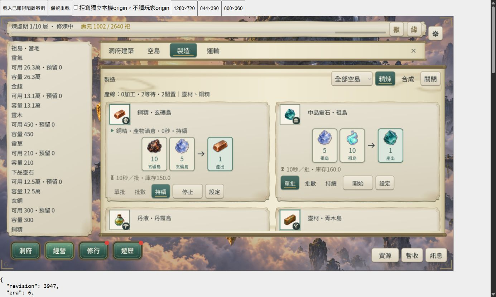

# CONTENT-P2-SUPPLY 整合回饋與整批收尾

日期：2026-10-24。使用者明確接受「接受目前節奏與 UI，完成整批驗收收尾」。本批供給人工接受及L3完成，CONTENT-P2-SUPPLY **DONE（桌面／Web有界）**。

## 範圍與接受

本次收尾限於 CONTENT-P2-SUPPLY：已核定 R46 proposal-1 的七項新資源、三座採集島、五條新增回運線、三項加工配方、九設施、Era4–6 既有修行時間與可選技能政策，以及版本化供給／容量／保存。七島／十二航線／十一配方為整合後總數。其他 P2 技能、天賦、丹藥、宗門、靈獸、敘事及新島世界美術仍屬另外批次，不把供給完成寫成 CONTENT-P2 全部完成。

人工接受與數值依據見 [closure-decision.json](artifacts/content-p2-supply-closure/closure-decision.json)、[R46 設計](../34-res1-e-46-design.md)。沿用同日 [SUPPLY-1](content-p2-supply.md)、[SUPPLY-2](content-p2-supply-2.md)、[SUPPLY-3](content-p2-supply-3.md) 的分階段證據及永久失敗紀錄。

## 本輪修改

- `src/presentation/island_world.gd`：丹霞未開拓提示接受舊D2與新SUPPLY版本，避免新版誤顯示需遷移；原世界runner的「Era3 pending opening visible」失敗保留，由完整命令自動串行重試驗證。
- `tests/content_p2_supply_ui_runner.gd`：三尺寸各自重設新增航線的一級起始設定。原測試在1280升到三級後，844／800還斷言一級，造成20項失敗。正式航線規則、費用、UI與保存行為未改。
- `tests/mfg3_inline_runner.gd`：舊D2診斷fixture先經正式 `prepare_supply()` 再接新版製造UI，並對decode／遷移失敗提早退出。原測試直接放入缺新增資源的舊狀態，發生 refined_iron key SCRIPT ERROR 後協程停住；本輪核對唯一所屬程序後終止該停滯程序，保留原stdout／stderr並由全量自動串行重試。
- `tools/supply_closure_review_server.py`：候選包專用 loopback 審閱服務，明確三尺寸、已賺得 fixture 與可切換拒寫；沿用正常 Web 保存命名空間但以獨立 origin 隔離玩家資料。
- `tools/supply_closure_audit.py`：封存本輪原始 stdout／stderr、另存新測試輸出並復原既有 JSON 證據，核對全量 runner、候選檔案與人工接受。
- 本報告、接受 metadata、README／ROADMAP／交接／狀態／docs25／docs34 及英文 checkpoint 更新；開始時正式 runtime/content 相較 SUPPLY-3 雜湊無差異，最終僅上述丹霞狀態文案版本判斷修復，見 [source-reuse-check.json](artifacts/content-p2-supply-closure/source-reuse-check.json)。

## L3 驗收命令與結果

```powershell
.\tools\godot\4.7.2\Godot_v4.7.2-stable_win64_console.exe --version
powershell -NoProfile -ExecutionPolicy Bypass -File tools/run_all_runners.ps1 -Full -List
powershell -NoProfile -ExecutionPolicy Bypass -File tools/run_all_runners.ps1 -Full -Parallel 3 -TimeoutSeconds 1500
.\tools\godot\4.7.2\Godot_v4.7.2-stable_win64_console.exe --headless --path . --export-release Web build/web-content-p2-supply/index.html
node tools/prepare_web_compression.mjs build/web-content-p2-supply
python tools/compile_r46_content.py --check
python tools/subset_game_fonts.py --check
python tools/supply_closure_audit.py --archive-generated
python tools/supply_closure_audit.py
```

引擎實測 `4.7.2.stable.official.ed1daf0bf`。Full registry 為116支，`DAO_VIEWPORT_MATRIX=full`，並行3。1500秒上限因本批合法逐秒長流程既有約1122秒，且既有48h／全尺寸測試超過45秒，不把原逾時當通過。

**全量最終結果：exit0，116／116唯一runner最終通過。114支initial通過，丹霞世界59項與製造66項serial-retry通過；供給UI三尺寸170項通過。完整供給長流程1380.8秒，94項／failures=[]，已自然壽盡輪迴。** 原始預覽與命令見 [本批證據](artifacts/content-p2-supply-closure/)。首輪沙箱命令因 user:// 初始化受阻而中止，保留 `full-sandbox-interrupted.log`；其中供給UI尺寸共用狀態失敗已修正，故事UI `formal UI initialized` 失敗保留。隨後正常主機權限執行完整L3，不將中止輪改寫為成功。正常權限的供給UI三尺寸170項及故事UI已通過；正式log保留兩支initial失敗及修復後serial-retry；不能寫成初跑全綠。原mfg3停滯程序經核對後終止，其原SCRIPT ERROR確實落盤。成功嘗試仍有既有RID／ObjectDB等退出診斷，未聲稱全部日誌零錯誤。

候選 `build/web-content-p2-supply` 匯出 exit0；Brotli壓縮往返與四首BGM companions exit0。核心壓縮合計90,920,558 bytes，BGM另計。R46編譯一致性與現有兩字型覆蓋檢查 exit0；沒有更新引擎／模板或重建字型。正式 `build/web` 未作為本次匯出目的地。

## 同候選桌面瀏覽器

本輪實際滑鼠使用 IAB／`127.0.0.1:48450` 獨立 origin；外層1400×840只作測試容器。Godot canvas backing實測1280×720、844×390、800×360，對應CSS內框1279×719、843×389、799×359，保留此1px差異，不宣稱CSS精確等於backing。三尺寸皆以遊戲內捲動操作，外層JSON觀測區的瀏覽器捲軸不作遊戲版面替代。

- 1280：七島分頁、寒銀地方容量300、採集專島／無工坊／未開世界入口、管理清單與製造11配方呈現可讀。
- 844：製造／運輸內捲；滑鼠啟動中品靈石量產，祖島工作實際消耗材料並完成，正式產物庫存60→160。寒鐵回運一→二級，顯示權威10靈材＋10銅精費用。
- 800：七島下拉可選太虛，地方容量300與調度已建可讀；寒鐵二→三級拒寫進保護層，保存資料仍二級；取消拒寫後點原地重試，恢復保存，重載仍三級、enabled=true、reserve=0、target=3000。短式保存／升階動作可經內捲到達，未縮字或縮命中區。
- 候選觀測期間 console warn/error 查詢為空。丹霞文案修復後重新匯出／壓縮並補三尺寸抽驗，最終包仍保存中品靈石160／寒鐵三級；`web-final-*`截圖對應最終候選，較早操作圖對應只差此文案判斷的前包。已賺得Era6 fixture由正式codec重封UTC，`REVIEW_REBASE state_equal=true`；不是灌入資源或本輪瀏覽器自然修行長跑。首個瀏覽器工具初始化逾時，重連後成功；未修改防火牆或安全設定。
- 十一張關鍵畫面、尺寸與重載資料見 [web-observations.json](artifacts/content-p2-supply-closure/web-observations.json)。驗收分頁已關閉、viewport覆寫已reset，本輪loopback服務核對命令列後停止。



## 流程、保存與證據保留

原SUPPLY-3合法舊子版本無技能路徑為已賺得Era3起點4783秒 → Era4 12183 → Era5 26963 → Era6 58903 → Lv10 150253 → 158400壽盡輪迴。玄龜為Era4合法分支實料餵養，火鳳為Era6主線實料餵養；三次既有seed渡劫皆成功不推論所有玩家首世可達。原長流過早輪迴4項失敗與story0保存缺口的首次尾段失敗永久保留，原報告不改成單次全綠。本輪完整供給流程最終94項／failures=[]，三次突破仍為12183／26963／58903秒，Lv10 150253秒，壽盡158400秒後輪迴至age0；不是補尾段。新報告與完整快照另存本批 `generated/docs/verification/artifacts/content-p2-supply-3/`，原歷史檔案已逐字復原。

本輪開始前備份994份既有JSON證據／fixture；全量完成後將25份變動結果另存 `generated/` 再逐字復原既有檔，994份最終雜湊全部符合起點。所有本輪Godot程序與驗收服務已退出。沒有讀寫玩家origin／使用者進度、commit或push。既有dirty工作區保持。

## 收尾界線

供給批次人工接受與L3已完成，標DONE。最終交付稽核另見本批 `delivery-audit.json`。設計proposal的 `implementation_status: TODO` 是凍結的設計核定時點metadata；不改其原始來源雜湊與編譯provenance，當前實作狀態由本報告及closure-decision覆蓋。其他P2內容仍需逐批核定與實作；本輪不自動開新批次。完成後依Context Guard停止，英文交接追加至 `updata.txt` 最頂部，下一大型任務交由New Chat指定。
