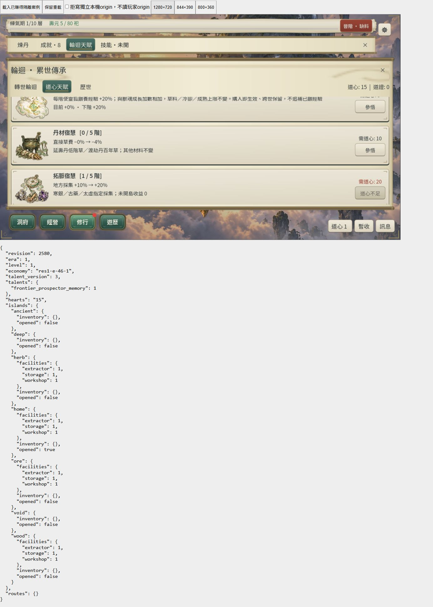
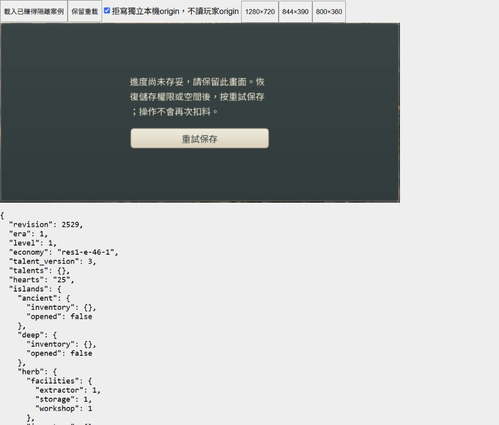

# CONTENT-P2-TALENT 整批收尾

日期：2026-10-25。使用者明確回覆「接受三圖與目前節奏」。三張圖、卡片與整合節奏已接受；**CONTENT-P2-TALENT DONE（L3／桌面Web有界）**。

## 範圍與沿用證據

限於已核定 U 的丹材／拓脈／玄靈三項五階天賦、資格與付款、保存遷移及卡片。沿用 [TALENT-1 核心](content-p2-talents-core.md)、[TALENT-2 三圖／合法路徑／桌面付款](content-p2-talents-ui.md)。10／20／40／80／160 道心、公式、schema5、talent_version3 與 rules core-flow-20 均保持。

前輪合法代表路徑是既有已賺得元嬰快照→正式時間推進至壽盡→正式輪迴25道心→三條首購比較，非當輪空白存檔或瀏覽器自然多世養成；15階共付930／餘70是明示1000道心合成預算。此次人工接受不改寫這些證據界線。

## 本輪檔案與命令

- `assets/ui/reincarnation-painted/talent2-manifest.json` 及前輪 `art-manifest.json`：記錄三圖 ACCEPTED、日期與使用者原話；PNG 及 prompt 保持。
- `tools/talent2_closure.py`：備份雜湊、原始日誌封存、測試產物另存後逐字復原、候選來源及交付稽核。
- `tools/talent2_closure_fixture.gd`：只重封既有已賺得輪迴案例的 envelope UTC，codec 讀回 `state_equal=true`。
- `tools/talent2_closure_server.py`：127.0.0.1:48471 正常候選測試殼，獨立 origin；拒寫與尺寸切換只存在殼中。
- `tests/early_v1b_talents_runner.gd`：L3發現定義總數仍停在P1六項，改為現行九項；原三項成本、效果與輪迴斷言保持，未改正式規則。原測試副本與失敗日誌另存。
- `tests/sks_p2_flow_runner.gd`：已賺得供給fixture在本輪開始時即skill_version4；測試改精確接受v3遷移與v4不變兩條合法分支，仍要求零技能、正確Era／economy與最終v4，其餘逐技能付款及拒寫斷言保持。
- README／ROADMAP／docs25／docs36／ai-handoff／development-status／proposal 及英文 updata checkpoint：接受與最終狀態。

```powershell
.\tools\godot\4.7.2\Godot_v4.7.2-stable_win64_console.exe --version
python tools/talent2_closure.py backup
python tools/talent2_closure.py reconcile
python tools/talent2_closure.py sources
powershell -NoProfile -ExecutionPolicy Bypass -File tools/run_all_runners.ps1 -Full -List
powershell -NoProfile -ExecutionPolicy Bypass -File tools/run_all_runners.ps1 -Full -Parallel 3 -TimeoutSeconds 1800
.\tools\godot\4.7.2\Godot_v4.7.2-stable_win64_console.exe --headless --path . --export-release Web build/web-content-p2-talents/index.html
node tools/prepare_web_compression.mjs build/web-content-p2-talents
.\tools\godot\4.7.2\Godot_v4.7.2-stable_win64_console.exe --headless --path . --script res://tools/talent2_closure_fixture.gd
python tools/compile_r46_content.py --check
python tools/subset_game_fonts.py --check
python tools/talent2_closure.py restore
python tools/talent2_closure.py finalize
python tools/talent2_closure.py audit
```

引擎 `4.7.2.stable.official.ed1daf0bf`。L3 完整尺寸、121支唯一註冊 runner、並行3；1800秒限時依已知供給逐秒長流程與並行負載設定。原始命令、exit、每支 stdout／stderr 均保存；最終完整命令exit0，121／121唯一runner通過：118初跑、3串行重試。不是初跑全綠；原失敗保留於日誌。

正常 Web preset、custom_features 空白，測試 fixture 不在正常包內。候選 `build/web-content-p2-talents` 匯出 exit0，Brotli 往返與四首原 MP3 companions exit0，核心 br 合計96,459,602 bytes；未覆寫原 `build/web`。R46 與字型 check 均 exit0，沒有重建字型或更新環境。

## 三橫式桌面瀏覽器

正常候選與真實滑鼠，外層1400×850作測試容器；iframe canvas backing逐一讀回1280×720、844×390、800×360。遊戲內捲動到達 P2 卡片；三圖、目前→下階、未開島0與火鳳門檻可讀。寬式重載圖用 fullPage 截圖，保留完整遊戲寬度；測試殼下方JSON僅觀測落盤，外部捲動不代替遊戲內捲動。

800×360由拓脈0階／25道心以滑鼠參悟，拒寫後全域保護；仍拒寫再次重試，落盤資料維持舊 revision／無拓脈／25道心。恢復寫入、原地重試，同份結果保存為拓脈1階／15道心。保留重載後仍1階／15道心／talent_version3；寬式卡片顯示目前+10%→下階+20%，二階需20、道心不足。返回洞府通過。正常時鐘持續，初次載入166秒及重載18秒離線摘要均正常顯示並滑鼠關閉；不稱暫停精確時間比較或自然長流程。

本次 observed console error／warn為空；前輪兩筆無來源URL的 MutationObserver TypeError 仍保留，不能藉本輪空視窗將歷史改成零錯誤。[逐項觀測](artifacts/content-p2-talents-closure/browser-observations.json)。





## 原失敗與保留

第一輪備份在歷史巢狀備份觸發 Windows 路徑長度限制。原腳本命令串未以備份結果阻擋下一步，因此 L3 已短暫啟動；發現後主動中止該輪及沙箱匯出，日誌保留，不視為完成。改平面雜湊檔名後4173份JSON備份雜湊全一致；並以第一輪已完成的較早副本校正一份 `last-earned-level.json` 基準，見[基準校正](artifacts/content-p2-talents-closure/baseline-reconciliation.json)。不宣稱全部檔案都在第一次嘗試前完成備份。

正常 L3 初跑丹藥 runner 的609項功能斷言無失敗，但來源fixture `FileAccess.open`失敗，明確 RUNNER_RESULT FAIL／exit1；保留原失敗，依固定工具串行重試結果判定。沒有取得OS錯誤碼，不擅自歸因檔案鎖／並行或修改保存規則。啟動時另有一支既有獨立供給runner及本機服務，未終止或宣稱屬本輪；共用證據差異先封存再核對復原。

舊 `early_v1b_talents_runner.gd` 初跑527項中一項失敗：定義總數斷言仍為6。改為9後由同次工具串行重試；不放寬或刪除其他檢查。此變更僅測試，正式候選排除tests，不需重匯出。

技能合法流程初跑392項中八項失敗，四份供給來源皆已為v4，原斷言卻固定要求v3及reconcile必須改變。本輪基準備份證實開始時已是v4，不能歸因本輪供給runner。修正為僅支持v3／v4，並精確要求reconcile回傳值等於來源是否v3；保留原392項付款／容量／保存檢查，不將v4重新改造成舊版存檔。原失敗及來源hash保留。

瀏覽器工具曾把Uint8Array當Buffer讀取而失敗，沒有改網站狀態；截圖實際為JPEG，原誤用PNG副檔名已按實際格式更名。既有 RID／ObjectDB退出診斷與刻意損壞JSON的錯誤測試輸出不宣稱不存在；SCRIPT ERROR及timeout仍不得算通過。

未改玩家進度、規則或PNG，未commit／push，未新增FPS通過聲稱。最後復原與候選來源雜湊以[交付稽核](artifacts/content-p2-talents-closure/delivery-audit.json)及[復原紀錄](artifacts/content-p2-talents-closure/restored.json)為準。完成後更新英文checkpoint並停止本階段，下一大型工作由New Chat指定，不自動開其他P2／P3。

最終串行重試通過：tests/content_p1_pills_runner.gd, tests/early_v1b_talents_runner.gd, tests/sks_p2_flow_runner.gd。測試服務已Ctrl+C停止（exit1為主動停止）、分頁關閉、viewport override重設；無殘留本輪服務。

交付稽核396項、failures=[]；879份候選來源／資產hash保持。4173份起點JSON中，一份美術manifest為明確接受更新，其餘4172份逐字核對；36份重產差異先另存再復原。TALENT-2三尺寸UI共153項、合法輪迴流程49項、天賦核心826項均在本次L3通過。原始初跑／三次串行重試stdout及stderr已一併封存，不將原失敗改寫為初跑全綠。
