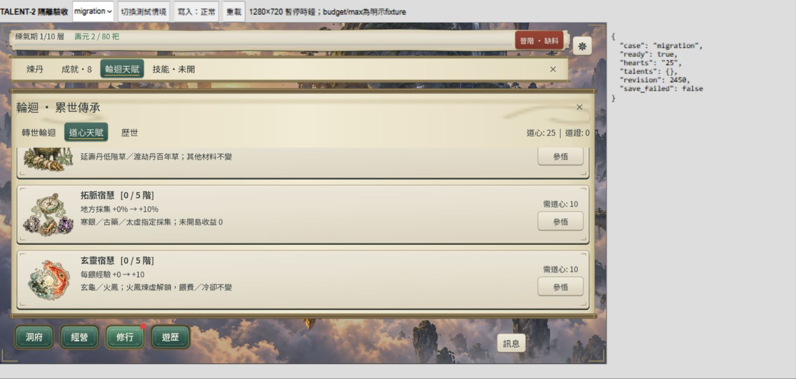
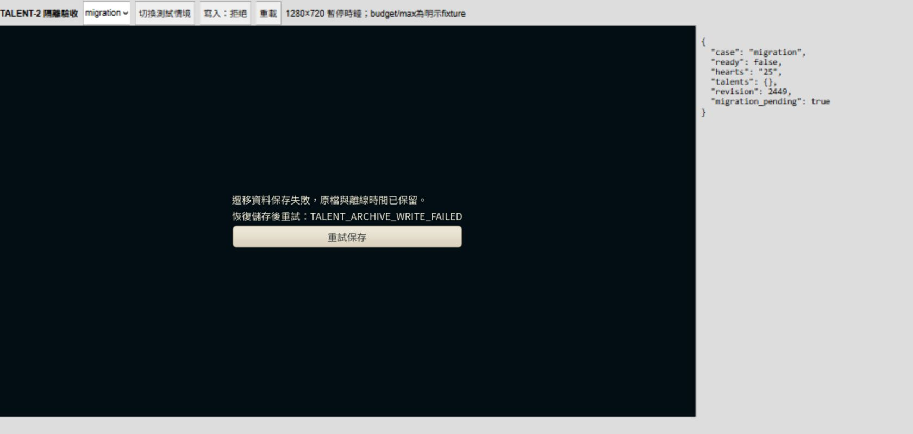

2026-10-25 更新：三圖／卡片與目前節奏已由使用者明確接受，整批L3與桌面Web收尾完成，見[整批驗收](content-p2-talents-closure.md)。下方2026-10-24待接受文字保留為當時狀態。

# CONTENT-P2-TALENT／TALENT-2 三卡、三圖與桌面 Web 驗收

2026-10-24。**TALENT-2 技術範圍交付（L1／L2，桌面 1280×720）；整批 IN_PROGRESS，三圖／整合節奏待人工接受。** 承接[已核定 U](../36-content-p2-talent-design.md)及[TALENT-1](content-p2-talents-core.md)，沒有執行 L3、全尺寸矩陣或交付整批候選包。未 commit／push。

## 交付與來源

- `reincarnation_panel.gd` 接入三張圖，顯示直接草費 −4%／階、地方採集 +10%／階、每餵經驗 +10／階的當前→下階與滿階，並列作用範圍／未開島收益 0／火鳳煉虛門檻。TIP 保留跨世資格、持有道心的機會成本與不追補；沿既有 GameTab、CloseSeal、字型、UiIllustration B、44px 動作與單區內捲。
- `TalentSystem.view`／`GameSession.get_view().talent_options` 將正式 `can_learn` 的決策交給卡片，補上首次輪迴、最高元嬰、版本、缺道心、滿階與保存中狀態；UI 不修改庫存，不改 U 的價格或公式。
- 內建 `image_gen.imagegen` 逐張生成三張原創候選 RGBA，保留透明 alpha。無外部參考素材；原圖與 runtime 逐位元相同，沒有修圖、裁切或縮放。來源／日期／完整英文 prompt／用途／切層／權利界線／SHA256 見[資產 manifest](artifacts/content-p2-talents-ui/art-manifest.json)、[prompt 集](artifacts/content-p2-talents-ui/prompts.json)。**PENDING_USER_ART_ACCEPTANCE，未冒稱接受或第三方商用授權。**
- runtime 圖：`assets/ui/reincarnation-painted/elixir_conservation_memory.png`、`frontier_prospector_memory.png`、`sacred_beast_nurture_memory.png`；原圖在本驗收 `artifacts/content-p2-talents-ui/*-original.png`。
- 新增 `tests/content_p2_talents_flow_runner.gd`／`content_p2_talents_ui_runner.gd` 並登記固定入口；P1 UI 的六卡斷言改為現行定義數，沒有放寬圖片與命中要求。
- `src/verification/talent2_acceptance.gd/.tscn`、四份具來源註記的 fixture、獨立 feature／export preset／namespace；`tools/talent2_acceptance_server.py` 只綁 localhost:4471，HTML 僅測試工具列與觀測。正式 `build/web` 不由本任務匯出覆寫。
- 補字「−／省」的 Sans／Serif runtime 子集，原始字型保持。`prepare_talent2_art.py` 保存資產來源；`audit_talent2_acceptance.py` 稽核觀測資料，不驅動 UI 或改存檔。

## L1／有界 L2

本機版本 `4.7.2.stable.official.ed1daf0bf`，沒有更新引擎或模板。每組 selector 均先 `-List`，沒有 `-Full`。

| 實際範圍／命令 | 最終結果 |
| --- | --- |
| `tools/run_all_runners.ps1 -Only 'content_p2_talents_ui_runner.gd,content_p2_talents_runner.gd,content_p1_talents_ui_runner.gd,m3a_reincarnation_ui_runner.gd'` | 原命令 exit1：新 UI 前置失敗；核心826、P1 UI57、輪迴 UI 通過。保留 [l1.log](artifacts/content-p2-talents-ui/l1.log)，不改寫為整次通過 |
| 新 UI 修正前置後 `-Only 'content_p2_talents_ui_runner.gd'` | 最終 exit0，51 checks／failures=[]，[最終輸出](artifacts/content-p2-talents-ui/ui-final.log) |
| `-Only 'content_p2_talents_flow_runner.gd' -TimeoutSeconds 600` | exit0，49 checks／failures=[]，327.7秒；[輸出](artifacts/content-p2-talents-ui/flow-run.log)、[逐項結果](artifacts/content-p2-talents-ui/flow.json) |
| Godot 原生 `--path . --resolution 1280x720 --script res://tests/content_p2_talents_ui_runner.gd` | exit0，51 checks，三張原生 PNG 已檢視，[輸出](artifacts/content-p2-talents-ui/native.log) |
| `python tools/prepare_talent2_art.py`、`python tools/subset_game_fonts.py` 後 `--check` | exit0，三圖 RGBA alpha 0–255、字型子集檢查通過 |
| Godot `--headless --path . --import`；`--export-release Talent2Acceptance build/talent2-acceptance/index.html` | 正常授權匯入與最終隔離測試匯出 exit0，[匯入](artifacts/content-p2-talents-ui/import.log)、[匯出](artifacts/content-p2-talents-ui/export.log)；四個原 MP3 companion 已複製 |
| `python tools/audit_talent2_acceptance.py` | exit0；實際 check 數與逐階付款見 [audit.json](artifacts/content-p2-talents-ui/audit.json) |

合計五支唯一相關 runner 最終分段通過；因同功能的規則／View／UI／輪迴依賴與桌面抽驗，按有界 L2 記錄。不是全量回歸。

## 合法代表路徑的界線

沿用同日已審計的 `content-p2-supply-3/earned-era4.json`，SHA256 `5c7b38f649d5aaee6c1c1ac1d2b9ada5d79a1a0aed824816fe246440d11c2895`；元嬰當世、未輪迴、0道心。正式既有版本遷移後，沿 `OfflineSettlement` 從 12,753 秒推進至 65,400 秒壽盡，送正式 `reincarnate`，獲 25 道心並由輪迴規則更新最高境界4；沒有直接注入道心／最高境界。

同一已賺得起點分三條比較分支，各用正式 `learn_talent` 購首階，25→15；二階需20，原子拒絕。保存 codec 重載保留，下一世正式壽盡輪迴後仍保留新天賦。這是**沿用合法元嬰快照的模擬時間代表路徑**，不是本輪空白新檔→元嬰或瀏覽器自然一生。

滿階另用明示 `synthetic-budget` 1000 道心：三項各10／20／40／80／160，總930、餘70；CLI及桌面實付均驗證。此預算不冒充自然多世累積。

## 桌面 Web 真實滑鼠

本輪來源隔離包、IAB，Godot iframe 實測 **1280×720**；外層1680×800只容納測試工具。遊戲時鐘暫停，啟動／恢復／重載依法結算等待時間，故 revision／壽元可能增加；道心扣款以實際數值核對。

- elixir／frontier／beast 三個合法得款分支，各滑鼠首購25→15；丹材重載保留，缺道心按鈕實點不重購。
- budget 三項逐階共15次真實點擊，10／20／40／80／160各付一次；1000→70，滿階點擊不重扣，重載仍三項5階／70。當前與下階、三圖載入、未開島0、火鳳門檻、內捲與返回依原生／瀏覽器分別記錄。
- 購入後 localStorage 拒寫：玄靈1→2時990→970，保存保護；仍拒寫再按重試，970與二階不變；恢復寫入後只保存同一份結果，重載保留。初次玄靈0→1也觀察到保護與恢復後990，但觀測器隨 SceneTree 暫停、未記錄中間值，不能拿該段假稱拒寫時JSON已更新；後續觀測器改 ALWAYS，補驗取得完整資料。
- 首次遷移：原先全寫入拒絕先命中同一舊檔的 `SKILL_ARCHIVE_WRITE_FAILED`，保留畫面；測試 fault 再精準限制 `save_before_talents_`，最終畫面明示 `TALENT_ARCHIVE_WRITE_FAILED`。Session 尚未 ready、migration_pending=true、25道心／無新階；再次拒寫重試保持。恢復後同候選完成，ready=true、talent_version3、25道心不減。原文字節歸檔與讀回、槽失敗原子性沿本輪核心826及 TALENT-1 獨立證據，不用畫面代替。

所有 JSONL 觀測與過渡狀態保留：[browser-states.jsonl](artifacts/content-p2-talents-ui/browser-states.jsonl)。[15筆精確付款稽核](artifacts/content-p2-talents-ui/audit.json)、[console 原文](artifacts/content-p2-talents-ui/browser-console.json)。兩次補匯出只修改隔離觀測器／故障定位，正式卡片／規則／資產來源保持；最終包再重開保存核對，未冒稱重跑全部付款。

最終觀測稽核 **184 checks／failures=[]**；最終測試包與來源 SHA256 見 [web-manifest.json](artifacts/content-p2-talents-ui/web-manifest.json)。8份交接文件嚴格UTF-8、本驗收本地連結、P1證據逐字恢復及 `git diff --check` 通過，見 [static-check.json](artifacts/content-p2-talents-ui/static-check.json)。隔離分頁已關閉、viewport override 已恢復；`python tools/talent2_acceptance_server.py` 服務由 Ctrl+C 結束，exit1是主動終止，不當作伺服器執行失敗。

## 失敗、保存與結案界線

原合法流程首輪錯將輪迴前 `highest_era` 當4（實際由正式輪迴更新），且兩次45秒及一次180秒逾時均失敗；R46逐秒結算52,647 tick確為長測試，僅此支延長600秒後327.7秒通過。沒有為其改規則或快速注入年齡。

新 UI 初輪未合法開頁造成九卡／命中失敗，補資格前置後又因 deferred 啟動報告遮罩使返回失敗；等待啟動報告完成並隱藏後51項通過。測試觀測器初次 `ready` 名稱與Node原生signal衝突、Variant推斷皆已修正；最初字型缺字、一次PowerShell內嵌Python引號 SyntaxError、未註冊selector被List拒絕、首次匯出目錄不存在亦保留，不將命令發出視為成功。首次沙箱匯入曾有user://與圖片快取錯誤，改正常授權匯入成功，未手改.godot。

原生仍有既有 Font RID／CanvasItem／ObjectDB退出診斷。瀏覽器留下兩筆無來源URL的 `MutationObserver.observe` TypeError，未完整歸因；保留console，不宣稱零錯誤。此後權威付款、兩類恢復與重載仍由畫面及JSONL核對通過。

P1 UI 重產的 `native-ui.json` 先保存本輪57項結果，再按開始時副本逐字恢復。開始時工作區已有大量 TALENT-1／RunnerResult 及工具變更，保持不覆蓋；其他來源報告的既有同步異動不擅自還原。只用專用user路徑及 `dao2_talent2_acceptance_*` namespace，沒有讀寫正式玩家進度。

三圖與整合節奏仍待人工接受，整批 **IN_PROGRESS**。未跑L3／全尺寸／FPS；觸控與實機延期，非當前阻擋。依 Context Guard 寫英文 checkpoint 後停止；下一 New Chat 先接受／具體修訂三圖與本批節奏，再同批唯一 L3 收尾。不開其他 P2／P3，不重問U價格或重做TALENT-1。
