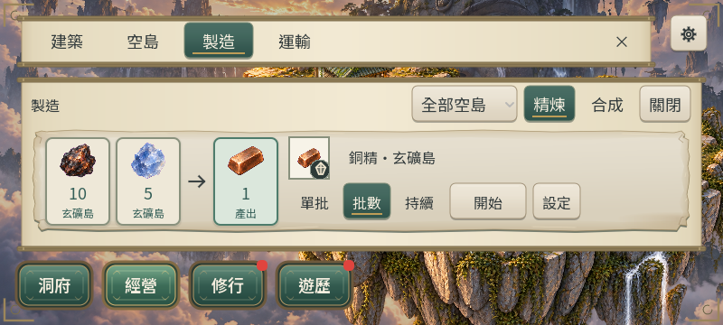

# MFG-3：列內模式、啟停與就地設定

2026-10-20，**DONE（桌面原生／桌面 Web 有界）**。MFG-0/1/2 既有成果沿用，本輪完成列內操作並補製造候選包的受控桌面 Web 回歸；EARLY-V1-D／RES1-D 仍需人工節奏判定，EARLY-V1-B/C 的獨立缺口不因此完成。

## 交付

- `src/presentation/recipe_row.gd`：復用 SegmentChips 與共用紙面選中樣式，提供單批／批數／持續及獨立設定鈕；修正原 setup 同時連接按鈕與轉發 signal 導致回呼執行兩次。標題、模式與操作維持至少44px；時長／狀態採16px及換行。批數超過999時，籌碼顯示「批數」，精確值保留於輸入欄，避免百萬批數撐破卡寬。
- `src/presentation/manufacturing_panel.gd`：一個共享設定區重掛於選中卡片內；其餘配方保持可見，再次點擊收起、開另一列移動展開區。批數、絕對保留量與模式草稿在當次 UI 記憶體中保留，重載不新增保存欄位。跨分類情境入口會顯示正確配方。短式材料與操作並排，次要時長／庫存留圖印TIP；設定內容在原頁內捲。
- 列上主動作只開始或停止，缺料／同島忙碌禁用；單批收尾禁用，不再兼作詳情入口。加工中的模式顯示實際 job 並禁用變更；明確切方仍由展開設定送既有 switch_processing。保留量沿原有絕對值字串契約，未改成百分比。
- 全部收益、扣料、每島一條產線及保存由原 Session／核心命令處理；沒有經濟、schema 或規則版本修改，沒有新美術資產。

## 驗證命令與結果

Godot 版本實查：`4.7.2.stable.official.ed1daf0bf`。以下在專案根目錄執行，`$taskEngine` 指向 `tools/godot/4.7.2/Godot_v4.7.2-stable_win64_console.exe`，APPDATA 設為專案內 `build/mfg3-user`／`mfg3-final-user`／`mfg3-export-user`，不使用玩家資料。

| 命令／證據 | 結果 |
| --- | --- |
| `powershell -NoProfile -ExecutionPolicy Bypass -File tools/run_all_runners.ps1` | **82/82，exit0**；`artifacts/mfg-3/all-runners.log`。此全量之後僅調整大批數籌碼寬度及標題44px，最終專項／原生再驗 |
| `--headless --path . --script res://tests/mfg3_inline_runner.gd`；同一入口不帶 headless 作原生渲染 | 首版62 checks；最終加百萬批數三尺寸案例後 **65 checks、failures=[]、exit0**，`native-delivery.log`。含一次點擊只送一次命令、草稿、計數完工、持續／停止、收尾禁用、拒寫／重試及載入 |
| 最終相關回歸：`recipe_row_runner`、`mfg_controller_runner`、`res1_ui1a_runner`、`res1_ui1b_runner`、`abode_presentation_parity_runner`、`m2d_responsive_ui_runner` | exit0；UI1-A **223**、UI1-B **220**，其餘見 `final-*.log`；最後原生65專項覆蓋微調後三尺寸 |
| `python tools/subset_game_fonts.py --check` | exit0；未重建／改動字型 |
| `--headless --path . --export-release Web build/web-mfg3/index.html` | exit0，最後 `export-delivery.log` 無 SCRIPT ERROR／ERROR；只匯出候選目錄 |
| `node tools/prepare_web_compression.mjs build/web-mfg3` | exit0，包含四首 BGM companions；`compression.log` |
| `python tools/mfg3_preview_server.py --port 48933` | 隔離 loopback 服務；候選包、明示注資診斷 fixture、只讀存檔證據及既有拒寫工具；不宣稱自然流程 |

## 原生畫面

`artifacts/mfg-3/native-list-{1280x720,844x390,800x360}.png` 與 `native-settings-{1280x720,844x390,800x360}.png` 共六張，由最終專項實際 Godot 渲染並目視檢查；不是概念稿或 FPS 證據。

## 真實桌面瀏覽器

以 Codex IAB、真實滑鼠／鍵盤操作隔離 origin `http://127.0.0.1:48933`，launcher iframe 1280×720／844×390／800×360。844 案實測 canvas CSS 843×389、backing 844×390，屬既有畫布1px邊差，按鈕與字級正常；未當作實體裝置證據。

1. 1280：進經營→製造；點靈材的批數籌碼，當列出現批數輸入，其餘卡片可見；實際輸入3並點開始，畫面顯示後續2批。落盤開始收據 revision2062，完成後 revision2102、wood.spirit_timber **50→53**、wood.stone_low **50→35**、jobs={}；重載保持同結果。
2. 844：列上選持續→開始銅精，revision2127 的 ore job `repeat=true`、remaining10。材料／模式／動作同屏。
3. 800：點批後停止，revision2173 的 ore job `repeat=false`、remaining5，畫面改「本批收尾」；後續 revision2184 jobs={}。同尺寸開設定，原列表內展開，實際滾輪可到原料保留／開始設定，固定頁首收起及關閉仍可達。
4. 同 origin `/fault.html`：正常載入後選靈材持續，按既有「拒絕寫入」工具，再真實點列上開始。出現「進度尚未存妥／重試保存」保護畫面；恢復儲存後點重試，返回製造並顯示「保存已恢復」。再實際 reload、關離線摘要及重開製造，仍只有一條靈材持續產線，最終缺料等待、產出60；點停止可立即移除等待工作。最終該重載頁 `dev.logs(levels=['error'])` 為空陣列；不以此覆蓋前述刻意注入故障。

以上數字由工具可見頁面／隔離存檔證據面板取得，操作截圖在本次對話工具結果；原生 PNG 為持久化視覺檔案。沒有將直接函式測試冒充瀏覽器點擊。

## 保留包與限制

- `build/web/index.pck` 保持原 SHA256 **7E7E619DCAA28FB05E1C397ADCC24CE9071D9B53B4E8FA6379C186E0AF9F9400**，EARLY-V1-D 凍結包／4380 origin 未覆寫、未清除。候選包 hash 由最終 `compression.log` 及 `delivery-hashes.json` 記錄。
- 本輪是製造 UI 技術／桌面有界交付，沒有追認使用者美術或自然節奏接受。UI 模式／草稿只在記憶體中保留，正式 job 才按既有保存契約恢復。
- 觸控／實機／實機高 DPR、慢網冷啟動依政策延期，非當前阻擋；無新 FPS 聲稱。
- 初次未隔離 APPDATA 的 UI1-A 啟動因 user:// 寫入失敗而中斷，改專案內隔離目錄後通過；初次整包 import 在大量歷史圖匯入期間手動中止，後續正常匯出成功。初輪新增測試暴露 quick-start 保留量未轉字串，已修為原字串契約。最終相關指令誤寫不存在的 responsive_ui_runner，已改實際 m2d_responsive_ui_runner 並通過。初次沙箱本機服務連線逾時，改同一127.0.0.1服務經正常權限流程啟動後成功。證據面板初版對 Dictionary 呼叫 slice，修為 Object.values 後讀取正常。
- 原生／部分 CLI 退出仍有 FontAdvanced／CanvasItem／ObjectDB／resource 使用中診斷，與既有測試退出紀錄一致；測試結果 exit0、無專項失敗，不將退出日誌聲稱完全乾淨。未 commit/push，保留其他 dirty 成果。

## 下一步

本輪停止。新對話接 EARLY-V1-B/C 缺口，或由使用者提供前期節奏判定；MFG 候選的受控桌面 UI 回歸已補，RES1-D／EARLY-V1-D 不因此自動 DONE。一般 Web 保留凍結包，後續版本放行再決定更新。
