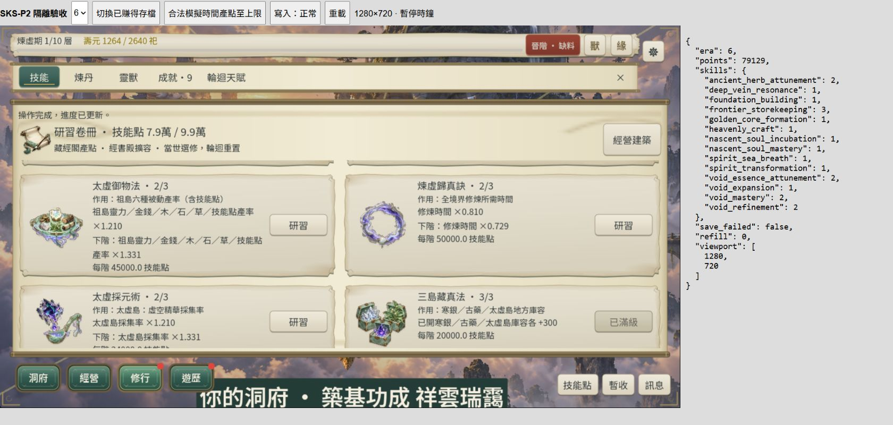
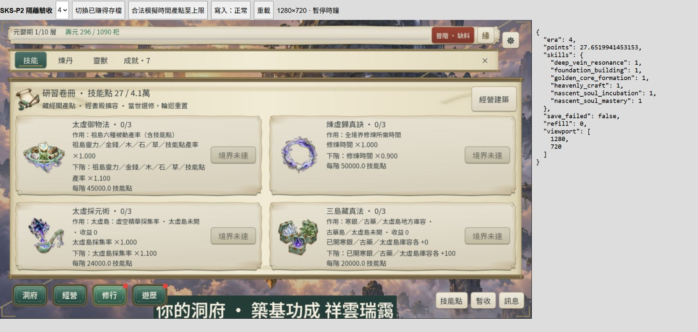

# SKS-P2／P2-S2：資產整合與桌面滑鼠驗收

日期：2026-10-24。**P2-S2 DONE（L2，桌面 1280×720 有界）；SKS-P2 整體 IN_PROGRESS。**

使用者明確要求「合併 worktree ，美術接受，繼續驗收」。十二圖的生成與美術接受完成；本段收結合法流程／卷冊 UI 與桌面操作，沒有執行整批 L3。

## 整合與修改

- 來源 worktree：`C:/Users/asus/.codex/worktrees/5d59/Dao2`。十二圖是未提交資產交付，因此採逐檔整合而非 Git 歷史 merge；43 份獨立交付檔案按相對路徑搬入主工作區，既有主工作區 P2-S1／S2 變更保持。未刪除 worktree、未 commit／push。檔案與來源 hash 見 [integration.json](artifacts/sks-p2-acceptance/integration.json)。
- `assets/ui/skills-painted/` 十二 PNG、獨立 manifest；`docs/verification/artifacts/sks-p2-k-art/` 原圖／提示詞／原始稽核；全部 runtime PNG 與原交付 SHA-256 相同。使用者接受記錄已寫入 manifest；既有 pending manifest 另加 superseded 指向，保留歷史。
- `tests/uix_r8_skills_ui_runner.gd`：移除十二圖缺圖豁免，要求全部 24 個技能插圖成功載入；P2 ID 清單只用於作用範圍斷言。
- `src/presentation/skill_study_view.gd`：技能點頁首沿共用 NumberFormatter，避免序列化長小數撐長文字；不改實際數值、費用或資格。補齊新文字「御／艙」所需 runtime Sans／Serif 子集與 manifest，原字型不改。
- 新增 `src/verification/sks_p2_acceptance.gd/.tscn`、四份原始已賺得快照副本、`SksP2Acceptance` export preset／feature 與獨立 Web namespace；正式無此 feature 的路徑保持。`tools/sks_p2_acceptance_server.py` 僅綁 localhost 4468、提供測試殼與 JSONL 觀測；`tools/audit_sks_p2_acceptance.py` 只稽核證據。

## 證據與範圍

合法 Era3／4／5／6 首階流程沿用同日 [392 checks／0 failures](sks-p2-flow.md)，本輪不重跑未變更規則長流。瀏覽器從其 earned fixtures 開始，正式 GameSession／原生卡片送出研習；測試殼可呼叫正式時間推進產點，不注入點數、技能或境界。這是暫停時鐘的隔離抽驗，非瀏覽器自然一生流程。

IAB 桌面瀏覽器的 Godot iframe 為 **1280×720**；外層 1680×800 僅容納工具列及狀態觀測。逐 ID 滑鼠點擊、圖像／當前下一階、精確扣點已驗：

| ID | 名稱 | 已觀測升階 | 精確扣點 |
| --- | --- | --- | ---: |
| nascent_soul_incubation | 元嬰孕育 | 0→1 | 21250 |
| nascent_soul_mastery | 元嬰大成 | 0→1 | 21000 |
| heavenly_craft | 天工煉靈法 | 0→1 | 12000 |
| deep_vein_resonance | 寒脈共鳴訣 | 0→1 | 9000 |
| void_expansion | 虛空擴展 | 0→1 | 30000 |
| spirit_transformation | 化神凝意法 | 0→1 | 35000 |
| ancient_herb_attunement | 古藥養靈術 | 0→1 | 15000 |
| spirit_sea_breath | 神海納息訣 | 0→1 | 18000 |
| void_mastery | 太虛御物法 | 1→2 | 45000 |
| void_refinement | 煉虛歸真訣 | 1→2 | 50000 |
| void_essence_attunement | 太虛採元術 | 1→2 | 24000 |
| frontier_storekeeping | 三島藏真法 | 2→3 | 20000 |

Era6 四項初輪 1→2；Era4／5 八項於最終包 0→1。`frontier_storekeeping` 初次拒寫恢復期間補算 16 秒、增加 603.5850654216 點，不能把淨差額當精確扣費；最終包另驗 2→3：99,129→79,129，成本 20,000、滿階禁用。原觀測保留，不改寫為零時間。

最終包再以古藥養靈術 1→2 驗拒寫：99,886.8339229555→84,886.8339229555，僅扣一次 15,000；拒絕狀態再次按重試，等級與點數保持。恢復寫入後正確保存；保存保護解除會依法補算等待時間，故恢復後點數有合法增加，未聲稱完全不變。重載與 Era4 切換再返回 Era6，十二技能及古藥第二階均保留，skill_version 4／economy `res1-e-46-1` 保持。Era4 八項未來境界按鈕禁用；未開古藥／太虛島顯示「收益 0」，禁用實際點擊未學習。

全部 24 張圖於最終穩定觀測載入成功。JSONL index 31 有重載過渡期全部 texture=false，保留原始值；第一次過寬稽核因此失敗，調整為檢查最終穩定畫面並明列過渡觀測，不刪除原證據。[完整逐次狀態](artifacts/sks-p2-acceptance/browser-states.jsonl)、[稽核／扣點事件](artifacts/sks-p2-acceptance/browser-audit.json)、[Web hash](artifacts/sks-p2-acceptance/web-manifest.json)。

## 命令與結果

- Godot `--version`：4.7.2.stable.official.ed1daf0bf。正常授權 `--headless --path . --import` 成功。
- 先 `tools/run_all_runners.ps1 -Only 'uix_r8_skills_ui_runner.gd,sks_p2_core_runner.gd,content_p1_skills_ui_runner.gd' -List`：3 支；相同 selector 加 `-TimeoutSeconds 120`：exit 0、單尺寸全部通過（核心81／R8最終114／P1 UI29 checks）。
- 字型／頁首格式修改後，先 `-Only 'uix_r8_skills_ui_runner.gd,content_p1_skills_ui_runner.gd' -List`：2 支；同 selector `-TimeoutSeconds 120`：exit 0，僅補受影響驗證。[L1最終輸出](artifacts/sks-p2-acceptance/l1-ui-final.log)、[保存的stdout／stderr](artifacts/sks-p2-acceptance/logs)。
- `python tools/subset_game_fonts.py`、其後 `--check`：exit 0。
- Godot `--headless --path . --export-release SksP2Acceptance build/sks-p2-acceptance/index.html`：最終 exit 0；四 BGM companion 已補至本機包。此為 L2 測試匯出，未交付整批候選包，不反向升 L3。
- `python tools/sks_p2_acceptance_server.py`：本機服務成功；Browser Use 實際滑鼠驗收如上。最終瀏覽器 error／warn 查詢空；停止瀏覽器後 Ctrl+C 結束服務，exit 1 為主動終止。
- `python tools/audit_sks_p2_acceptance.py`：exit 0，12 ID／12 精確費用／24穩定貼圖／12圖hash／版本／viewport 通過。

初次沙箱 user:// 初始化／UI runner 失敗、Computer Use app approval timeout、Chrome provider 不可用、沙箱服務連線 timeout、最初缺 BGM companion、字型缺字及過渡期稽核失敗均保留。其後使用正常授權引擎／本機服務與 IAB 完成。Runner 仍有既有 Font RID 退出診斷，未稱日誌零錯誤。初始乾淨的既有 native-ui.json 被 runner 重產後，先保存本次輸出再逐字恢復 HEAD，未將其當作玩家進度。

## 退出與交接

P2-S2 DoD 由既有合法流程與本次十二圖接受、卷冊桌面逐 ID／拒寫／重試／重載證據滿足，標 DONE。SKS-P2 整體仍 IN_PROGRESS；下一 New Chat 收整合技能點節奏／卡片回饋，接唯一整批 L3、候選包壓縮及三橫式桌面收尾。不重問十二圖美術、不重生圖、不重做 K／R46 或 P2-S1。未執行 L3、全尺寸矩陣或 FPS 驗收；未改玩家進度。本階段停止。
