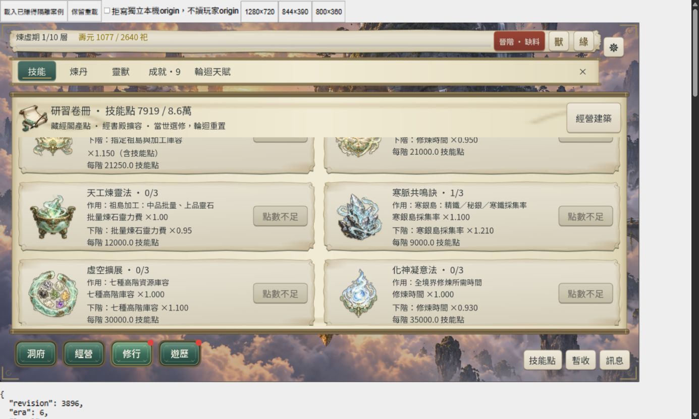

# SKS-P2 整批收尾

日期：2026-10-24。使用者指示「整批收尾」，承接現版 SKS-P2；十二圖美術接受沿用前輪，不重問 K／R46。**SKS-P2 DONE（L3，桌面／Web有界）。**

## 範圍與既有證據

限於 Era4–6 十二技能、效果、容量、折扣、保存、卷冊 UI 與已接受插圖。其他 P2 系統與新島世界美術仍屬另外批次。

沿用 [核心 L2](sks-p2-core.md)、[392 項合法流程](sks-p2-flow.md)及[十二圖／24 貼圖與12筆精確扣點桌面驗收](sks-p2-acceptance.md)。原始 K 數值、技能可選、schema5、skill_version4、economy `res1-e-46-1` 與 R46 舊修行時間保持。本次「整批收尾」按承接現版整合節奏／卡片辦理；保留使用者原話，不捏造另一次逐項口頭接受。

## 本輪修改

- `tests/uix_r10_fortune_ui_runner.gd`：L3 初跑在 800×360 的末選項可捲達斷言失敗。隔離診斷顯示絕對底部時 scroll y=134、高76，最後按鈕 y=118、高44；卡片尾端文字使底部位置不等於按鈕全可見位置。測試改以 `ensure_control_visible(last)` 定位後，仍嚴格要求 44px 且整個按鈕在捲動區內。未改正式 UI、字級或規則。單支完整三尺寸補驗 exit0；全量自動串行重試結果另記。
- `tools/sks_p2_closure_review_fixture.gd`：已賺得 Era6 存檔只重封 UTC，codec 讀回 `state_equal=true`；不灌資源、境界或技能。
- `tools/sks_p2_closure_review_server.py`：只綁 127.0.0.1:48461 的正常 Web 候選測試殼，尺寸切換與保存拒寫僅存在服務殼；玩家 origin 隔離。
- `tools/sks_p2_closure_audit.py`：封存原始 runner 日誌、新測試輸出與逐字復原既有 JSON，核對候選 hash、瀏覽器觀測及全量結果。

## 命令與驗收

```powershell
.\tools\godot\4.7.2\Godot_v4.7.2-stable_win64_console.exe --version
powershell -NoProfile -ExecutionPolicy Bypass -File tools/run_all_runners.ps1 -Full -List
powershell -NoProfile -ExecutionPolicy Bypass -File tools/run_all_runners.ps1 -Full -Parallel 3 -TimeoutSeconds 1800
.\tools\godot\4.7.2\Godot_v4.7.2-stable_win64_console.exe --headless --path . --export-release Web build/web-sks-p2/index.html
node tools/prepare_web_compression.mjs build/web-sks-p2
python tools/compile_r46_content.py --check
python tools/subset_game_fonts.py --check
python tools/sks_p2_closure_audit.py --archive-generated
python tools/sks_p2_closure_audit.py
```

引擎為 `4.7.2.stable.official.ed1daf0bf`，118 支唯一註冊 runner、完整 viewport matrix、並行3。1800秒上限依既有供給逐秒合法長流程約1381秒及並行負載設定；不是把逾時當成功。原沙箱受 user:// 日誌／UI 初始化限制的首輪已主動中止，匯出亦中止，原輸出保留。

**正常權限完整命令最終exit0，118／118唯一runner最終通過：116支initial，機緣UI70項與供給94項serial-retry通過。** 供給重試1343.3秒、SKS合法流程392項／160.5秒，技能UI完整三尺寸通過。不是初跑全綠；原兩項失敗仍在完整命令與原始stdout／stderr中。新供給完整流程由既有已賺得D2 Era3舊子版本無技能起點，三次升境仍12183／26963／58903秒，煉虛十層與158400秒自然模擬壽盡後輪迴age0；不是當前P1空白瀏覽器自然一生證據。

供給 initial 雖exit0、94項`failures=[]`且完成壽盡輪迴，但`save_snapshot`兩次`FileAccess.open`返回null，觸發`store_string` SCRIPT ERROR，故完整工具正確判定失敗並串行重試，不拿功能check數掩蓋腳本錯誤。未取得當時OS錯誤碼，不指定其檔案鎖定／並行／環境根因。沒有為此放寬檔案權限、關閉安全設定或改正式保存；機緣UI串行重試70項已通過。

正常 Web preset 候選 `build/web-sks-p2` 匯出 exit0；Brotli roundtrip、核心三檔 hash 與四首 BGM companions 生成 exit0，核心 br 合計 **92,163,565 bytes**。未覆寫既有 `build/web`。R46 編譯一致性與字型覆蓋檢查 exit0；未更新引擎或字型。

使用既有`Web` preset，`custom_features=""`，其exclude_filter明確排除`src/verification/*`、tests、tools、docs及build，故測試fixture的UTC重封不進正常候選。正式runtime與資產自匯出後hash無變動；本輪測試定位修改不需重新匯出遊戲。

## 正常候選桌面瀏覽器

IAB 獨立 origin `127.0.0.1:48461`，外層1400×840作測試容器，Godot iframe依序1280×720、844×390、800×360。後兩尺寸canvas backing實際屬性已讀回對應大小，寬式最終亦讀回1280×720；外層觀測區不替代遊戲內捲動。

- 三尺寸技能卡當前／下階、圖像、作用範圍可讀，窄式單欄與末端三島藏真法可經遊戲內捲動到達，維持44px操作。正常時鐘持續產點，並非暫停殼或瀏覽器自然一生。
- 800×360 由寒脈共鳴訣0階以真實滑鼠研習，故障殼拒寫進全域保護；再次按重試仍保護，落盤資料保持舊技能／點數／revision。取消拒寫、按原地重試後為1階；保留重載後仍1階、skill_version4與同一economy。重開技能頁再切1280，卡片顯示1/3、當前×1.100與下階×1.210。
- 本輪時鐘未暫停，恢復後依法補算等待時間，故不能以淨點數差當作精確扣9000。本輪驗持久化且只研習一次；逐ID精確費用沿用前輪12筆證據，不重寫為零時間。
- 正常首次載入呈現158秒離線結算，保存恢復後重載呈現8秒離線摘要；兩次均由真實滑鼠關閉。此為隔離已賺得案例的正常離線路徑，非冷啟動速度驗收。
- 觀測 console error/warn 查詢空。首個DOM測量誤用iframe contentDocument未支援，改由frame locator讀canvas屬性；保留此工具失敗，不影響遊戲結論。瀏覽器分頁已關閉、viewport覆寫重設，測試服務Ctrl+C停止（exit1為主動停止）。

完整觀測見 [browser-observations.json](artifacts/sks-p2-closure/browser-observations.json)。



## 保留與交接

開始時備份2033份既有JSON證據，備份雜湊核對全部一致；全量結束後另存28份變動結果再逐字復原，2033份最終均符合起點。初始git狀態乾淨的17份既有src/verification JSON被runner重產後，亦先封存本輪輸出再還原固定HEAD `c81254b553ad94bae2cee3275bc516658ff17b0a`；本輪開始前已髒的技能UI證據按本輪起點保留。首次沙箱復原在其中一份來源fixture返回`Invalid argument`，正常權限續作完成；新輸出先封存且不覆寫，復原紀錄包含首次已完成部分。Runtime／資產provenance排除正常Web preset已排除的測試fixture；不將測試時間戳差異誤認玩法改動。

首輪沙箱失敗、機緣UI首次失敗、診斷命令引號錯誤、診斷可重現失敗及修復紀錄永久保留。既有RID／ObjectDB退出診斷不當作日誌零錯誤。未新增FPS驗收聲稱，未改玩家進度、未commit／push。結案後依Context Guard將英文checkpoint置於updata.txt最頂部，停止本階段；下一大型工作由New Chat指定，不自動開其他P2／P3。

最終命令、原始日誌、候選hash、復原與交付稽核見[本批證據](artifacts/sks-p2-closure/delivery-audit.json)、[復原紀錄](artifacts/sks-p2-closure/restored-fixtures.json)。README／ROADMAP／交接／狀態／docs21／docs25／docs35與proposal的implementation metadata同步；proposal其餘規則與數值逐鍵保持。僅執行收尾靜態稽核，不因這些文件變更重跑L3。

首輪交付稽核393項僅savepack文字比對失敗：原始成功標記含ANSI顏色碼。保留`delivery-audit-initial.json`，讀取器移除顏色碼後重驗同一份exit0／候選hash，最終393項、failures=[]；不重新匯出或改寫原始log。最終UTF-8、報告連結、Python語法與相關文件diff-check通過。
