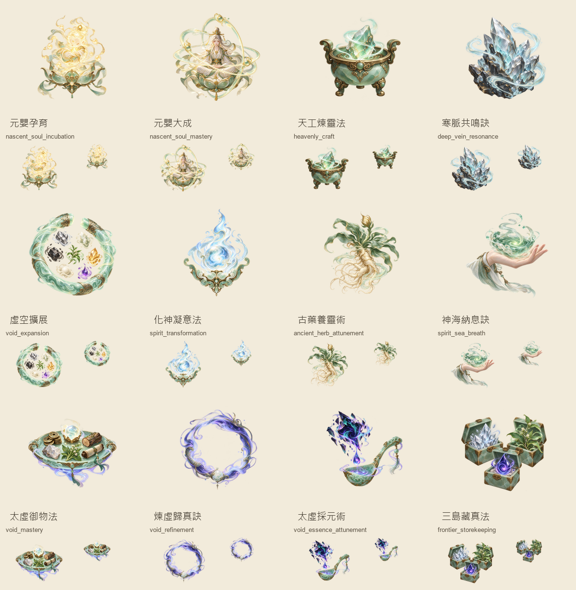

2026-10-24 更新：使用者明確回覆「合併 worktree ，美術接受，繼續驗收」。十二圖已按原 SHA-256 整合回主工作區並標示 ACCEPTED；以下 PENDING／僅資產交付為產圖當時歷史。接線與桌面驗收見 [P2-S2](sks-p2-acceptance.md)。

# SKS-P2／K-art：十二張技能圖資產交付

2026-10-24。依使用者指示，Codex 僅負責資源生成及完成標註；P2-S2 代碼由 OpenCode 推進。本紀錄不取代 P2-S2 功能驗收，也不宣稱 SKS-P2 整體完成。

## 交付與取用

十二技能的資源路徑、原圖、提示詞、SHA-256、尺寸及來源／授權記錄集中在 [獨立 manifest](../../assets/ui/skills-painted/content-p2-skills-manifest.json)。檔名為 `assets/ui/skills-painted/<skill_id>.png`，採 336×336 RGBA，完整 alpha 範圍等比縮入 304×304、置中並保留至少 16px 透明留白。原始 ImageGen PNG 原樣保留於 [originals](artifacts/sks-p2-k-art/originals)，沒有覆寫既有技能圖或既有 manifest。

圖片為單一扁平 RGBA 物件組，並非可編輯多圖層檔。原生透明度保留，不用色鍵去背；僅使用 Pillow 做裁界、Lanczos 等比縮放及透明畫布置中。沒有將共用 B 細邊／投影烘焙進圖片，由既有 Godot 呈現層負責。

來源為內建 ImageGen 原創生成；未輸入第三方參考圖。題材來自 [方案 K](../35-sks-p2-design.md) 的逐 ID `art_subject`，風格依現有青玉／古金手繪技能圖。授權標示為專案 AI 生成素材，不聲稱取得第三方商用授權。

| 技能 ID | 名稱 | 資源狀態 |
| --- | --- | --- |
| nascent_soul_incubation | 元嬰孕育 | GENERATED；待人工美術接受 |
| nascent_soul_mastery | 元嬰大成 | GENERATED；待人工美術接受 |
| heavenly_craft | 天工煉靈法 | GENERATED；待人工美術接受 |
| deep_vein_resonance | 寒脈共鳴訣 | GENERATED；待人工美術接受 |
| void_expansion | 虛空擴展 | GENERATED；待人工美術接受 |
| spirit_transformation | 化神凝意法 | GENERATED；待人工美術接受 |
| ancient_herb_attunement | 古藥養靈術 | GENERATED；待人工美術接受 |
| spirit_sea_breath | 神海納息訣 | GENERATED；待人工美術接受 |
| void_mastery | 太虛御物法 | GENERATED；待人工美術接受 |
| void_refinement | 煉虛歸真訣 | GENERATED；待人工美術接受 |
| void_essence_attunement | 太虛採元術 | GENERATED；待人工美術接受 |
| frontier_storekeeping | 三島藏真法 | GENERATED；待人工美術接受 |

總覽包含主圖、112px 與 64px 縮圖，用於資產檢視；未套 Godot B shader，不冒稱正式卡片或遊戲畫面驗收。

## 驗收級別與命令

本輪為 **L1 靜態資產驗收**，不跑遊戲 runner、瀏覽器或 Web 匯出，不做 L3。

- `python docs/verification/artifacts/sks-p2-k-art/prepare_assets.py`：逐 ID 檢查十二 PNG、RGBA／透明 alpha、產出尺寸與透明留白，保存雜湊與 [audit.json](artifacts/sks-p2-k-art/audit.json)。
- 使用內建 `view_image` 檢視原圖與總覽，核對題材、無文字框底及透明輪廓。
- `E:/WORK/Dao2/tools/godot/4.7.2/Godot_v4.7.2-stable_win64_console.exe --version`：`4.7.2.stable.official.ed1daf0bf`。本 worktree 的同相對路徑引擎不存在，首次相對路徑查驗失敗；未安裝／升級引擎。
- Pillow `12.2.0`；內建 ImageGen 每張獨立生成。部分初稿漏帶共用風格提示而偏寫實，已淘汰並以完整提示重生；淘汰圖不列入完成數。

## 範圍與後續

本輪不修改 `src/`、`tests/`、`data/`、`scenes/`、存檔、規則、UI 接線或 build；不修改方案 K 核定 metadata。完成狀態僅為 **K-art 資源生成與標註完成**，人工美術接受仍 PENDING。P2-S2 程式與卡片接線、合法流程、同修改包桌面抽驗由 OpenCode 續作；不要重生這十二張圖或用本記錄代替功能證據。

原始 PNG、提示詞與獨立 manifest 可直接按 ID 交接。本階段停止，不展開下一大型任務；後續美術修訂可開 New Chat 指定技能 ID。
