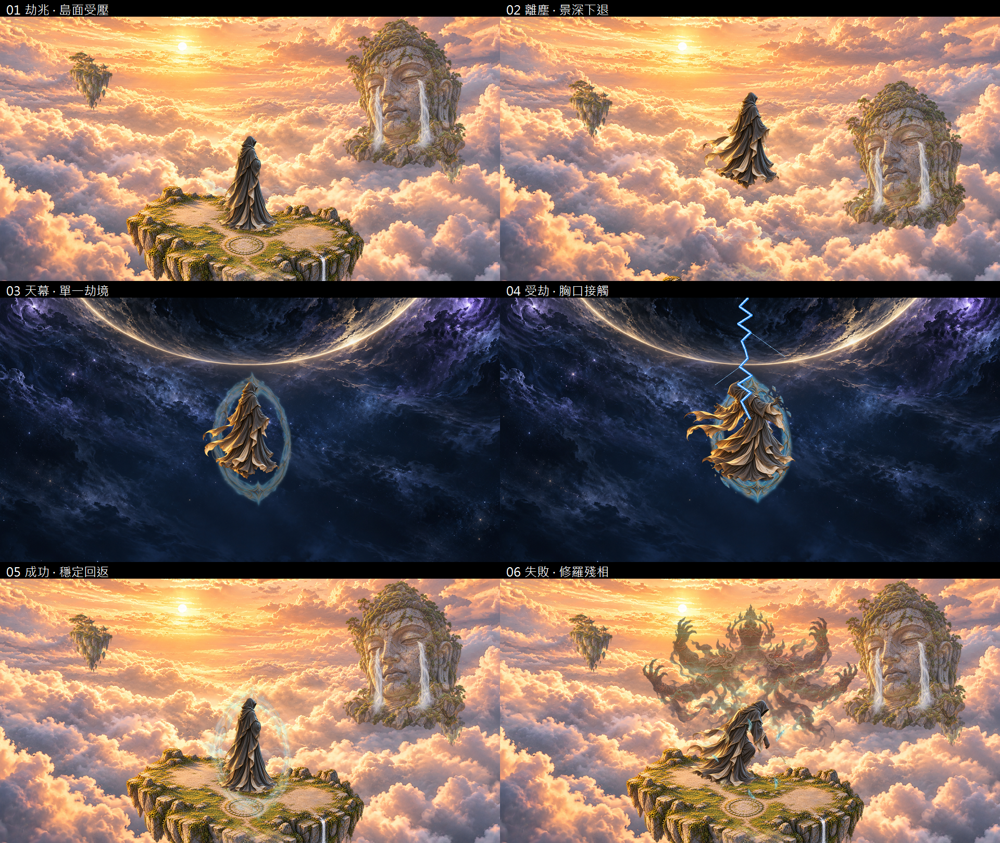

2026-10-18 使用者核定「接受 A 素材方向，再開 TRIB-B」：**TRIB-A DONE（素材方向已接受）**。既有靜態證據沿原日期，未重跑A生成；下方待接受／不開B為歷史，已由本段覆蓋。後續見[TRIB-B隔離動態交付](trib-b.md)。

# TRIB-A：拆層素材與六張關鍵構圖

2026-10-18。**IN_PROGRESS：素材與靜態檢查已交付，待使用者視覺接受。** TRIB-0 完成為現況基礎；本輪不開 TRIB-B 動態舞台，也未將候選替換到正式世界。

## 交付

- `assets/tribulation/trib-a/`：22 張打包 PNG、engine import sidecars、manifest／SHA256、精確提示詞、分鏡標示與英文素材說明。
- 乾淨雲海底板、乾燥淚佛、獨立雙瀑布／兩個水流區、遠島、近霧／遠霧、單一星幕弧面；沿用既有島體，不新增正式地標。
- 懸浮／後仰受擊／前折失衡／穩定回復四姿態與四張胸口發光資料遮罩；獨立島面陰影。
- 完整／裂紋／分離碎光三種護體與修羅失敗劫相；首張碎裂稿仍連成光圈，已退選並保留原稿。修羅只是敘事意象，不新增心境值、Boss、死亡或懲罰。
- 六張構圖：劫兆→離塵→天幕→受劫→成功回返／失敗回返。三個橫式尺寸各六張，共18張；圖上標籤只在審查聯絡表，不烘焙到遊戲素材。
- `docs/verification/artifacts/trib-a/`：16 次生成原稿與 ID、三色底單張／聯絡表、18構圖、10極值圖、初輪與最終 QA／log。`.gdignore` 隔離證據素材。
- `tools/trib_a_assets.gd` 離線包裝／靜態合成、`trib_a_inspect.gd` 原圖檢視、`trib_a_texture_check.gd` 匯入紋理解碼、`trib_a_review.ps1` 標示、`trib_a_verify.ps1` 檔案／hash驗證。

原參考為現有 `fx3art1/sky.png` 與披風人物；原始使用者概念的第三方商用權利仍未獨立確認。本輪內建 image_gen 派生不等於額外授權證明。未引入第三方素材庫／音效／字型；完整來源與加工方式見[素材說明](../../assets/tribulation/trib-a/README.md)、[manifest](../../assets/tribulation/trib-a/manifest.json)、[提示詞](../../assets/tribulation/trib-a/generation-prompts.json)。

## 驗證與目視結果

本輪確認引擎 `4.7.2.stable.official.ed1daf0bf`，不是自動升級。工作區有大量既有 dirty／EARLY-V1 成果，全部保留，未 commit／push。

| 命令／工具 | 實際結果與證據邊界 |
| --- | --- |
| Godot `--version` | exit0，4.7.2 |
| 內建 image_gen | 16次原稿已保存，15張選用；一張碎裂稿退選 |
| `trib_a_inspect.gd` | exit0；透明圖皆有實際 alpha；相對 log 路徑觸發 `user://E:` 診斷，後續改絕對路徑 |
| `trib_a_assets.gd` 初輪 | exit0、214 checks、failures=[]；靜態幾何過關後目視發現回返人物偏高，已修正 |
| `trib_a_assets.gd` 最終 | exit0、228 checks、failures=[]；qa.json 的227為寫入報告前計數，加最後一次報告寫入檢查為console228 |
| Godot `--headless --path . --import` | exit0，22素材匯入完成；有編輯器 profiler `user://` 診斷與既有巢狀 preview 專案提示，不能稱日誌零錯誤 |
| `trib_a_review.ps1` | exit0；首輪 PowerShell5 無BOM腳本的中文字串誤解碼，改 UTF-8 JSON 讀標籤後重跑，目視繁體字正常；初圖保留 |
| `trib_a_texture_check.gd` | exit0，22 imported Texture2D，failures=[] |
| `trib_a_verify.ps1` | 最終exit0、161檔案／hash／prompt／UTF-8檢查，16份文字；初輪PowerShell屬性集合Count寫法失敗，改明確陣列計數後通過 |
| `git diff --check` | exit0；僅既有LF→CRLF提醒，無whitespace error |

三色底：[黑底](artifacts/trib-a/layers-black-labeled.png)、[灰底](artifacts/trib-a/layers-gray-labeled.png)、[白底](artifacts/trib-a/layers-white-labeled.png)。已逐聯絡表目視，透明區沒有明顯黑矩形、舊佛像／島體重影或硬切天空；人物四姿態、完整／裂紋／碎裂不同狀態可辨。胸口資料遮罩只保留人物範圍內的alpha，白底幾乎不可見是其資料語意，不是漏圖。

乾淨底板在佛像／水／島完全不繪製時仍連續；四個±0.07正規化位移、1.16倍雲海overscan與1.32倍星幕四極值均有覆蓋檢查及PNG。近島下移到y=1.32／佛像y=1.20、大小上下限也已合成；物件有意離開畫布時，下方仍是完整底板，沒有把人物原位或佛像殘影烘焙進去。這是靜態位移／縮放證據，不是魚眼扭曲驗證。

已目視最終六構圖、三色底、極值與三橫式代表圖。回返人物已改為落到島面，離塵則獨立懸浮；水流起點校正到打包後佛像眼角。雷擊引導終點以各姿態 `core_packed_uv` 對齊；控制點／端點檢查通過。六圖中的線雷只是離線構圖定位，正式多節拍雷擊、接觸泛光與魚眼需 B 階段動態試演。

沒有執行正式命令、開啟 Session、讀寫玩家進度、修改玩法／存檔schema、Web匯出或全量遊戲Runner。驗證直接使用 Godot Image CPU 合成與匯入資源，不是原生GPU畫面截取、真實Web滑鼠互動或FPS證據；三個PNG尺寸也不等於正式響應式UI驗收。既有64px素材留白與未來共用UI／44px契約保持。

## 狀態與接續

素材生產／靜態技術檢查完成，**人類視覺審查尚未通過，所以 TRIB-A 不標 DONE**。按[24計畫](../24-tribulation-and-world-vfx-plan.md) §8 的原文明訂「使用者視覺審查」，而 TRIB-B 相依明訂「A素材方向接受」，目前止於具體可審查成果。這是計畫要求的視覺閘門，不是命令執行權限問題。

依 AGENTS Context Guard，本階段已追加英文 checkpoint 至 `updata.txt` 頂部並同步狀態；下一個 New Chat 先接素材回饋，接受後才開 TRIB-B 隔離成功／修羅失敗動態試演。不要先改正式場景或把靜態雷擊示意當成已接受的動態成品。

最終文件更新後重跑 `trib_a_verify.ps1`：161 checks／exit0；`git diff --check` exit0。本輪來源與證據均保存在專案，未啟動HTTP服務或瀏覽器分頁。
