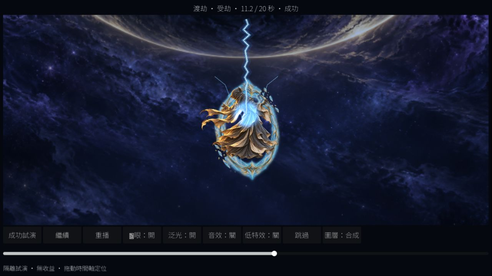
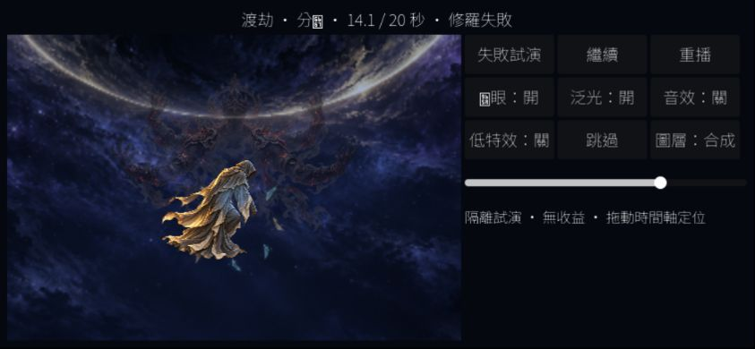

2026-10-19 最新音效請聽[TRIB-B-F1修訂](trib-b-f1.md)：預備遠雷／更接近打雷的噪聲裂雷、低頻滾雷及立體回響；Web已更新，本頁下方原錄影／音效描述保留10/18版本。B仍待使用者接受。

# TRIB-B：隔離渡劫動態試演

2026-10-18。使用者明確核定「接受 A 素材方向，再開 TRIB-B」：**TRIB-A DONE；TRIB-B IN_PROGRESS（動態交付，待視覺／聽感接受）**。本輪不接正式世界或結果頁，TRIB-C／D 未開。

## 交付與觀看

- [隔離 Web 試演](http://127.0.0.1:48942/)：成功／修羅失敗、暫停／繼續、重播、0–20 秒定位、魚眼／泛光／音效／低特效、背景／人物／護體／雷擊／修羅單層、跳過。音效預設關閉。
- [成功 20 秒錄影](artifacts/trib-b/success.mp4)、[修羅失敗 20 秒錄影](artifacts/trib-b/failure.mp4)。固定時刻 Godot 原生渲染，附同時間軸合成音效；不是實際執行 FPS 證據。
- 三擊 7.6／9.3／11.1 秒：主雷與兩殘留分支命中當前人物胸口、局部 mask 接觸泛光；第二擊後裂盾，12.4 秒成功穩住／失敗失衡與修羅殘相，16 秒回返。
- 島體／地面影、淚佛／雙瀑布、遠島／遠霧分速退開；一個半解析度背景 SubViewport 做短時魚眼，中央人物／控制 UI 獨立。姿態有各自胸口 anchor，不以貼圖中心亂對位。
- `src/verification/tribb/` 是來源小專案，`.gdignore` 隔離正式匯入；`tools/build_trib_b.ps1` 複製指定素材、匯入、保存 UID、另匯出到 `build/web-trib-b`。詳見[來源及音效說明](../../src/verification/tribb/README.md)。

## 驗證紀錄

Godot `--version`：`4.7.2.stable.official.ed1daf0bf`、exit0；未升級引擎／模板。桌面 NVIDIA GTX 1660 Ti、OpenGL Compatibility 原生實際渲染。

| 命令／工具 | 結果與範圍 |
| --- | --- |
| `powershell -NoProfile -ExecutionPolicy Bypass -File tools/build_trib_b.ps1 -ExportWeb` | 匯入與隔離 Web 匯出 exit0；工具另掃描 SCRIPT ERROR／ERROR，沒有只依退出碼。見 import.log／export.log／build-final.log |
| Godot `--path build/trib-b-project --script res://capture.gd --log-file .../native-final.log` | 最終666 checks／failures=[]／exit0，見 checks.json／native-final.log；1280×720、844×390、800×360，各兩結局×六時刻；胸口／雷端／完整人物畫布、44px控制／界內、暫停／隱藏、低特效、音效起停／失焦／skip；再480固定影格／兩段20秒 |
| ffmpeg 12fps PNG + 各結局 WAV → H.264／AAC MP4 | 見 encode-success.log／encode-failure.log；只作可審看的演出錄影 |
| IAB 真實桌面 Web、滑鼠 | 1280×720、844×390、800×360；canvas實際CSS略低1px（DPR約1），見 browser.json；主雷接觸／時間定位、失敗分歧、低特效、單層、skip、重播／重載及尺寸改變保留14.1秒已驗 |

第一輪原生 630 checks／failures=[]／exit0；目視發現外向魚眼取樣造成邊緣拉絲，改內向取樣，桌面控制改一行九鈕以增加舞台。初輪 checks／native log／edge-smear-initial.png 保留，最終截圖已目視無同類拉絲。IAB第一次建頁工具逾時；沙箱內48941服務無法連線（本機socket拒絕），改經已放行的本機48942服務後成功，未繞過瀏覽器安全警告。

音效為原創程式合成，不引入外部sample；原生驗證可播放及生命週期起停，Web實際開關驗證與console另記。聽感仍待使用者，不將按鈕狀態當作揚聲器聽測。沒有production BGM，BGM duck／共用設定接線屬C。

未載入 GameSession／玩家進度，沒有送命令、重擲、收益、schema或規則變更。正式場景／一般Web保持既有狀態，不將選單假成功寫成正式Era4開放；沒有FPS數值或正式整合驗收。既有dirty成果保留，未commit／push。

## 接續

本輪止於可審看試演；B視覺及聽感待使用者接受，不標DONE。下一個New Chat先收B回饋，接受後才TRIB-C正式結果／音訊／保存接線與相關回歸。已將英文checkpoint置於updata.txt頂部並同步development-status。

最終收尾：`ffprobe`兩MP4皆H.264／AAC、240影格、20.000秒，exit0；嚴格UTF-8／JSON與22份來源／匯出／錄影hash紀錄成功；`git diff --check` exit0（既有LF→CRLF提醒保留）。IAB error／warn紀錄為空，兩結局自然結束及Web音效開關已實際操作。保留48942 loopback服務及審看頁，音效回關閉；沙箱48941測試服務已停止。
