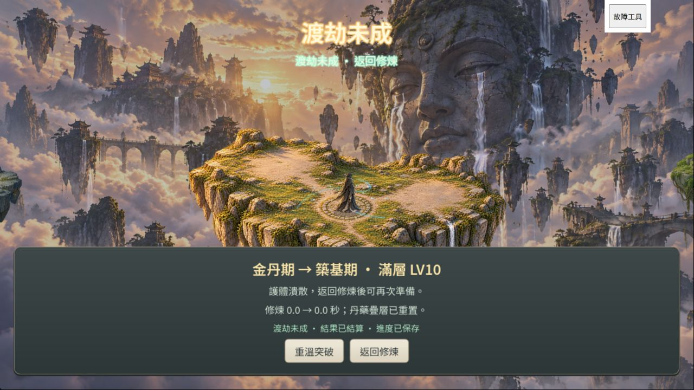

# TRIB 既有接線收結

日期：2026-10-24。任務：TRIB-B／F1 接受、TRIB-C／D 既有實作驗收。**DONE（桌面／Web 有界）**。使用者明確回覆「接受既有畫面與 F1 雷聲」。沒有重製素材、音效或正式接線。

## 範圍與相依

TRIB-0／A 已完成；正式 `BreakthroughSequence`、`src/presentation/tribulation/` 舞台、BGM 壓低與恢復及 LivingAbode 結果／保存接線已存在。先前文件所稱「C 未開」落後於程式，本輪補獨立交付及當前來源的桌面證據；歷史記錄不改寫。B／F1 人工接受與 C／D 的有界技術收結均已完成，解除正式 Era4 實作的 TRIB 前置。

正常內容仍只有 Era1–3。驗收使用既有 `trib0_fixture.gd`：最小 Era4、免除 fixture 金丹容量門檻、已知成功／失敗 RNG 索引；不是自然取得或 Era4 正式開放。成功案例的240秒修行／壽元也是 fixture，不是已核定 R46-C 數值。

## L2 驗證與命令

本輪是既有接線的領域驗收，無正式程式改動；按2026-10-23分級政策跑四支相關 runner、單尺寸1280×720及一次桌面Web抽驗。未跑 L3、全量、全尺寸或三橫式瀏覽器矩陣；不交付候選包。本機測試匯出不是發佈候選。

| 命令 | 實際結果 |
| --- | --- |
| Godot console `--version` | `4.7.2.stable.official.ed1daf0bf`，exit0 |
| `powershell -NoProfile -ExecutionPolicy Bypass -File tools/run_all_runners.ps1 -Only 'tribc_integration_runner.gd,trib0_outcome_runner.gd,m2b_breakthrough_runner.gd,island_breakthrough_runner.gd' -List` | 精選4支，matrix=single，不啟動引擎 |
| 上列命令移除 `-List`，正常權限重跑 | exit0，4／4 PASS；TRIB-C 71 checks、TRIB-0 34 checks，failures=[]；兩既有突破 runner PASS。各支約5.4–6.3秒，無 `SCRIPT ERROR:` |
| `--headless --path . --export-release Trib0Acceptance build/trib-closure/index.html` | 建目錄後最終exit0；本次來源、獨立測試目錄；未覆寫build/web |
| `Copy-Item src/BGM/*.mp3 build/trib-closure/audio/bgm/` | 配套既有BGM原檔，供正常延遲載入；沒有製作壓縮候選 |
| Python沿 `island_preview_server.Handler`，BUILD指定build/trib-closure | 只綁127.0.0.1，48440失敗／48441成功兩獨立origin；本輪結束停止 |

完整四支stdout／stderr及匯出日誌在 [trib-closure](artifacts/trib-closure/)。TRIB-C涵蓋取消不擲骰、成功／失敗事件、單次提交、拒寫／只保存重試、BGM壓低與精確恢復、skip停音與關閉SubViewport、自然結束不發獎、低特效中途切換、靜音、失焦與場景退出清理、雙提交攔截、記憶體重播及重載不推造結果。

歷史證據：2026-10-19既有 [native.log](artifacts/trib-c/native.log) 記錄113 checks／failures=[]、三尺寸18張原生PNG；保留原文，不稱本輪重跑。B／F1於2026-10-18／19的隔離動態、聲音與三橫式Web證據見 [B](trib-b.md)／[F1](trib-b-f1.md)。本輪以當前來源的單尺寸CLI與Web補正式接線，沒有以舊包冒充新證據。

## 真實桌面 Web

Codex IAB，CSS／canvas均1280×720，DPR1.25；不是實體裝置驗收。兩個origin原本無存檔，不讀其他origin玩家資料；沿既有正式命令與儲存橋接，沒有以直接呼叫函式冒充滑鼠。

1. 48440滑鼠按突破，準備頁可讀83%／一疊層、降至築基滿層／修煉歸零／清丹及取消。故障工具拒寫後按開始：保護層顯示「渡劫未成」及保存失敗，沒有稱功成。此時長等待使fixture的原123秒修煉在封頂刷新後成為0，Web觀察為0→0；原生71項另驗123→0，不混稱。
2. 恢復儲存→滑鼠「重試保存」，背景時間沿原機制補算（當次10ticks），回同一失敗演出。觀察修羅舞台後滑鼠跳過，結果為金丹→築基滿層LV10、丹藥疊層清除、進度已保存。重播→跳過→返回可用，世界／HUD恢復。
3. 48440重載保持築基滿層；console起點Era3 index10→重載Era2 index11，只有一次擲骰。
4. 48441 `?case=success`獨立案例：滑鼠準備→開始，完整等待演出自然結束，顯示金丹→元嬰成功及進度已保存。重播→跳過→返回正常。重載Era4 index1，起點Era3 index0，只有一次擲骰。
5. 成功重載後開設定，「重溫突破」灰化；沒有依Era偽造記憶體回放。兩份browser日誌保留，當次查詢warn／error均空；未量測FPS、p95或GPU，不宣稱效能通過。沒有觀察到自然成功演出卡住或殘留；這是操作觀察。

## 失敗、資料安全與交接

首輪沙箱runner出現`user://`／log不能寫、初始化Nil、timeout／SCRIPT ERROR，已中斷，原失敗不算通過；正常權限四支重跑通過。初次匯出因目標目錄未建exit1，並有既有P1驗收截圖匯入診斷；建立目錄後最終exit0。IAB初次初始化逾時；localhost連線逾時，既有錯誤頁的再導航受URL政策阻擋；新tab使用127.0.0.1後正常。沙箱HTTP服務不可達，正常權限loopback服務正常，未改防火牆。探索時兩個猜測的trib-c工具路徑不存在及PowerShell/rg萬用字元查詢失敗，未當遊戲測試結果。

本輪修改：本報告、TRIB接受metadata與證據、docs24當前狀態、README／ROADMAP／docs25／docs34／交接／開發狀態及updata。所有既有dirty成果保留；未改正式規則／素材／schema／玩家進度，未commit／push。匯出可能生成本輪證據PNG的Godot匯入metadata，不用其修來源。

下一個已授權任務為 **CONTENT-P2-SUPPLY**，沿已核定R46-A／B／C／S原案，不再索求方向核定；本輪實作仍TODO。7資源／3島／5航線／3配方／9設施、Era4–6容量與修行、schema5下economy遷移／歸檔讀回／候選保存／只保存重試為範圍；驗收含合法命令到6、玄龜／火鳳實料餵養、無技能主線及輪迴，依L1／L2分段。其他P2逐項內容與新美術不自動擴張。依AGENTS階段checkpoint規定，TRIB階段在此停止，下一New Chat直接承接SUPPLY。

交付靜態稽核首輪536項有4項格式檢查失敗：瀏覽器screenshot回傳JPEG卻存.png副檔名、匯出日誌ANSI色碼未移除。已把三張原始位元組更名.jpg（未轉碼），並以去ANSI後文字檢查完成標記；原稽核保留static-audit-before-format-fix.json。修正後536項全部通過，scoped git diff --check exit0；LF／CRLF提醒保留。

清理：兩個有效驗收tab已關閉、viewport override已reset；最初localhost錯誤頁的close也被URL政策拒絕，留作暫時tab由回合結束自動清理，未繞過政策。兩本輪loopback服務以Ctrl+C停止（exit1為主動終止）。
